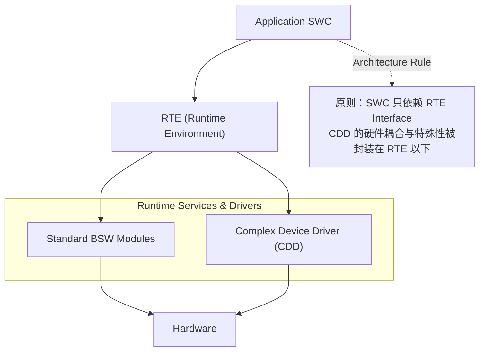
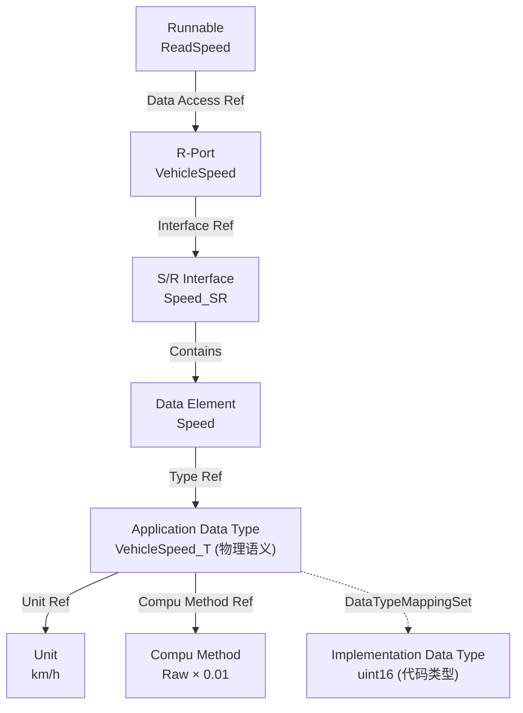
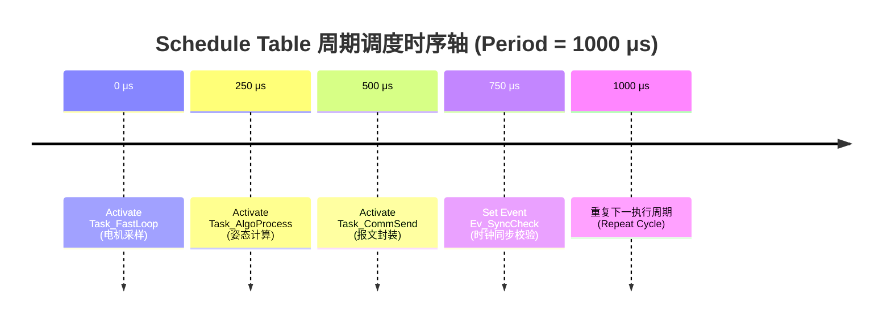
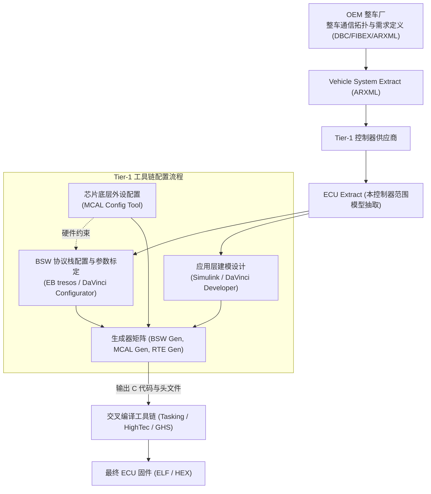

Classic 平台的配置即代码 Configuration as Code 与模型驱动开发（MDD）范式初看繁琐，但换来的是高度的可复用性、可认证性（ISO 26262）和全生命周期的可追溯性。工程实践中的难点主要集中在三个方面：

1. **[[RTE]] 生成与交互机制**：理解 Runnable 的触发事件、数据传递一致性模型（隐式 vs 显式）以及跨核/跨网络通信映射；
2. **OS 实时调度设计**：合理配置周期任务、Basic 与 Extended Task 划分、优先级天花板协议、Schedule Table 与 Timing Protection 等运行时行为；
3. **工具链协同与模型契约**：不同厂商工具依赖 ARXML 交换模型和配置，版本兼容性（Schema 差异）与供应商私有扩展往往是大型项目集成的核心风险。

## AUTOSAR Classic 分层架构

![[autosar-cp-layered.png]]

AUTOSAR Classic 的核心价值并非“分层”本身，而是通过严格的标准化接口契约实现软硬件解耦。理论上，当底层 MCU 从 NXP S32K 迁移到 Infineon AURIX TC3xx 时，只需替换 MCAL 驱动及对应配置，上层 SWC 与核心算法逻辑无需修改。代价是深层调用链带来的 CPU 开销、静态内存占用以及较高的工具链学习成本。

### CDD

复杂驱动（CDD）是架构中的受控例外通道，它允许绕过部分标准软件栈直接访问硬件寄存器，常用于：
1. **超高实时性或高频场景**（如电机高频 FOC 控制、复杂点火/喷油脉冲采集）；
2. **AUTOSAR 标准尚未覆盖的外设或私有协议**（如特定传感器总线、定制 ASIC 通信）。

因此 CDD 会削弱平台可移植性，在功能安全项目中通常需要进行额外的安全分析与隔离论证（如 ASIL 分解与内存保护）。

> CDD 是为了绕过标准软件栈访问硬件，**而不是为了绕过 RTE 访问应用**。推荐的标准交互方式是：CDD 向上提供标准 Port，上层 SWC 始终通过 RTE 访问 CDD 服务。由此，CDD 的非常规性被严格封装在 RTE 以下，确保应用层的纯粹性与可移植性。



## BSW 与启动时序

基础软件由四层构成：**服务层（Services Layer）**、**ECU 抽象层（ECU Abstraction Layer）**、**微控制器抽象层（MCAL）** 以及纵向贯穿的 **复杂设备驱动（CDD）**。

| 组 / 层次  | 代表模块                                | 职责                                        |
| :------ | :---------------------------------- | :---------------------------------------- |
| 系统服务    | [[OS]]、[[EcuM]]、[[BswM]]、WdgM       | 启动管理、模式仲裁、多任务调度、看门狗监控                     |
| 通信服务与抽象 | [[Com]]、[[PduR]]、[[CanIf]]、CanTp    | 信号打包解包、PDU 路由转发、传输层长报文分段重组、驱动接口抽象         |
| 诊断服务    | [[Dcm]]、[[Dem]]、FiM                 | UDS 诊断服务 ISO 14229、故障码生命周期管理、功能禁止状态仲裁     |
| 存储服务与抽象 | [[NvM]]、[[MemIf]]、[[Fee]]、[[Ea]]    | 非易失存储管理、Flash 模拟 EEPROM (磨损均衡)、CRC 校验与持久化 |
| IO 抽象   | IoHwAb                              | 封装板级电路差异，提供传感器/执行器物理量抽象                   |
| MCAL 驱动 | Can、Spi、Lin、Adc、Pwm、Dio、Fls、Gpt、Mcu | 芯片底层寄存器驱动                                 |

启动序列是理解 BSW 的切入点。RTE 与 SWC 的运行依赖 OS 任务调度机制，因此操作系统必须先于 RTE 启动：

```text
1. 上电复位 (Reset Vector)
   │
2. EcuM_Init() [Pre-OS 阶段]
   │ ├── 关闭全局中断，初始化 MCU 时钟、RAM/ROM 校验
   │ └── 初始化启动阶段必需的底层驱动 (Mcu, Port, Gpt, Wdg 等)
   │
3. StartOS() [启动操作系统，移交 CPU 控制权]
   │ └── OS 初始化系统上下文与定时计数器 (System Counter)
   │
4. EcuM_StartupTwo() / OS Init Task [Post-OS 阶段]
   │ ├── 启动 WdgM 看门狗监控
   │ ├── 初始化 BswM 状态机
   │ └── BswM 按规则列表依次触发 BSW 初始化：
   │       ├── 存储栈就绪：MemIf → Fee/Ea → NvM_ReadAll() 读取持久化数据
   │       ├── 诊断栈就绪：Dem、Dcm 初始化
   │       └── 通信栈就绪：Can → CanIf → PduR → Com → ComM 激活网络通道
   │
5. Rte_Start() [运行时环境就绪]
   │ └── 初始化 RTE 数据缓冲区、信号映射指针与内部资源互斥锁
   │
6. SWC Init Runnable 执行
   │ └── RTE 触发初始化事件 (InitEvent)，各 SWC 完成算法初值设定
   │
7. BswM 进入 RUN 模式
   └── OS 周期调度器与调度表全面启动，周期任务与事件监听进入稳定运行态
```

因此，当某个业务 Runnable 被周期调度执行时，其所依赖的驱动、通信、诊断、NVRAM 和模式管理能力实际上已经全部就绪。

## SWC 交互建模

AUTOSAR 应用层由多个 SWC 组成。SWC 可以理解为一个独立的软件功能单元，它封装内部算法与状态，仅通过标准化接口与外界交互。设计良好的 SWC 应具备以下特点：

- 不依赖具体 MCU 或 ECU 硬件，代码中不包含任何寄存器操作
- 不感知底层通信协议（CAN/LIN/Ethernet），只面向信号与数据语义编程
- 所有跨模块及跨层交互均经由 Port 和 RTE 完成

因此，SWC 的核心工作并不是操作硬件，而是处理数据和实现业务逻辑。

```text
Port 类型：
  P-Port（Provide Port） ：提供数据输出或对外提供函数服务
  R-Port（Require Port） ：请求外部数据输入或调用服务
  PR-Port（Provide-Require Port）：具备双向交互能力的复合端口

Interface 类型：
  Sender-Receiver（S/R）：数据驱动，一对一或一对多传递
    - 无队列（Non-Queued / 覆盖式）：适用于状态量（车速、温度、电池电压）
    - 有队列（Queued / 队列式）：适用于离散事件流（按钮触发、状态跃迁），防止丢包
  Client-Server（C/S）：操作驱动，客户端发起函数调用，服务端执行
    - 同步调用（Blocking）：调用方挂起等待执行结果（通常限定在同核快速服务）
    - 异步调用（Non-Blocking）：调用方立即返回，通过 Callback 或轮询获取结果
  Mode-Switch Interface：模式管理通知（如 RUN、POST_RUN、SLEEP 状态广播）
  Parameter Interface  ：标定常数或配置参数注入

Runnable：
  SWC 内可被调度的函数单元
  - Init Runnable：初始化执行一次
  - Periodic Runnable：周期定时触发（如 10ms、20ms）
  - Triggered Runnable：数据接收或模式变更等事件触发
  - Operation Runnable：响应 Client-Server 调用

示例（车速显示 SWC）：
  R-Port：VehicleSpeed（S/R Interface，接收来自 CAN 总线的车速）
  P-Port：DisplaySpeed（S/R Interface，输出到仪表显示模块）
  Runnable：ReadSpeed（周期 20 ms 触发执行）
```

### 数据一致性保障机制

在 S/R 通信中，多个 Runnable 可能会抢占式访问同一个数据元素，RTE 提供了两种数据访问策略：

- **显式访问（Explicit Access, `Rte_Read` / `Rte_Write`）**：直接读写共享缓冲区。若存在不同优先级任务交叉读写，必须在配置中启用 Exclusive Area 互斥锁，以防数据撕裂。
- **隐式访问（Implicit Access, `Rte_IRead` / `Rte_IWrite`）**：RTE 在 Runnable 启动时为其创建局部数据快照（Shadow Buffer），在退出时统一回写。**保证了整个 Runnable 执行期间读取到的数据原子性与一致性**，以极小的内存代价换取免锁并发。

> SWC 描述“做什么”，Port 描述“与谁交互”，Interface 描述“交换什么”，Runnable 描述“什么时候执行”，而 RTE 负责将这些模型映射为最终运行的代码。

## RTE 生成与通信机制

RTE 是 AUTOSAR Classic 最具代表性的设计之一。它位于 Application Layer 与 BSW 之间，为 SWC 提供统一的运行环境和通信接口。RTE 本质上是一层自动生成的软件中间件。它不是手写的，而是由 RTE Generator 根据系统模型与 ECU 配置自动生成：

```text
RTE 生成器输入：
  SWC 描述（ARXML）：Port、Runnable、触发事件、内部行为 (Internal Behavior)
  ECU 配置（ARXML）：SWC 实例到 Task 的映射、分区与核分配
  通信矩阵（ARXML/DBC）：系统信号到 Com 模块的打包映射

RTE 生成器输出：
  Rte.c / Rte.h：全局通信宏、API 声明与路由实现
  Rte_<SWC>.c / .h：每个 SWC 的专用框架接口与类型定义
  任务主体代码：将 Runnable 挂接到 OS Task 循环或事件监听体

RTE API 典型形态：
  /* 显式发送信号 */
  Rte_Write_DisplaySpeed_speed(value);

  /* 显式接收信号 */
  Rte_Read_VehicleSpeed_speed(&speed);

  /* 隐式接收信号（原子快照读取） */
  speed = Rte_IRead_ReadSpeed_VehicleSpeed_speed();

  /* C/S 同步服务调用 */
  Rte_Call_MyPort_MyOperation(arg, &result);
```

RTE 对上层 SWC 完全屏蔽了数据交互的底层物理拓扑差异：
- **同核内部通信**：直接优化为全局内存指针传递或函数直接调用；
- **跨核通信（Inter-Core）**：自动下沉调用 OS 的 **[[OS]] IOC** 实现多核安全传输；
- **跨 ECU 网络通信**：自动对接 BSW 通信栈（[[Com]]、[[PduR]]、[[CanIf]]），通过物理总线收发。

## ECU 配置与 ARXML

AUTOSAR 使用 ARXML（AUTOSAR XML）作为统一的配置与模型交换格式。无论是 SWC、接口、通信、诊断、OS 还是 ECU 配置，最终都以 ARXML 的形式进行描述和交换。

下面是一个简化的 SWC 定义示例：

```xml
<APPLICATION-SW-COMPONENT-TYPE>
  <SHORT-NAME>SpeedDisplay</SHORT-NAME>

  <PORTS>
    <R-PORT-PROTOTYPE>
      <SHORT-NAME>VehicleSpeed</SHORT-NAME>
      <REQUIRED-INTERFACE-TREF>
        /Interfaces/Speed_SR
      </REQUIRED-INTERFACE-TREF>
    </R-PORT-PROTOTYPE>
  </PORTS>

  <INTERNAL-BEHAVIORS>
    <SWC-INTERNAL-BEHAVIOR>
      <SHORT-NAME>SpeedDisplay_IB</SHORT-NAME>
      <RUNNABLES>
        <RUNNABLE-ENTITY>
          <SHORT-NAME>ReadSpeed</SHORT-NAME>
          <MINIMUM-START-INTERVAL>0.02</MINIMUM-START-INTERVAL>
        </RUNNABLE-ENTITY>
      </RUNNABLES>
    </SWC-INTERNAL-BEHAVIOR>
  </INTERNAL-BEHAVIORS>

</APPLICATION-SW-COMPONENT-TYPE>
```

这个片段描述了：

```text
SWC: SpeedDisplay
R-Port: VehicleSpeed
Interface: Speed_SR
Runnable: ReadSpeed
Minimum Start Interval: 20 ms
```

AUTOSAR 模型不是一棵单向树，而是一张复杂的网状引用拓扑（Reference Network）。在 ARXML 中大量出现 `*_REF`，理解 AUTOSAR 的关键是理顺这些引用绑定关系：



> **ADT 与 IDT 的解耦**：Application Data Type 刻画现实物理世界概念（如 `0~250 km/h`，精度 0.01）；Implementation Data Type 刻画底层 C 代码数据类型（如 `uint16`）。通过 `DataTypeMappingSet` 映射连接，使应用层算法开发彻底摆脱对底层编译位宽的直接依赖。

## OS 任务调度

AUTOSAR OS 基于 OSEK/VDX 标准，是一个面向汽车 ECU 的实时操作系统（RTOS）。与通用操作系统不同，它强调严格的确定性（Determinism）与静态配置（Static Configuration）。

所有 SWC 的 Runnable 最终都会被映射到 OS Task，由 OS 统一调度执行。

### 任务模型对比

| 任务类型          | 状态模型                          | 同步机制                                  | 栈资源消耗                             | 适用场景                     |
| :------------ | :---------------------------- | :------------------------------------ | :-------------------------------- | :----------------------- |
| Basic Task    | 仅 3 态：Ready、Running、Suspended | 仅支持运行至退出，不支持等待事件                      | **极低**（同优先级任务可复用共享栈 Shared Stack） | 周期性控制算法的首选（占 90% 以上系统任务） |
| Extended Task | 4 态：增加 **Waiting** 态          | 支持 `WaitEvent()` 与 `SetEvent()` 挂起/唤醒 | **高**（每个扩展任务必须配置独立私有栈）            | 耗时未知的后台长时任务、诊断会话等待       |

### 调度规则与中断管理

```text
调度策略：
  完全抢占式（Full Preemptive）：高优先级就绪任务立即抢占执行
  非抢占式（Non Preemptive）：任务主动释放前不被抢占
  混合调度：不同任务按配置具备不同抢占属性

优先级定义：
  数字越大优先级越高（0 为最低优先级，符合 OSEK 规范，与 FreeRTOS / ARM NVIC 相反）
  共享资源（Resource）采用最高优先级天花板协议（Priority Ceiling Protocol, PCP）彻底防止死锁与优先级反转

中断管理（ISR）：
  Category 1（ISR1）：由芯片硬件中断向量直接响应，不进入 OS 包装层，延迟极低，严禁调用任何 OS API
  Category 2（ISR2）：由 OS 统一接管分发，开销稍大，但允许在中断中调用指定 OS 服务（如 ActivateTask、SetEvent）

计数器与警报：
  Counter 记录系统周期性滴答（如 1 ms Tick）
  Alarm 绑定 Counter，在计数值到达设定门限时触发动作（激活 Task、设置 Event 或调用回调）
```

**任务划分最佳实践**：执行周期相同且依赖关系简单的 Runnable 尽量合并到同一 Task 中顺序执行，减少 OS 上下文切换与栈开销；控制关键任务赋予高优先级。

## 调度表与时间保护

普通周期任务通常通过 Counter + Alarm 激活。但对于需要保证任务间严格执行相位差、端到端抖动敏感的控制场景，则必须使用 Schedule Table（调度表）。

对于 ISO 26262 ASIL 项目，仅能正确调度还不够，还必须防止故障任务失控或长时霸占 CPU，因而引入了 Timing Protection（时间保护）。

### Schedule Table

调度表定义了一组基于绝对时间偏移的「到期点（Expiry Point）」，每个到期点精准激活特定任务或置位事件。调度表还可与整车总线全局时间同步（如 CAN-FD / TSN / FlexRay 同步），实现分布式确定性时钟对齐。



### Timing Protection - ASIL C/D

时间保护是多核与混合关键度（Mixed-Criticality）系统的核心屏障，包含三个维度的监控：

1. **执行时间保护 (Execution Budget)**：监控任务或 ISR2 单次运行耗时，超出预算立即触发 `ProtectionHook` 终止违规任务；
2. **到达率保护 (Inter-Arrival Time Frame)**：设定任务在窗口内被允许激活的最小时间间隔，防止物理中断风暴或偶发故障导致任务激活过频拖垮系统；
3. **加锁时间保护 (Locking Budget)**：限制任务持有时钟中断锁（`DisableAllInterrupts`）或资源锁的最长时间，避免低优先级任务死锁关键高优先级任务。

> **工程实践**：时间保护的阈值必须严格基于 **WCET（最坏情况执行时间）** 分析工具（如 aiT）得出。预算设置太紧会导致系统误报急停，太松则失去故障遏制价值。

## MCAL 与硬件抽象

MCAL 是 AUTOSAR Classic 最靠近芯片的一层，也是整个分层架构实现硬件可移植性的基石。它直接访问 MCU 寄存器和外设硬件，并向上提供符合 AUTOSAR 规范的标准化 API，一般由芯片厂商（如 Infineon、NXP、ST）交付。

```text
主要 MCAL 驱动模块：
  Can             ：CAN 控制器芯片驱动（注：CanIf 属于上层 ECU 抽象层）
  Spi             ：SPI 总线驱动
  Lin / Eth       ：LIN 总线与车载以太网控制器驱动
  Adc             ：模数转换驱动
  Dio             ：数字引脚 IO 驱动
  Pwm             ：脉冲宽度调制输出驱动
  Gpt / Icu       ：通用定时器与输入捕获驱动
  Fls             ：内部/外部 Flash 芯片物理读写驱动（注：Fee 属于上层内存抽象层）
  Wdg             ：硬件看门狗驱动
  Mcu             ：芯片时钟分配、复位源检测、低功耗电源管理

配置与生成：
  使用芯片原厂的配置工具（如 Infineon AURIX 的 EB tresos、NXP Config Tools）
  生成 Mcu_Cfg.c、Can_Cfg.c 等硬件级配置代码
  导出 BSW/MCAL 的配置描述 ARXML 与上层工具链协同集成
```

### 多核架构下的工程关键点

在主流车载多核芯片（如 AURIX TC3xx 具备多达 6 个 TriCore 核）上：
- **独立 OS Core**：每个核运行独立的 OS 实例，拥有本地私有任务就绪队列与调度器；
- **核间通信（IOC）**：跨核任务通信严格走 OS IOC 规范通道，底层利用硬件 Mailbox 互斥中断或共享内存无锁队列实现；
- **外设并发与重入性**：对于多核共享的硬件外设（如共享同一 SPI 控制器），必须在驱动或系统层配置硬件自旋锁（Spinlock）保证互斥访问。

## 工具链与生成流程

AUTOSAR 交付并非单个软件工程，而是跨组织、跨工具链的模型驱动协作过程：



### 典型工具链组合

- **系统设计与架构**：PREEvision / SystemDesk / Vector DaVinci Developer
- **ECU 配置与代码生成**：Vector DaVinci Configurator / EB tresos / ETAS ISOLAR-A/B
- **MCAL 配置**：芯片厂商专用配置工具（通常基于 tresos 或专用 GUI）
- **编译调试**：Tasking VX-toolset / HighTec / Green Hills (GHS)

### 工程落地三大避坑原则

1. **Schema 严格对齐**：不同工具支持的 AUTOSAR Schema 版本必须严格统一（如 4.2.2 vs 4.4.0）。导入时 80% 的模型解析错误均源自命名空间或版本不一致；
2. **配置与生成代码的单向流**：所有自动生成的源文件（`*_Cfg.c`、`Rte_*.c`）**绝对严禁手工直接修改**。任何改动必须回溯至配置工具与 ARXML 模型，否则重新生成时手改内容将被无情冲刷；
3. **版本控制配置隔离**：将 `*.arxml`、`*.xdm`、`*.dpa` 等原始输入与工程工程描述文件纳入 Git 进行严格 Code Review，生成的成百上千个 C 源文件建议由 CI/CD 流水线自动生成构建，避免代码仓库臃肿膨胀。

## 工程决策指南

| 决策点         | 选项 A            | 选项 B           | 推荐原则                                             |
| ----------- | --------------- | -------------- | ------------------------------------------------ |
| 平台选择        | AUTOSAR Classic | 裸机 / 自研框架      | 涉及功能安全、诊断、OTA、大规模软件复用时优先 Classic；简单控制器可采用裸机方案    |
| S/R 通信      | Non-Queued      | Queued         | 状态量（车速、电压、温度）使用 Non-Queued；事件流（按键、事件通知）使用 Queued |
| C/S 通信      | 同步调用            | 异步调用           | 快速服务同步调用；耗时操作（Flash、复杂计算）优先异步                    |
| Runnable 映射 | 多 Task          | 少 Task         | 周期和实时性要求接近的 Runnable 合并到同一 Task，减少上下文切换          |
| Task 类型     | Basic Task      | Extended Task  | 默认优先 Basic Task，仅在需要 WaitEvent 时使用 Extended Task |
| 调度机制        | Alarm           | Schedule Table | 独立周期任务使用 Alarm；具有严格时序关系的控制链路使用 Schedule Table    |
| 调度策略        | Full Preemptive | Non-Preemptive | 安全关键、实时控制任务优先抢占式；后台任务可采用非抢占式                     |
| 时间保护        | 开启              | 关闭             | ASIL C/D 必须启用；QM 项目根据资源和实时性需求评估                  |
| 通信抽象        | 标准 BSW          | CDD            | 优先使用标准栈；仅在性能或特殊硬件无法满足时引入 CDD                     |
| 硬件访问        | 经 RTE           | 直接调用驱动         | SWC 应仅依赖 RTE；避免直接访问 MCAL 或寄存器                    |
| 配置维护        | 模型驱动            | 手工修改生成代码       | 修改 ARXML 和配置模型，不修改 Generated Code                |
| MCU 迁移      | 保持 SWC 不变       | 重构应用代码         | 将 MCU 相关逻辑限制在 MCAL、CDD 和配置层                      |

## 结语

AUTOSAR Classic 的核心思想是「模型驱动 + 配置驱动」，是“静态确定性”哲学。

- **SWC** 刻画业务语义与算法内核
- **Port / Interface** 定义模块间通信的契约边界
- **RTE** 抹平数据在同核、跨核与跨网络传输的物理落差
- **OS** 以微秒级的精度裁决 CPU 时间片的归属
- **BSW** 构建起汽车电子必备的系统可靠性基座
- **MCAL** 屏蔽硬件底层差异，奠定芯片移植能力
- **ARXML** 扮演整个汽车电子分布式系统的“单一事实源（Single Source of Truth）”
- **工具链** 负责将形式化模型转换为最终确定性运行的 C 代码

从工程角度看，AUTOSAR 的难点不在于编写代码，而在于理解模型、配置、调度与生成代码之间的关系。真正成熟的 AUTOSAR 工程师，往往花更多时间分析 ARXML、Task 映射和 BSW 配置，而不是编写业务逻辑本身。