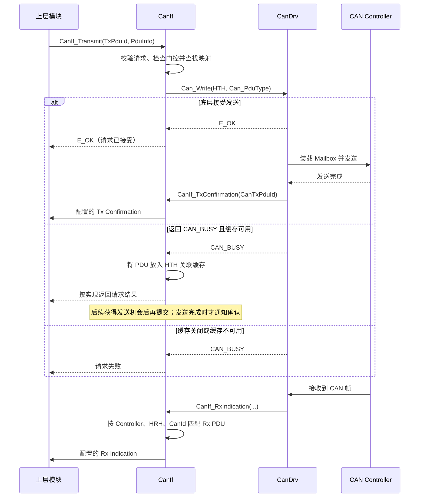
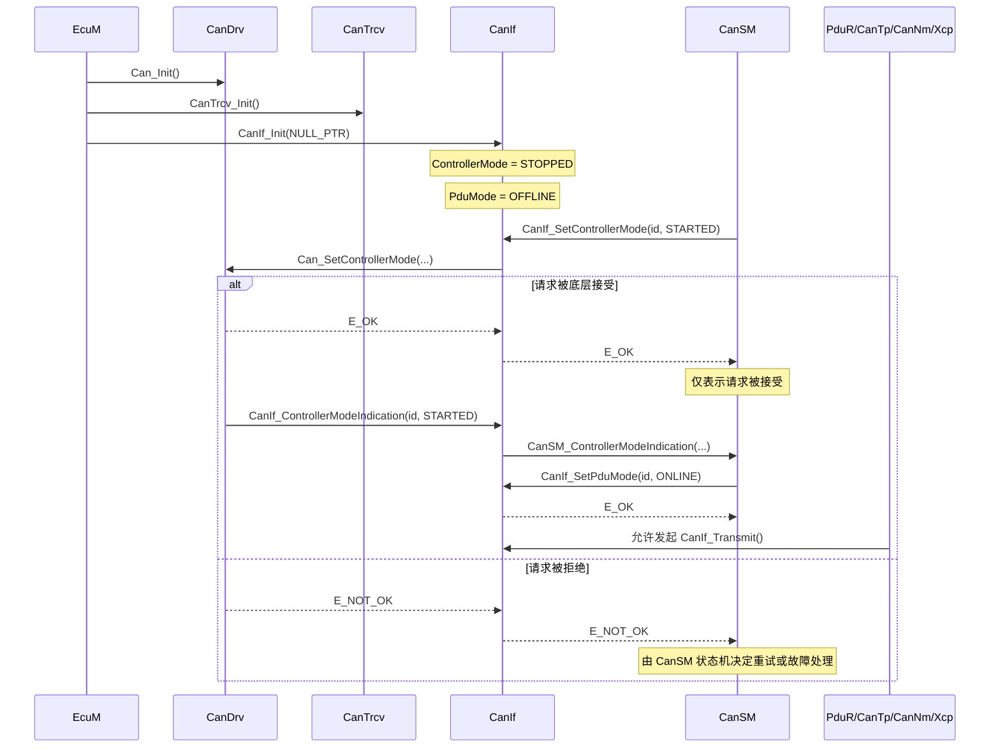
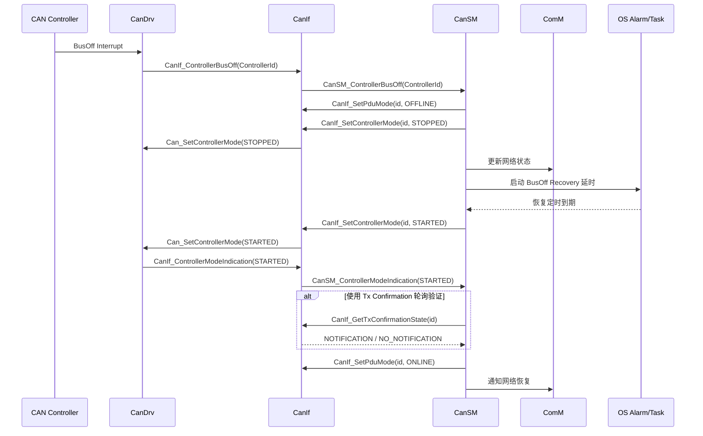

CanIf 是 AUTOSAR Classic CAN 通信栈中的适配与访问控制层。它向上为 [[PduR]]、[[CanTp]]、[[CanNm]]、[[Xcp]]、[[CanSM]] 等模块提供统一的收发和模式管理接口；向下将抽象 PDU 映射到具体 CAN Controller、Hardware Object、CanId 和底层驱动。

CanIf 的核心职责是维护这层静态映射，并控制 PDU 是否可以通过软件路径收发。它不解析 COM Signal、不执行 ISO-TP 分段重组，也不负责 BusOff 恢复策略。

## 职责与边界

|CanIf 负责|由其他模块负责|
|---|---|
|Tx PDU 到 CanId、HTH、Controller 及上层确认目标的映射|I-PDU 路由：PduR|
|Rx HRH、CanId、DLC 到 Rx PDU 及上层接收目标的映射|信号打包、解包与发送模式：Com|
|Controller、Transceiver 和 PDU 模式接口适配|长报文分段和重组：CanTp|
|底层收发、模式变化、BusOff 和唤醒事件的转发|BusOff 恢复策略和定时：CanSM|
|配置启用时，对 `CAN_BUSY` 请求进行软件缓存|硬件 Mailbox 调度和中断处理：CanDrv|
|CAN Classic/CAN FD 的配置和报文接口适配|应用层重发、端到端确认和业务超时|

CanIf 不替代 PduR：PduR 决定 I-PDU 在通信栈中的路由，CanIf 决定 CAN PDU 如何对应到具体控制器和硬件对象。

## 核心对象与模式

### 三类模式

CanIf 提供 Controller、Transceiver 和 PDU 三类模式控制。三者控制对象不同，不能互相替代：

|模式|控制对象|典型作用|
|---|---|---|
|Controller Mode|CAN 控制器|启动、停止或休眠控制器|
|Transceiver Mode|物理收发器|切换收发器的正常、待机或休眠状态|
|PDU Mode|CanIf 软件收发路径|允许、限制或禁止特定方向的 PDU 收发|

因此，Controller 进入 `STARTED` 不代表 PDU 路径已经允许发送；PDU Mode 设为 `ONLINE` 也不代表控制器已启动。CanSM 通常负责协调这些状态，并根据底层模式指示推进其状态机。PDU Mode 的具体枚举和各模式语义应以所用 AUTOSAR 版本及实现为准。

### PDU 标识与静态映射

CanIf 同时处理多个层次的标识符，名称相似但用途不同：

- 上层传入的 `CanIfTxSduId`：选择一条已配置的 Tx PDU。
- 底层使用的 CanId、HTH 和 Controller：决定帧的 CAN 标识符、发送硬件对象及控制器。
- CanDrv 回调使用的 `CanTxPduId`：用于将发送结果关联回 CanIf 配置。
- Rx 方向的 HRH、CanId 和 Controller：用于识别接收帧；匹配后再映射到配置的上层 Rx PDU ID。

这些标识符由配置关联，不应假设数值相同或可直接互换。上层 PDU ID、CanIf 配置、CanDrv 硬件对象和接收/发送回调目标必须来自一致的生成配置。

## 接口契约

### 上游调用者

|调用方|接口|关键契约|
|---|---|---|
|PduR、CanTp、CanNm、Xcp、CDD|`CanIf_Transmit()`|使用配置对应的 `CanIfTxSduId`；调用期间数据指针有效；长度符合该 PDU 配置；发送是否开放还受 Controller 状态和 PDU Mode 等实现条件约束|
|PduR、CanTp、CanNm、Xcp、CDD|配置的 Tx Confirmation / Rx Indication 回调|回调目标由 Tx/Rx PDU 的上层模块配置决定；回调中的 PDU ID 必须与相应上层模块的路由一致|
|CanSM|`CanIf_SetControllerMode()`|异步请求接口；`E_OK` 仅表示请求被接受，不代表控制器已完成切换|
|CanSM|`CanIf_SetPduMode()`|修改 CanIf 的软件收发门控，不等价于改变 CAN 控制器硬件状态|
|CanSM|`CanIf_SetTrcvMode()` 等|仅在配置了 CanTrcv 且底层驱动支持相应能力时有效|
|EcuM/初始化序列|`CanIf_Init(NULL_PTR)`|应在所需的 CanDrv、CanTrcv 初始化之后调用；当前实现不使用 Post-Build 配置，配置指针传 `NULL_PTR`|

调用 `CanIf_Transmit()` 返回 `E_OK` 表示请求已被接受（可能进入底层驱动，也可能进入启用的 CanIf 缓存），不代表帧已发送完成。发送完成或失败应以配置的 Tx Confirmation 处理为准。

### 下游驱动与回调

|下游模块|CanIf 使用的能力或入口|关键契约|
|---|---|---|
|CanDrv|`Can_Write()`、Controller Mode 控制及其回调|HTH、Controller ID 和软件 PDU ID 必须与 CanDrv 配置一致；发送完成通过 `CanIf_TxConfirmation()` 返回|
|CanDrv|`CanIf_RxIndication()`|当前实现通过中断接收路径处理帧，不提供完整的轮询读取 Rx PDU 路径|
|CanDrv|`CanIf_ControllerBusOff()`|CanIf 转发 BusOff；恢复状态机由 CanSM 管理|
|CanTrcv|模式、唤醒标志和 Partial Networking 能力接口|仅当 CanIf 配置了 Transceiver 且底层驱动支持相应接口时有效|
|Det|Development Error 上报|受 `CanIfPublicDevErrorDetect` 等配置控制；部分丢帧场景不会产生 DET 报告|

Controller 和 Transceiver 的模式切换通常通过底层请求及异步指示完成。下行 API 返回成功不能代替最终模式确认；调用方应结合相应的 Mode Indication 处理结果。

## 收发路径

### 发送

典型发送路径如下：

1. 上层以 `CanIfTxSduId` 调用 `CanIf_Transmit()`，并提供数据及长度。
2. CanIf 检查初始化状态、PDU ID、数据指针、长度以及当前发送门控条件。
3. CanIf 根据配置查找 CanId、HTH、Controller 和 `CanTxPduId`，构造 CanDrv 所需的报文描述。
4. CanIf 调用 `Can_Write()`；底层接受后，调用者收到请求处理结果。
5. CanDrv 在发送完成后调用 `CanIf_TxConfirmation()`，CanIf 再根据配置通知对应上层模块。

`CanIf_TxConfirmation()` 是一次底层发送结果通知，不等于对端 ECU 已收到或处理业务数据。应用层若需要端到端可靠性，仍需设计自己的确认、超时和重试机制。

### 接收

接收时，CanDrv 将收到的帧及接收硬件对象信息交给 CanIf。CanIf 根据 Controller、HRH、CanId 及相关配置识别 Rx PDU，并调用该 PDU 配置的上层接收回调。若配置的上层接收目标是 PduR，PduR 再将报文路由到相应模块；例如普通 I-PDU 可继续交给 Com 处理。

CanIf 的接收识别和映射不是信号解码：普通 I-PDU 的解码由上层完成，ISO-TP 长报文的分段与重组由 CanTp 完成。Rx PDU 的 HRH、CanId、Controller、长度/帧类型及上层 PDU ID 应与生成配置保持一致。CAN FD 的帧类型及最大 64 字节载荷也必须与对应控制器、PDU 和上层配置相匹配。

下面的时序图将发送和接收放在一起对照。发送请求是上层主动提交，最终结果通过异步 Tx Confirmation 返回；接收则由底层把帧推送到 CanIf，再由 CanIf 调用匹配 PDU 配置的上层回调。

图中 `Upper` 表示该 PDU 配置的上层接收/发送目标，可能是 PduR、CanTp、CanNm 或其他模块；具体回调和 PDU ID 由配置决定。缓存相关的返回值及失败处理也应以实际实现为准。

## 发送缓存

当 `CanIfPublicTxBuffering = true` 时，CanIf 可在底层返回 `CAN_BUSY` 时，将待发送 PDU 放入与 HTH 关联的软件缓存，等待后续发送机会：

1. CanIf 先尝试调用 `Can_Write()`。
2. 底层接受请求时，CanIf 等待该帧的 Tx Confirmation。
3. 底层返回 `CAN_BUSY` 时，若缓存启用且有可用空间，CanIf 保存该请求。
4. 某个相关硬件发送完成后，CanDrv 调用 `CanIf_TxConfirmation()`；CanIf 通知已完成的上层请求，并尝试提交缓存中的下一条报文。
5. 缓存不可用或已满时，请求可能失败；上层需根据接口返回值决定是否重试。

缓存是有容量限制的软件排队机制，不是无限队列。队列容量、排序策略、缓存请求的返回语义以及缓存满时的行为取决于具体配置和实现；不能仅凭启用了缓存就假设所有请求最终都会发送。

## 初始化与模式切换

CanIf 初始化是同步操作，但控制器启动和停止通常是异步操作。典型上线顺序如下，具体顺序和模式取决于 ECU 配置及硬件能力：

1. 初始化 CanDrv 和所需的 CanTrcv。
2. 调用 `CanIf_Init(NULL_PTR)`。
3. CanSM 请求 Controller 进入 `STARTED`，CanIf 将请求转发给 CanDrv。
4. CanDrv 完成状态切换并通过 Controller Mode Indication 通知 CanIf，CanIf 再通知 CanSM。
5. CanSM 根据模式指示和网络状态设置 PDU Mode。
6. 当控制器状态及 PDU 门控均满足要求后，上层才可按配置发起发送。

上图展示的是一种典型时序，不应将其理解为所有配置都使用相同的 Controller、Transceiver 和 PDU Mode 切换顺序。

## BusOff 事件与恢复

CAN 控制器发生 BusOff 时，CanDrv 将事件通知 CanIf，CanIf 再将其转发给 CanSM。CanIf 不负责恢复策略；CanSM 根据网络配置决定停止/重启控制器、等待恢复延时及何时重新开放 PDU 路径。

控制器重新启动不等于网络已恢复。排查 BusOff 时，应进一步确认 CanSM 状态、Controller Mode Indication、PDU Mode、ComM 通知和后续 Tx Confirmation。

## 配置与问题定位

遇到收发异常时，可沿配置映射和异步调用链逐层检查：

1. **请求入口**：确认调用方使用的 `CanIfTxSduId`/Rx PDU ID、数据指针和长度有效。
2. **静态映射**：核对 CanId、HTH/HRH、Controller ID、CanDrv 软件 PDU ID 及上层回调目标。
3. **模式门控**：确认 Controller 已到达所需模式，且 PDU Mode 允许对应方向收发；不要只检查其中一项。
4. **底层结果**：区分 `Can_Write()` 接受、`CAN_BUSY`、缓存成功/已满和 Tx Confirmation，不要把它们视作同一结果。
5. **异步闭环**：确认 Controller Mode Indication、Tx Confirmation、Rx Indication 和 BusOff 回调均能到达预期模块。
6. **诊断能力**：检查开发错误检测及相关诊断配置；未产生 DET 不一定意味着没有丢帧或运行期故障。

## 核心结论

- CanIf 是 CAN 通信栈中的接口适配与收发门控层，不是路由、信号处理或 BusOff 恢复模块。
- PDU ID、CAN ID、HTH/HRH 和 Controller ID 属于不同配置维度，必须通过一致的生成配置关联。
- Controller Mode、Transceiver Mode 和 PDU Mode 控制不同对象；上线状态需结合实际模式及异步指示判断。
- `CanIf_Transmit()` 返回成功不等于总线发送完成；发送完成通知也不等于对端业务确认。
- Tx 缓存可缓解 `CAN_BUSY`，但容量有限，队列满及失败处理仍需由上层按接口结果承担。
- 排查应沿“上层请求 → CanIf 映射与门控 → CanDrv → 底层回调 → 上层通知”的闭环进行。
