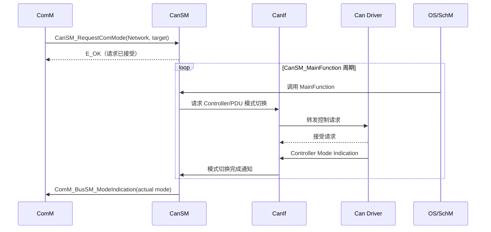

CanSM 是 [[ComM]] 的通信模式请求与 [[CanIf]]/CanTrcv 硬件状态控制之间的协调层。它不处理 CAN 报文内容，而是把“网络需要通信、停止通信或只接收”的意图转换成一组有序的异步模式操作，并负责 BusOff 恢复。可以将其理解为：

- ComM 决定“网络要不要通信”
- CanSM 决定“通过什么状态序列实现”
- CanIf 执行 Controller、Transceiver 和 PDU Mode 的具体请求与状态转发

## 管理的状态维度

|维度|典型状态|管理目的|
|---|---|---|
|ComM 通信模式|`NO_COMMUNICATION`、`SILENT_COMMUNICATION`、`FULL_COMMUNICATION`|对上层表达网络能力|
|CAN Controller 模式|`STOPPED`、`STARTED`、`SLEEP`|控制 CAN 控制器硬件状态|
|CanIf PDU 模式|`OFFLINE`、`TX_OFFLINE`、`ONLINE`|控制报文路径是否允许收发|
|CAN Transceiver 模式|`NORMAL`、`STANDBY`、`SLEEP`|控制外部收发器物理工作状态|

这些状态并不等价，且具体 PDU Mode、Controller/Transceiver 模式及合法切换次序取决于 AUTOSAR 版本、配置和硬件能力。尤其要注意：

- `Controller STARTED` 不等于网络已经进入 `FULL_COMMUNICATION`
- `FULL_COMMUNICATION` 表示 CanSM 已按配置完成网络通信所需的切换，并向 ComM 报告；不能仅凭某个 Controller 已启动来判断
- `SILENT_COMMUNICATION` 通常表示允许接收、禁止发送；对应的 CanIf PDU Mode 由配置决定
- CanSM 管理配置的 Network；Network 与 ComM Channel、CAN Controller、CanTrcv 的映射必须一致。一个 Network 的状态也不代表 ECU 上所有总线的状态

## 工作机制

### 上下游接口契约

|方向|接口/模块|契约|
|---|---|---|
|EcuM → CanSM|`CanSM_Init()`、唤醒源相关接口|在 ECU 初始化和唤醒流程中按配置调用。当前 NeuSAR 配置不使用 Post-Build，`CanSM_Init()` 的配置指针传 `NULL_PTR`，且仅初始化一次|
|ComM → CanSM|`CanSM_RequestComMode()`|提交目标通信模式；`E_OK` 只表示请求被接受，不表示模式切换已经完成|
|OS/SchM → CanSM|`CanSM_MainFunction()`|按配置周期推进各 Network 的状态机、计时器和待处理事件；任务周期会影响状态推进和恢复时延|
|CanSM → CanIf/CanTrcv|`CanIf_SetControllerMode()`、`CanIf_SetTrcvMode()`、`CanIf_SetPduMode()`|按配置请求控制器、收发器和 PDU 路径切换|
|CanIf/CanTrcv → CanSM|模式指示回调|底层模式切换通常异步完成；CanSM 根据完成指示推进状态，不能把下行 API 的 `E_OK` 当作硬件状态已生效|
|CanIf → CanSM|`CanSM_ControllerBusOff()`|转发 BusOff 事件；恢复动作由 CanSM 在后续状态机处理中执行|

### 通知与诊断

- **ComM**：稳定模式切换后，CanSM 通过 `ComM_BusSM_ModeIndication()`报告当前模式。
- **BswM**：若配置相关通知，CanSM 可通过 `BswM_CanSM_CurrentState()`通知网络状态变化，供系统模式规则使用。
- **Dem**：配置 `CANSM_E_BUS_OFF` 后，CanSM 可在 BusOff 及恢复过程中更新相应诊断事件状态；具体状态转换遵循 Dem 配置。
- **Det**：启用 `CanSMDevErrorDetect` 时，可上报未初始化、非法 Network 句柄、空指针及非法 Controller/Transceiver ID 等开发期错误。Det 并不替代运行期网络故障诊断。

### 核心任务模型

CanSM 不是“调用即完成”的同步控制模块，而是一个典型的 **请求、回调和周期任务协同模型**：

1. `CanSM_RequestComMode()`接收并保存 ComM 请求
2. `CanSM_ControllerBusOff()`等回调记录异步事件或底层状态
3. `CanSM_MainFunction()`周期扫描每个网络
4. 状态机根据请求、回调标志和计时器推进
5. 调用 CanIf 发起下一步硬件模式转换
6. 最终通过 ComM/BswM Indication 发布稳定状态

### 状态机

![[cansm-state-machine.png]]

### 模式切换与确认

模式切换不是一次原子操作，而是由 CanSM 按配置分阶段推进：

1. 接收 ComM 的目标模式，更新对应 Network 的请求状态。
2. 依据目标模式进入 PRE_FULLCOM、PRE_NOCOM 等过渡状态，按配置控制 PDU 路径、Controller 和 Transceiver。
3. 等待 CanIf/CanTrcv 的异步模式指示，并在 `CanSM_MainFunction()` 中处理超时或继续下一步。
4. 到达稳定状态后，通过 `ComM_BusSM_ModeIndication()`发布实际通信模式；配置了 BswM 通知时，也同步发布 Network 状态。

具体调用次序受配置、唤醒路径和硬件能力影响，不能只根据目标模式推断固定的 Controller/Transceiver 操作顺序。排查时应区分“请求已接受”“底层模式已确认”和“稳定态已通知”三个时点。

### BusOff 恢复

BusOff 通常由 CanIf 转发给 CanSM。回调负责记录事件，FULLCOM 子状态机在后续周期中按配置执行恢复；不应在中断回调中直接完成整套模式切换。L1/L2 恢复可使用不同等待时间和重试阶段，具体阈值、计时及达到限制后的行为由 CanSM 配置决定。

恢复验证应区分控制器重启与网络恢复：检查 Controller Mode Indication、PDU Mode、ComM 实际模式、Dem 事件状态，以及上层发送是否重新得到确认。BusOff 恢复成功也不意味着应用层事务自动重发或对端已经处理。

### 配置与排查要点

- 核对 ComM Channel、CanSM Network、CanIf Controller、CanTrcv 和相应硬件资源之间的引用关系。
- 核对 `CanSM_MainFunction()` 周期与模式切换、BusOff 恢复计时参数的单位及配置关系。
- 发生模式切换超时，沿“CanSM 请求 → CanIf 下发 → 底层模式指示 → CanSM 状态推进”确认请求和回调是否匹配。
- 发生 BusOff 后，确认事件是否被转发、恢复计时是否运行、恢复请求是否完成，以及 ComM 是否收到最终模式指示。

## 核心结论

- CanSM 的本质是异步通信状态编排器，而不是 CAN 报文处理模块
- [[ComM]] 提供目标，CanSM 编排状态，[[CanIf]] 执行硬件操作，回调确认结果
- `PRE_FULLCOM`/`PRE_NOCOM` 负责将抽象通信模式转换成合法的硬件模式切换序列
- `FULLCOM` 内部的核心风险控制机制是 BusOff 的 L1/L2 快慢恢复
- `CanSM_RequestComMode()` 返回 `E_OK` 不等于开网完成，最终状态必须以 ComM/BswM Indication 为准
- 配置开发的核心不是参数填值，而是保证 ComMChannel、CanSM Network、CanIf Controller、CanTrcv 和 OS 周期之间的映射及时间约束一致
- 排查问题时，应沿“请求记录 → MainFunction 推进 → CanIf 请求 → 底层回调 → 稳定态通知”的闭环逐段确认