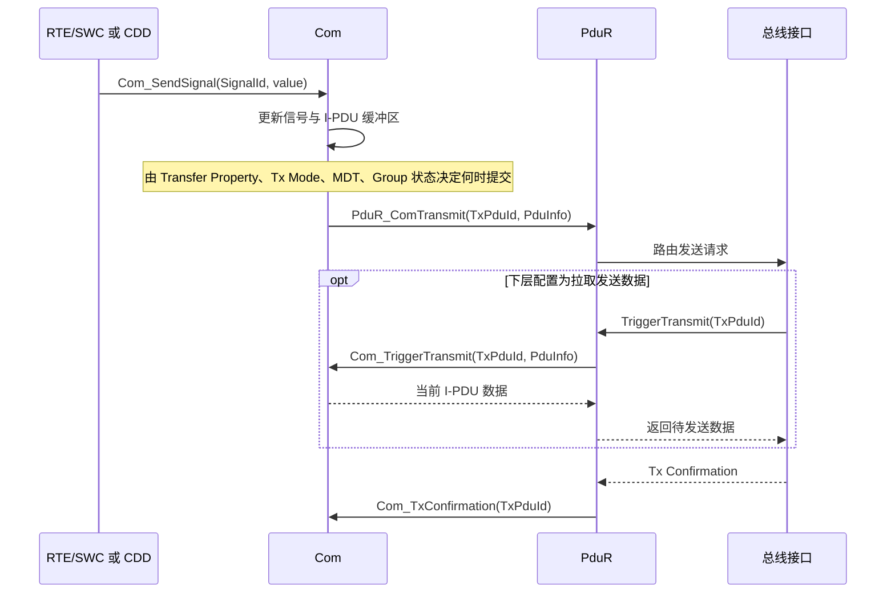
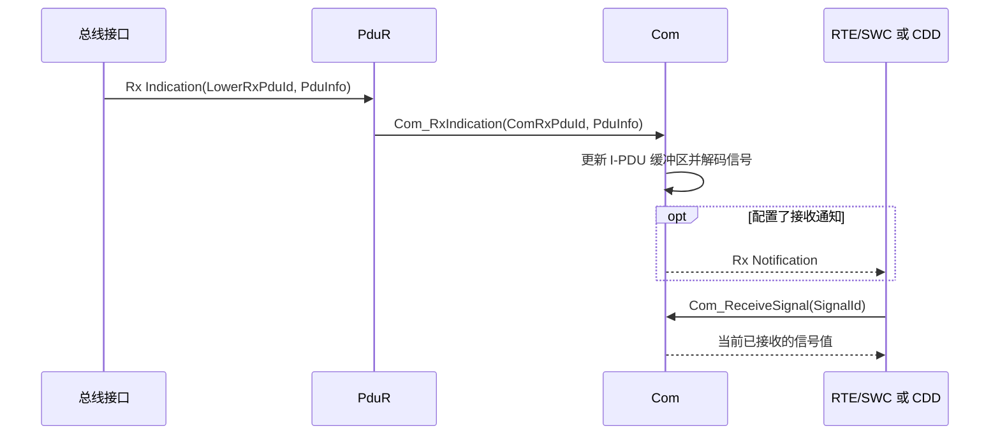

Com 是 AUTOSAR 通信栈中的信号语义层：它按生成配置将 Signal 和 SignalGroup 编码到 I-PDU[^1]，或从接收 I-PDU 中解码信号，并向 RTE/CDD 提供相应的数据访问接口。Com 还负责按配置管理 I-PDU 发送模式、接收超时监控、无效值处理和通知。

[^1]: I-PDU 是 Interaction Layer Protocol Data Unit，可理解为通信矩阵中定义的一组信号数据。

![[communication-stack.png]]

Com 可以理解为按通信矩阵配置执行的位级打包与解包层；它不是通用序列化框架，不负责 JSON/Protobuf 等格式的 schema 编码或动态对象解析。

Com 不直接处理 CAN ID、LIN Frame、Ethernet Socket 或控制器硬件。它操作的是配置的 `PduIdType`、`PduInfoType` 和 I-PDU；下层路由由 [[PduR]] 配置决定。

![[com-context-view.png]]

## 核心数据模型

```text
I-PduGroup
└── I-PDU
    ├── Signal
    ├── Signal
    └── SignalGroup
        ├── GroupSignal
        └── GroupSignal
```

- **Signal**：I-PDU 中一个按位定义的数据项，配置包含其位置、长度、字节序、数据类型及可选属性。
- **SignalGroup**：将多个相关 GroupSignal 作为一组访问；发送和接收可通过组接口及相应的 Shadow Buffer 完成。
- **I-PDU**：Com 与 PduR 之间收发数据的配置单元，承载一个或多个 Signal/SignalGroup。
- **I-PDU Group**：通信控制域，用于按配置批量启停一组 I-PDU。一个 I-PDU 可关联多个 I-PDU Group；实际启停状态由相应的 Group 控制 API 和配置共同决定。

I-PDU ID、Signal ID 和上层 RTE 数据元素属于不同的标识空间。它们通过生成配置关联，不应假设 ID 数值相同或能直接互换。

## 发送机制

### 信号更新与发送调度

`Com_SendSignal()` 将应用提供的值写入 Com 管理的信号/I-PDU 缓冲区。该 API 的返回只表示本次信号更新请求是否被接受，不表示 I-PDU 已提交给下层，更不表示报文已经上总线。

I-PDU 何时提交，受多项配置共同影响：

- **Transfer Property**：决定信号更新是否触发 I-PDU 发送，例如按触发、值变化触发或等待后续发送机会等属性。
- **Tx Mode**：I-PDU 可配置直接、周期或混合等发送模式；周期时间、重复次数和模式条件共同决定调度行为。
- **Minimum Delay Time (MDT)**：限制连续发送请求之间的最小间隔。
- **I-PDU Group 状态**：未启用的 I-PDU Group 会影响相应 I-PDU 的通信活动。
- **MainFunction 周期**：周期发送及相关计时器由配置的 Tx MainFunction 推进。

这些条件是组合关系，不应仅凭一次 `Com_SendSignal()` 调用推断发送时刻。应用若连续更新同一信号，Com 缓冲区中的最新值、触发属性和调度窗口共同决定实际发送内容与时机。

### Com 与 PduR 的发送交互

需要发送时，Com 通过 PduR 的发送接口提交配置的 I-PDU。某些下层接口还会在传输时通过 `Com_TriggerTransmit()` 向 Com 请求当前数据；该拉取机制取决于下层和路由配置，并非所有路径都必然发生。发送完成通知沿下层回调路径返回 Com。



`Com_TxConfirmation()` 是下层对发送请求完成情况的确认回调，不表示对端 ECU 已收到或处理该业务数据。端到端可靠性仍需由应用协议或其他机制保证。

## 接收机制

接收时，下层通过 PduR 将完整 I-PDU 交给 `Com_RxIndication()`。Com 根据接收 PDU 配置更新内部缓冲区，并按位置信息解码 Signal/SignalGroup；上层再通过相应的 Com/RTE 接口读取数据。Com 不负责 CAN 帧筛选或 ISO-TP 分段重组，前者由 CanIf/下层配置负责，后者由 CanTp 负责。



接收通知通常表示相应接收处理已发生，不是应用层业务有效性的确认。应用读取到的是 Com 当前保存的值；数据新鲜度应结合配置的接收超时和通知状态判断。

## 周期处理与监控

Com 的周期工作由配置的 `Com_MainFunctionTx()`、`Com_MainFunctionRx()` 等入口推进，通常由 OS 按配置周期调度。具体任务划分和周期应与相关发送周期、MDT 及接收超时参数一致。

- **发送处理**：推进周期发送、最小延迟时间及其他需延后执行的发送动作。
- **接收 Deadline Monitoring**：按配置检查 I-PDU 或 Signal 的接收时限；超时后的替代值、通知或其他行为由配置决定。
- **Update Bit 与通知**：若启用，可辅助指示特定信号是否在报文中更新；它与超时监控解决的问题不同，不能互相替代。
- **无效值处理**：无效值检测及其通知/替代行为按信号配置执行，不应将无效数据当作有效业务值使用。

主函数调度过慢或未运行会影响周期发送与超时检测的实际时间。因此，诊断信号超时或发送延迟时，应同时检查参数配置和 MainFunction 的实际调度周期。

## 配置与排查要点

1. **信号布局**：核对 Signal 的起始位、长度、字节序、数据类型、缩放/转换及所属 I-PDU。
2. **PDU 映射**：核对 Com Tx/Rx PDU ID、PduR 路由 ID 和上下层方向，避免混淆不同模块的 ID。
3. **发送条件**：检查 Transfer Property、Tx Mode、模式条件、MDT 和 I-PDU Group 是否共同允许发送。
4. **接收新鲜度**：核对接收周期、Deadline Monitoring、Update Bit、超时通知及无效值处理配置。
5. **异步闭环**：区分信号更新、PduR 提交、下层发送确认和对端业务确认；沿回调链确认请求是否到达预期模块。
6. **周期调度**：确认 Tx/Rx MainFunction 已由 OS 按预期周期调用，且计时参数单位和配置周期一致。

## 核心结论

- Com 将通信矩阵定义的 Signal/SignalGroup 与 I-PDU 之间进行打包、解包和数据管理。
- `Com_SendSignal()` 更新数据，不等于立即发送；发送时机由传输属性、Tx Mode、MDT、I-PDU Group 和周期任务共同决定。
- `Com_RxIndication()` 更新接收数据；读取值、新鲜度判断和业务有效性是不同层面的责任。
- `Com_TxConfirmation()` 表示下层返回发送确认，不等于远端业务确认。
- 排查应沿“信号配置 → I-PDU → PduR 路由 → 下层接口 → 异步回调/周期任务”逐段确认。
