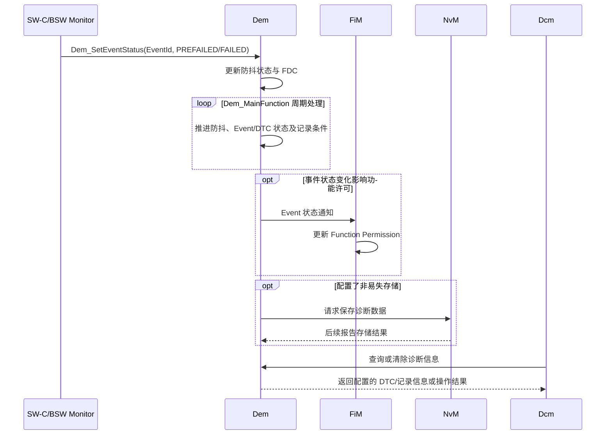

Dem 是 ECU 内部诊断事件和 DTC 状态的管理者。上游 Monitor 报告测试结果，Dem 按配置执行防抖、事件状态更新、DTC 确认、故障记录及老化处理，并通过 [[NvM]] 持久化需要保留的数据；[[Dcm]]、FiM、Dlt 等模块则通过相应接口读取诊断信息或接收状态通知。

需要区分 **Event** 和 **DTC**：Event 表示一个监控项的诊断结果，DTC 是面向诊断读取的故障代码；一个 DTC 可关联一个或多个 Event，状态汇总和故障内存行为受生成配置及诊断法规约束。

## 工作机制

### 职责与边界

SW-C 和 BSW 中存在大量故障监视器，但 Monitor 不应该各自实现防抖、DTC 状态机、故障确认、老化、故障内存管理和掉电保存。Dem 将这些共性能力集中起来，使故障监视器只需报告 `PASSED/FAILED/PREPASSED/PREFAILED`，其余生命周期由 Dem 统一处理。

同时，诊断服务模块并不保存故障信息。Dcm 处理 UDS/OBD 诊断服务，J1939 诊断由独立的 J1939Dcm 处理；DTC 状态、冻结帧、扩展数据和故障内存由 Dem 管理，并按配置通过接口提供给相应的诊断服务模块。

### 事件处理模型

Dem 采用“状态报告入口 + 周期处理 + 异步持久化”的混合模型。监控器报告结果后，Dem 根据配置推进防抖和事件/DTC 状态；符合记录条件时采集冻结帧、扩展数据等上下文，并在需要时通过 NvM 持久化。NvM 写入完成与事件状态更新是不同阶段。



![[dem-event-processing.png]]

Dem 处理 Event 报告的详细时序图：

![[dem-process-event.png]]

Monitor 可按配置在报告事件状态前请求预存冻结帧等现场数据；随后通过 `Dem_SetEventStatus()` 报告测试结果。记录数据的采集时机、触发条件、记录数量和覆盖策略均由 Dem 配置决定。

### 初始化

`FiM_Init()` 只完成 FiM 自身的基础初始化；在 `Dem_Init()` 完成并通过 `FiM_DemInit()` 通知 FiM 之前，FiM 还不能提供有效的功能许可查询，因此 `FiM_GetFunctionPermission()` 返回 `E_NOT_OK`。等 Dem 恢复诊断状态并完成初始化后，FiM 才读取所有相关 Event 状态、计算 Permission，并开始正常服务。

![[fim-dem-init-sequence.png]]

### UDS DTC Status Byte

|Bit|名称|工程含义|
|---|---|---|
|Bit0|`TestFailed`|当前测试结果是否为失败|
|Bit1|`TestFailedThisOperationCycle`|当前 Operation Cycle 内是否出现过失败|
|Bit2|`PendingDTC`|是否满足 Pending DTC 状态条件|
|Bit3|`ConfirmedDTC`|DTC 是否达到确认条件|
|Bit4|`TestNotCompletedSinceLastClear`|自上次清除后测试是否尚未完成|
|Bit5|`TestFailedSinceLastClear`|自上次清除后测试是否曾失败|
|Bit6|`TestNotCompletedThisOperationCycle`|当前 Operation Cycle 内测试是否尚未完成|
|Bit7|`WarningIndicatorRequested`|是否请求警告指示灯|

这些位的置位和清除规则由诊断规范、Operation Cycle、Dem 配置及 Event/DTC 状态共同决定；不能将单一状态位直接等同于“当前故障仍存在”。

### 防抖机制

#### Counter-based Debouncing

Monitor 报告：
```text
PREFAILED -> Counter 增加
PREPASSED -> Counter 减少
FAILED    -> 直接到 Failed Threshold
PASSED    -> 直接到 Passed Threshold
```

当计数达到失败阈值时，Dem 才把测试结果判定为最终 `FAILED`。`JumpUp` 和 `JumpDown` 的作用不是改变最终阈值，而是在检测方向发生反转时，把计数器快速移动到指定值，从而塑造故障建立和恢复的动态响应。

#### Time-based Debouncing

```text
PREFAILED -> 启动失败方向计时
PREPASSED -> 启动通过方向计时
FAILED    -> 直接判定失败
PASSED    -> 直接判定通过
```

时间型防抖的实际分辨率受 Dem 周期处理间隔和 OS 调度抖动影响。若设定时间短于任务的有效处理间隔，判定精度就无法达到该设定值；应结合实际调度周期评估防抖参数，而不能只看配置的毫秒数。

#### Monitor Internal Debounce

由 Monitor 自己维护防抖状态。Dem 可通过 `DemCallbackGetFDCFnc` 获取 `-128...127` 范围的 Fault Detection Counter (FDC)，再按配置将其用于事件状态和诊断信息处理。Monitor 的本地判定逻辑与 Dem 的 DTC 生命周期仍是两个不同职责。

### 配置与排查要点

- 核对 Event 到 DTC 的映射，以及事件组合、Operation Cycle 和使能条件。
- 确认 Monitor 报告的是即时结果还是预防抖结果，并核实防抖类型、阈值和任务周期。
- 检查冻结帧/扩展数据的触发条件与采集回调，避免把“事件已失败”误认为“记录数据已持久化”。
- 对照 DTC Status Byte、FiM 通知和 Dcm 查询结果，区分 Event 状态、DTC 汇总状态与功能许可状态。
- 若持久化数据缺失，检查 Dem/NvM 初始化顺序、写入请求及 NvM 最终状态。
