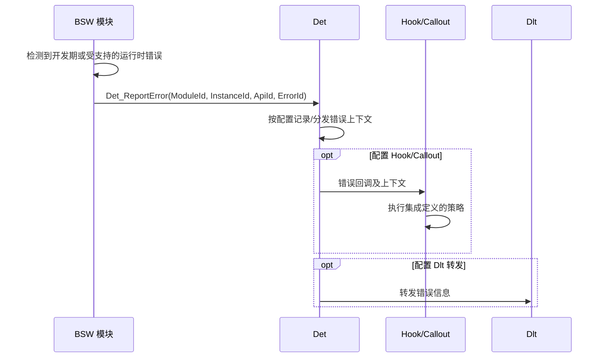

Det 为 BSW 开发期错误及实现支持的运行时错误提供统一的接收和分发入口。模块负责检测错误并上报；Det 根据配置调用 Hook/Callout，必要时转发给 Dlt 或保存错误上下文。Det 本身不判断业务故障是否成立，也不负责决定系统如何恢复。

标准错误标识包含以下四个字段：

- `ModuleId`：错误来源模块
- `InstanceId`：模块实例，单实例模块通常为 `0`
- `ApiId`：检测到错误的服务接口 ID
- `ErrorId`：具体错误类型

`FaultId` 若出现在具体平台文档中，应视为该实现的扩展命名，不能与标准四元组中的 `ErrorId` 混为一谈。

常见上报入口包括：

- 开发期错误：`Det_ReportError()`
- 运行时错误：`Det_ReportRuntimeError()`
- 瞬时故障：`Det_ReportTransientFault()`

是否提供全部入口、是否启用及其后续处理方式，取决于 AUTOSAR 版本和具体集成配置。

## 工作机制

### 职责边界

|职责|说明|
|---|---|
|错误检测|由调用 Det 的模块执行，例如检查初始化状态、空指针或参数范围|
|统一上报|接收错误标识及相关上下文，并按配置调用 Hook/Callout|
|错误记录与转发|若实现和配置支持，可保存错误上下文或转发给 Dlt|
|DTC 生命周期|不负责 Dem 的防抖、Event/DTC 状态、老化或故障内存管理|
|诊断协议|不负责 Dcm 的 UDS/OBD 服务处理和诊断响应|
|恢复策略|不自行决定降级、复位或继续运行；由集成的 Hook/Callout 或其他系统策略处理|

Det 不提供 RTE 服务接口。它与 [[Dem]] 的关键差别是：Det 汇聚软件模块报告的开发/运行错误；Dem 管理被诊断监控器判定的产品或系统故障及其 DTC 生命周期。

### 初始化与上报流程

EcuM 在 ECU 启动阶段调用 `Det_Init()`。Det 必须在可能向其上报错误的模块之前完成初始化；若启动顺序不满足这一条件，早期错误可能无法按预期记录或分发。

![[det-initialization.png]]

### 返回值与执行上下文

Det 的上报接口不应被当作 Dem/NvM 式的后台事务接口：调用方通常没有后续查询 Hook、日志或 Dlt 处理结果的通用机制。具体实现可能在调用上下文中立即执行回调，也可能把部分处理延后；应以目标 Det 实现和配置为准。

若实现规定 `Det_ReportError()` 固定返回 `E_OK`，该返回值只符合接口约定，不表示错误已被修复、系统仍可安全运行，或所有日志后处理都已完成。Hook/Callout 应保持有界且避免递归调用 Det；若采取复位或停机等动作，应由集成策略明确其执行上下文和时序。

![[det-report-error-configured.png]]

## 排查要点

- 核对四元组中的 `ModuleId`、`InstanceId`、`ApiId` 和 `ErrorId` 是否与生成配置及符号定义一致。
- 确认 `Det_Init()` 的执行顺序覆盖所有可能上报错误的模块，并检查多核实现的上下文隔离要求。
- 查明 Hook/Callout 是同步还是延后调用，以及是否可能重入、阻塞或触发复位。
- 不能仅凭没有 Det 记录就断定没有故障；错误检测可能未启用，或发生在 Det 初始化之前。
- 需要持久化 DTC、故障防抖或维修诊断信息时，应使用 Dem/Dcm 等相应模块，而不是把 Det 当作故障数据库。
