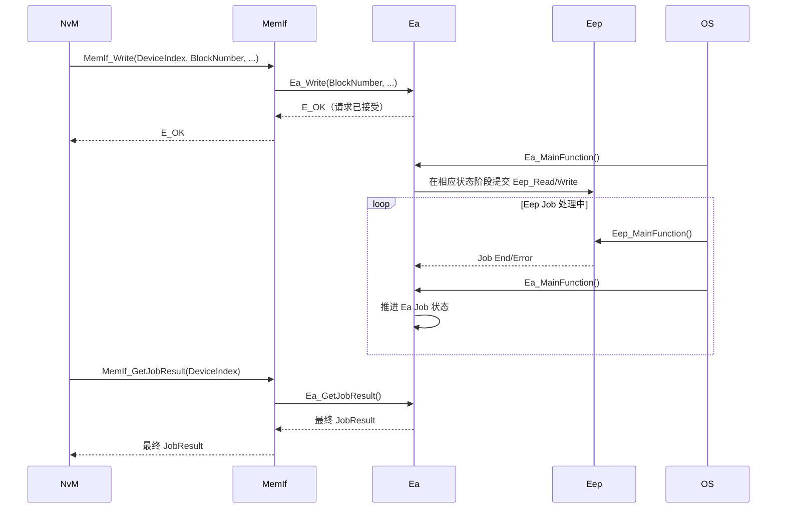

Ea 位于 [[MemIf]] 与 Eep 之间，向上提供基于逻辑 Block 的访问接口，向下通过 Eep 操作真实 EEPROM。Ea 不管理应用变量或 NvM Block 生命周期，而是依据配置将 Block 请求映射到 EEPROM 地址，并维护其访问 Job。与通过 [[Fee]] 在 Flash 上模拟 EEPROM 的方式相比，Ea 面向真实 EEPROM；具体写入粒度、页限制及擦写要求由 Eep 和器件实现处理。

## 功能点

- Ea 的核心职责包括：逻辑 Block 到介质地址的映射、读写请求管理、Block 有效性管理、必要的数据对齐/长度处理、任务状态维护，以及向上层报告 Job 结果
- Ea 不理解应用数据的业务含义，也不负责 RAM Block、ROM 默认值、CRC、冗余策略或 Dataset 策略管理；这些主要由 NvM 管理。Ea 只处理最终映射后的 Ea Block
- `EaBlockNumber`、`EaBlockSize` 和 `EaImmediateData` 等配置必须与使用 Ea 的 NvM Block 及生成的 MemIf 设备映射一致；具体由配置工具如何生成取决于项目流程
- Ea API 通常以 `BlockNumber`、`BlockOffset`、长度和数据缓冲区定位数据。若项目实现使用 32 位虚拟地址编码 Block 与 Offset，应将其视为实现约定，不应假设为所有 AUTOSAR 配置的通用格式

### 异步任务模型

- `Ea_Read`、`Ea_Write`、`Ea_InvalidateBlock` 和 `Ea_EraseImmediateBlock` 等服务通常以异步 Job 执行；`Ea_EraseImmediateBlock` 针对配置的 Immediate Data Block，不是任意 EEPROM 擦除接口
- API 返回 `E_OK` 表示请求已被 Ea 接受，不代表 EEPROM 操作已经完成；如果设备忙或参数无效，请求可能立即失败
- `Ea_MainFunction()` 周期推进读、写、失效等 Job，并与 Eep 驱动的执行周期配合；最终结果通过 MemIf JobResult 和/或配置的通知机制报告
- `Ea_MainFunctionPeriod` 应与实际 OS Task 周期一致。例如配置为 `0.01 s`，则应按项目调度设计以 10 ms 周期运行该函数

### 写入与数据一致性

Ea 的逻辑 Block 映射、写入对齐和有效性标记由具体实现及配置决定。发生掉电或 Job 失败时，不能仅凭 `Ea_Write()` 曾返回 `E_OK` 就认定新数据完整；应检查最终 JobResult，并由上层 NvM 按配置执行 CRC 校验、默认值恢复或冗余恢复。

![[ea-write.png]]