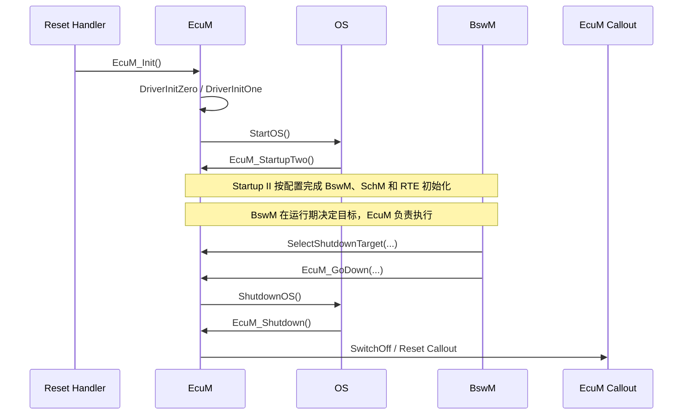
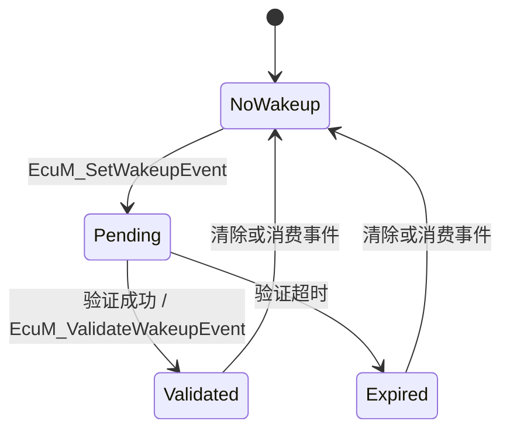

EcuM 管理 ECU 从复位、启动、运行到休眠、下电或复位的生命周期。它负责执行有严格顺序和时序约束的系统动作，但通常不负责决定业务上何时切换模式。其主要职责包括：

- 在 OS 启动前，以确定顺序初始化 MCU 驱动和基础 BSW
- 接收 [[BswM]] 已经做出的模式决策，并将其落实为睡眠、关机或复位动作
- 管理唤醒源的 Pending、Validated、Expired 状态及验证流程
- 在多核系统中同步各核的 Startup、Sleep 和 Shutdown 阶段
- 通过 Callout 将电源控制、复位、低功耗和唤醒验证等硬件相关动作留给集成代码实现

EcuM 的 Fixed/Flexible 配置形式、初始化阶段和具体 API 可因 AUTOSAR 版本及供应商实现而不同；本文中的调用链用于说明职责关系，执行顺序应以项目生成配置和集成代码为准。

## 工作机制

### 模块边界

|EcuM 负责|由其他模块/集成层负责|
|---|---|
|按阶段初始化驱动和基础 BSW，启动 OS 并完成 Startup II|业务级模式仲裁：通常由 [[BswM]] 完成|
|保存并执行已选择的 Shutdown Target|网络关闭条件判断：通常由 BswM 结合 [[ComM]]、[[Nm]] 等状态决定|
|管理唤醒源事件及其验证时限|具体硬件低功耗寄存器、电源开关和复位动作：由 MCU 驱动或 EcuM Callout 实现|
|按配置执行 ECU 睡眠、关机或复位流程|CAN/LIN 等总线协议和网络模式控制：由相应 BusSM/总线模块完成|
|在多核配置中协调生命周期阶段|应用业务功能本身及其运行条件|

### 上下游接口契约

#### 上游模块

|调用方|接口/职责|关键契约|
|---|---|---|
|BswM|`EcuM_SelectShutdownCause()`、`EcuM_SelectShutdownTarget()`、`EcuM_GoHalt()`、`EcuM_GoDown()`|按系统策略先选择合法的 Target/Mode，再请求 EcuM 执行；选择目标不等于硬件动作已经完成|
|唤醒源所属模块|`EcuM_SetWakeupEvent()`、`EcuM_ValidateWakeupEvent()`|潜在唤醒先报告为 Pending；只有完成配置的真实性验证后，才报告 Validated|
|Reset Handler/启动代码|`EcuM_Init()`|在启动阶段按集成约定调用，完成 OS 启动前初始化|
|OS DefaultTask|`EcuM_StartupTwo()`|按集成配置在 OS 启动后完成 Startup II|
|OS 周期任务|`EcuM_MainFunction()`|按配置周期推进唤醒源验证及相关计时|
|OS Shutdown Hook|`EcuM_Shutdown()`|按集成的 Shutdown 流程交回控制权，执行已保存的关机/复位目标|

唤醒源参数通常是 `EcuM_WakeupSourceType` 位图，而不是单个普通枚举值；每一位对应一个配置的唤醒源。具体位宽和有效位应以所用版本及生成配置为准。

#### 下游模块

- MCU
    - 提供正常运行模式、睡眠模式和复位能力
    - `EcuMSleepModeMcuModeRef` 和 `EcuMNormalMcuModeRef` 必须指向有效的 `McuModeSettingConf`
    - EcuM 负责选择模式，MCU 负责真正修改芯片状态
- OS / SchM / RTE
    - EcuM 调用 `StartOS()` 启动 OS
    - `EcuM_StartupTwo()` 完成 BswM 初始化、SchM 初始化和 `Rte_Start()`
    - 下电流程按集成顺序停止 RTE/SchM 并调用 `ShutdownOS()`
    - OS Shutdown Hook 按配置将控制权交回 `EcuM_Shutdown()`
- ComM
    - 若唤醒源配置了 `EcuMComMChannelRef`，有效网络唤醒最终需要通知对应 ComM Channel
    - 该引用为空通常表示该唤醒源不是网络唤醒源
- Det
    - 当 `EcuMDevErrorDetect = true` 时，EcuM 对未初始化调用、空指针、非法参数和未知唤醒源等开发错误进行上报
- 硬件集成层
    - 通过 `EcuM_AL_SwitchOff()`、`EcuM_AL_Reset()`、`EcuM_EnableWakeupSources()` 等 Callout 实现
    - EcuM 只规定函数名、调用时机和参数语义，硬件动作由系统集成者实现

### 任务模型

EcuM 的执行上下文可分为四类。各阶段的入口、调用者和可用服务不同，不能把 OS 启动前、周期任务和 Shutdown Hook 中的执行环境视为等价。

#### OS 启动前同步上下文

入口为 `EcuM_Init()`，通常由启动代码在 OS 启动前调用，主要完成：

- EcuM 内部变量初始化
- 可选循环复位检测
- 可选可编程中断配置
- 按顺序调用 `EcuM_AL_DriverInitZero()`
- 按顺序调用 `EcuM_AL_DriverInitOne()`
- 按集成流程调用 `StartOS()`

这一阶段通常不具备完整 OS 调度能力，因此初始化函数不能隐式依赖尚未启动的周期任务、事件、资源或异步处理。

#### OS DefaultTask 上下文

OS 启动后，由集成配置指定的任务调用 `EcuM_StartupTwo()`（常见为 DefaultTask）。该阶段完成 BswM、SchM 和 RTE 相关启动，并把运行期模式决策交给 BswM。

#### 周期任务上下文

`EcuM_MainFunction()` 由 OS 周期调度，主要负责推进唤醒源验证：

- 检查 Pending Wakeup
- 启动唤醒源验证
- 调用集成层验证逻辑
- 更新验证计时
- 将事件归类为 Validated 或 Expired
- 停止失败唤醒源的验证

因此它不是 ECU 主状态机的唯一驱动函数，而主要是唤醒事件验证引擎。

Pending 表示检测到潜在唤醒、仍在验证窗口内；Validated 表示唤醒源通过验证；Expired 表示在配置期限内未完成验证。Expired 不能简单等同于硬件故障，需结合唤醒源、验证 Callout 和诊断策略分析。

#### Shutdown Hook 上下文

`EcuM_GoDown()` 调用 `ShutdownOS()` 后，OS 通过 Shutdown Hook 调用 `EcuM_Shutdown()`。此时：
- 正常 OS 服务已经不可假定可用
- EcuM 根据保存的 Shutdown Target 调用 `EcuM_AL_SwitchOff()` 或 `EcuM_AL_Reset()`
- Callout 原则上不应返回，或者返回后必须进入明确的故障保护路径

### 生命周期时序

下图概括 OS 启动前初始化、OS 启动后的 Startup II，以及由 BswM 选择目标后进入 Shutdown 的主要交接点。Callout 细节和服务停止顺序由 ECU 集成方案决定。

### 唤醒事件状态流转

唤醒检测、真实性验证和后续网络恢复是三个不同阶段。对于映射到 ComM Channel 的网络唤醒源，EcuM 在有效唤醒后还需按配置通知 ComM；总线控制器和网络模式的恢复仍由相应模块完成。

无需单独验证的唤醒源可按其配置直接进入有效唤醒处理；上图展示的是需要验证的典型路径。

### 状态机

![[ecum-fixed-state-machine.png]]

![[ecum-flexible-phases.png]]

![[ecum-wakeup-handling.png]]

## 典型流程

### 上电启动

![[ecum-power-up-sequence.png]]

### 运行阶段

![[ecum-run-sequence.png]]

### 关机或复位

![[ecum-shutdown-sequence.png]]

### 休眠

![[ecum-sleep-sequence.png]]

### 唤醒

![[ecum-wakeup-sequence.png]]

### CAN 网络唤醒

![[ecum-can-wakeup.png]]

## 配置与排查要点

- 核对 Reset Handler、`EcuM_Init()`、`StartOS()`、`EcuM_StartupTwo()` 和 `EcuM_MainFunction()` 的调用顺序及任务归属。
- 检查唤醒源位图、验证期限、验证 Callout 和 `EcuMComMChannelRef` 映射；区分 Pending、Validated 与 Expired。
- 检查 Shutdown Target 是否在 `EcuM_GoDown()`/`EcuM_GoHalt()` 前正确选择，以及相应 Callout 是否实现且满足不可返回/失败保护约束。
- 若发生多核启动或关机挂起，沿各核阶段同步点、OS 服务可用时段和集成 Callout 逐一确认。
- 核对 MCU 正常/睡眠模式引用指向有效配置，并确认硬件实际支持目标模式。
