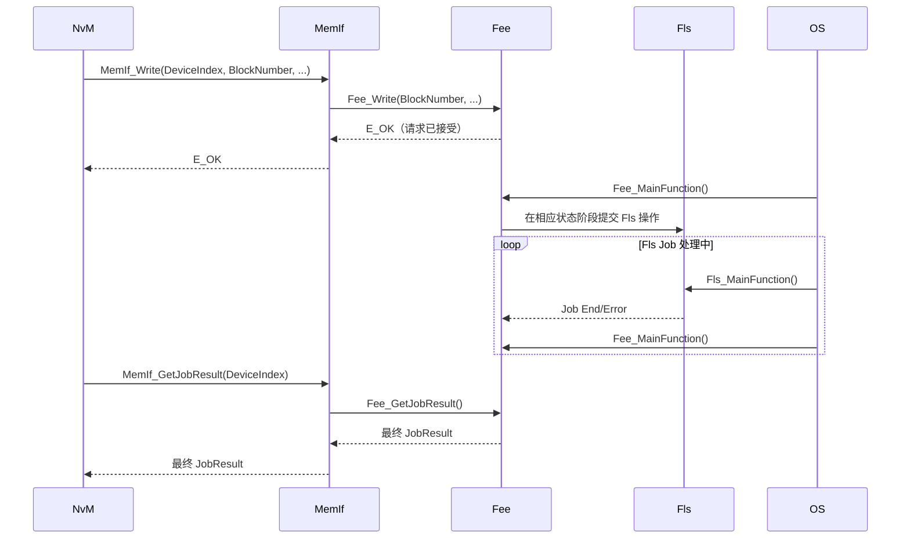

Fee 在 Flash 上提供类似 EEPROM 的逻辑 Block 读写能力。它需要隐藏 Flash 的擦除粒度和写入限制，并管理 Block 更新、有效性判定及空间回收。

常见 Fee 实现使用多个 Virtual Sector，以追加方式写入新 Block 版本，并在空间不足时执行扇区切换/垃圾回收。扇区数量、有效标记、启动扫描和掉电恢复算法属于实现细节；不能据此假设不同供应商的 Fee 具有完全相同的物理布局或原子性保证。

## 功能点

- Fee 作用是在 DataFlash 上模拟 EEPROM，为上层提供基于逻辑 Block 的非易失性数据读写能力。
- Fee 向上屏蔽 Flash 的物理限制，向下通过 Fls 完成实际的读、写和擦除操作。
- Fee 通常不把逻辑 Block 永久固定映射到单一物理地址，而是通过管理元数据追踪有效版本；具体更新策略取决于 Fee 实现。
- 旧版本一般不会在每次更新时立即擦除，而是在扇区空间不足时进行回收/切换。该机制可分摊擦除压力，但实际耐久度仍受介质寿命、写入频率、数据大小和回收策略影响。

### 异步任务模型

Fee 的 `Fee_Read`、`Fee_Write`、`Fee_InvalidateBlock` 和 `Fee_EraseImmediateBlock` 等主要服务以异步 Job 执行：

- API 返回 `E_OK` 表示请求已被接受，不代表数据已写入 Flash；接口可能因当前忙、参数错误或资源限制而立即拒绝请求。
- `Fee_MainFunction()` 推进 Fee 内部状态机，并调用 Fls 发起底层操作；Fls 的 MainFunction/中断处理也必须按驱动要求运行。
- 上层通过 `Fee_GetStatus()`、`Fee_GetJobResult()` 或配置的 Job End/Error 回调获知结果。`MEMIF_BUSY_INTERNAL` 表示 Fee 正进行内部处理，不能解释为当前没有工作。
- Fee 通常串行处理有限数量的外部 Job；并发请求能否排队、返回何种忙状态由具体实现决定，应以返回值和配置为准。
- `Fee_MainFunctionPeriod` 应与 OS 实际调度周期相匹配，同时校验 Fee/Fls 的任务调用顺序和驱动时序要求。

### NvM 配置

- Fee Block 通常不是在 Fee 中手工独立配置
- `FeeBlockNumber`、`FeeBlockSize` 和 `FeeImmediateData` 等信息由 NvM 配置及引用自动生成
- 因此新增 NvM Block 时，核心不是只修改 Fee，而是：
    - 在 NvM 中创建或配置 NvM Block
    - 配置相应 RAM Block、ROM Block、Block 长度和管理策略
    - 将底层存储设备映射到 Fee
    - 由配置工具生成对应 Fee Block 信息

### Fee Write

![[fee-write.png]]

### 配置与排查要点

- 新增持久化数据通常需先配置 NvM Block，再核对 MemIf 设备选择和生成的 Fee Block Number/Size；不要只手改 Fee 层配置。
- 检查 Fee Block 长度、虚拟扇区容量、元数据开销和并发/队列约束，确保可用空间能覆盖运行期写入与垃圾回收需求。
- 写入异常时区分 Fee 请求接受、Fee 内部作业、Fls Job 和最终 NvM 状态；逐层检查 MainFunction 调度与 JobResult。
- 对掉电一致性或数据耐久性有要求时，应查阅目标 Fee 实现的扇区切换、恢复算法和擦写寿命参数，不要仅凭“追加写”推断具备事务性或无限写平衡。