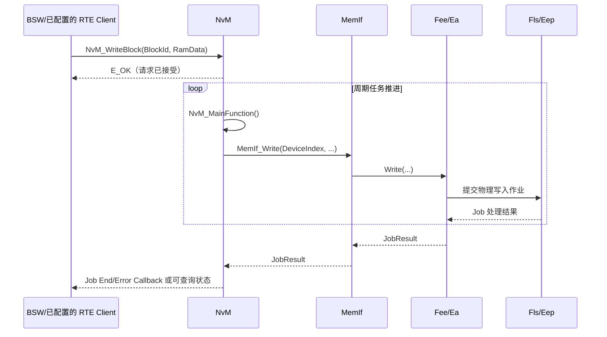

NvM 负责管理 RAM 数据与非易失存储数据之间的同步，以 **NV Block** 为单位工作，而不是直接管理 C 变量。每个 Block 的长度、管理类型、CRC/校验策略、默认数据及底层设备映射由生成配置定义。


## 工作机制

### 请求与完成状态

- `NvM_ReadAll()` 通常在启动阶段请求恢复配置范围内的 Block。读取无效、校验失败或首次使用时，NvM 按 Block 配置采用 ROM 默认值、初始化回调或相应错误处理。
- `NvM_WriteBlock()`、`NvM_ReadBlock()` 等异步服务返回 `E_OK`，表示请求已被接受，不表示介质访问已完成。请求由 `NvM_MainFunction()` 推进，再经 [[MemIf]] 和 [[Fee]]/[[Ea]] 访问 EEPROM 或 Flash。
- 完成状态可通过配置的 Job End/Error 回调或 `NvM_GetErrorStatus()` 获取。后者查询的是相应 Block 的请求状态/结果，例如 `NVM_REQ_PENDING`、`NVM_REQ_OK`、`NVM_REQ_NOT_OK`。
- 如果同一 Block 存在未完成请求，新请求可能因状态或队列资源而被拒绝；调用方必须检查 API 返回值，不能只依赖之后的状态查询。队列优先级行为由 `NvMJobPrioritization` 等配置决定。
- `NvM_WriteAll()` 常用于关机或受控掉电前保存配置范围内的数据，但它同样是异步流程；系统必须为请求完成及其错误处理留出时间。

典型请求闭环如下：



### Block 类型

| 类型            | NV 副本 | 适用场景       |
| --------------- | ---- | ---------------- |
| Native Block    | 1 | 一般数据             |
| Redundant Block | 2 | 需要提高掉电/介质故障容错的数据 |
| Dataset Block   | 多个数据集槽位 | 多套数据、版本或轮换存储 |

Dataset Block 通过 Data Index 选择当前访问的数据集槽位；槽位可按配置映射到 NV 或 ROM 数据。Redundant Block 管理两个 NV 副本，读取时可按配置尝试恢复有效副本。冗余并不等价于任意故障下都保证数据可恢复，具体结果还取决于副本状态和 NvM 配置。

### 应用层访问

应用 SWC 通常不直接调用 `NvM_WriteBlock()`。一般是通过 AUTOSAR 配置的 NvM Service Port，经 RTE 调用生成的接口，例如：

```c
Std_ReturnType ret =
    Rte_Call_<Port>_<Operation>(/* 参数由配置决定 */);
```

- 实际名称由生成器决定，常见形式是 `Rte_Call_<Port>_<Operation>()`，也可能生成封装的 macro 或 inline function
- SWC 通过该接口访问服务，RTE 再将调用映射到 NvM
- Block ID、RAM Block 和结果状态通常由配置绑定，不应由应用硬编码

`NvM_WriteBlock()`、`NvM_ReadBlock()` 等标准 NvM API 主要供 BSW 模块或已明确配置为直接使用 NvM 的 CDD 调用。SWC 直接调用它们会绕过 RTE 抽象，降低可移植性，也可能不符合项目的分层和接口约束。

> NvM 只负责 NVRAM Block 的抽象、校验和调度；底层介质访问由 MemIf 及对应的 Fee/Ea 模块完成。

### 异步调用与完成回调

![[nvm-asychronous-call-with-callback.png]]

### 异步调用与状态轮询

![[nvm-asychronous-call-with-polling.png]]

## 分层存储链路

![[memory-stack.png]]

### 配置与排查要点

- 核对 Block ID、Block 长度、RAM/ROM Block、管理类型和 `NvMNvramDeviceId` 是否一致。
- 确认调用方传入的 RAM 指针和长度符合该 Block 配置；不要假设 Block ID 就是底层 Fee/Ea Block 编号。
- 区分 API 请求被接受、NvM Job 结束和数据持久化结果；启动恢复失败时检查默认值策略与 CRC/校验结果。
- 关机前确认 `NvM_WriteAll()` 已完成或系统提供了足够的保存时间，不能把请求提交成功当作已落盘。