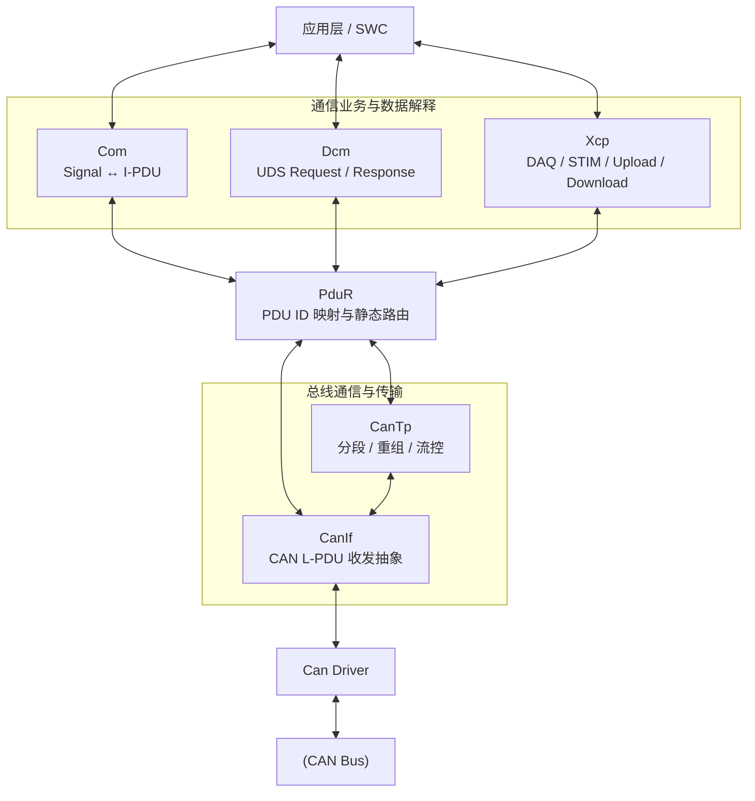
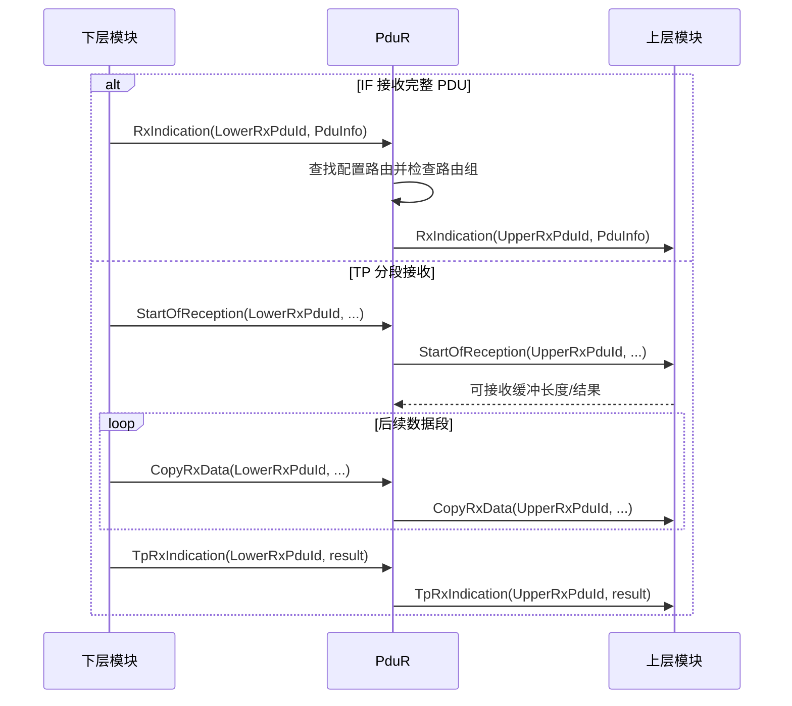

PduR 是 AUTOSAR 通信栈中的 I-PDU 静态路由器。它解决的核心问题是：将不同上层通信用户与不同下层通信协议解耦，并依据生成期配置完成 PDU[^1] ID 映射、单播、多播、网关转发和跨 Partition 分发。

[^1]: Protocol Data Unit

PduR 的路由关系由生成期配置的 PDU ID 和路由路径定义；配置了 Routing Group 时，可在运行期启用或禁用相应路径，但不会根据 Payload 内容动态选择目标。PduR 不解析信号、不修改 Payload，也不计算校验和。换句话说，它关注“这份 I-PDU 应送往哪里”，而不是“这份 I-PDU 表达了什么”。

## 工作机制

### 通信链路

在 AUTOSAR 通信栈中，可以把各模块理解成三个层次：



PduR 本身不理解 Signal、UDS Service 或 XCP Command。它处理的是 PDU 传输接口参数，而不是报文语义：

```text
PDU ID + 数据指针 + 数据长度
```

发送和接收方向使用的 PDU ID 由各层接口及生成配置定义，不能把上层 Tx/Rx ID 与下层 ID 当成同一个命名空间。排查路由时，应沿配置的路由路径核对源 PDU、目标 PDU 和方向。

#### 普通 CAN 信号

[[Com]] 管理 Signal 到 I-PDU 的映射，[[CanIf]] 管理完整 CAN 帧的收发，PduR 负责把两者连接起来。

#### UDS Request over CAN

PduR 对 UDS 的 SID、DID、SubFunction 一无所知。它只是把 CanTp 提供的数据通过 TP API 转交给 Dcm。对于 TP 接收，首帧或单帧触发 `StartOfReception`，后续数据通过 `CopyRxData` 提供，最终通过 `TpRxIndication` 通知完整 I-PDU 是否接收成功。

需要强调，即使某条 UDS Request 很短、可以用 Single Frame 发送，它通常仍然经过 CanTp，因为 SF 也是 ISO-TP 的一种帧类型。

#### UDS Response

典型 TP 发送采用“目标 TP 主动取数”模型：
1. Dcm 发起 `Transmit`
2. PduR 将发送请求路由给 CanTp
3. CanTp 根据当前要发送的 SF、FF 或 CF 大小调用 `CopyTxData()`
4. PduR 再向 Dcm 获取对应长度的数据
5. 全部发送结束后，通过 `TpTxConfirmation()` 通知最终结果

#### IF 与 TP 的对比

|维度|IF|TP|
|---|---|---|
|数据提供方式|通常一次提供完整 PDU|多次复制分段数据|
|CAN 侧表现|通常一个 CAN/CAN FD Frame|一个或多个 ISO-TP Frame|
|接收入口|`RxIndication`|`StartOfReception`|
|后续接收|无|`CopyRxData`|
|发送取数|直接数据或 `TriggerTransmit`|`CopyTxData`|
|接收结束|`RxIndication` 本身即表示收到|`TpRxIndication`|
|发送结束|`TxConfirmation`|`TpTxConfirmation`|
|流控|无|FC、BS、STmin|
|典型上层|Com、Xcp|Dcm|
|典型下层|CanIf|CanTp|

#### Confirmation 和 Indication

- **Indication**：下层通知上层已收到数据。
- **Confirmation**：下层通知上层发送请求已完成。
- 对 TP 路径，接收过程中的 `StartOfReception`/`CopyRxData` 是分阶段的数据交付，只有 `TpRxIndication` 才表示整个 TP I-PDU 的接收结果。
- Confirmation 表示传输层报告发送结束，不等同于远端应用已经接收或处理业务数据。

### 路由类型与资源边界

IF 路由以完整 I-PDU 为单位转发；TP 路由则通过 `StartOfReception`、`CopyRxData`、`CopyTxData` 等接口协调分段数据传递。配置了 Gateway 时，PduR 还可能需要缓存或分段转发资源，其容量和并发能力受生成配置与实现约束。

Routing Group 可在运行期启用或禁用已配置的路由集合；它不会创建新的路由，也不会动态改变 PDU 目标。多播路由会把同一源 PDU 分发到多个已配置目标，目标调用结果和失败处理应按对应接口及配置理解。

PduR 的 PDU ID 映射、上/下层模块引用、路由方向及 Routing Group 必须成套匹配。路由配置错误常表现为发送 API 返回失败、接收回调未到达上层，或网关 PDU 无法转发。应沿源 PDU ID、路由路径、目标 PDU ID 和路由组状态逐段检查，而不是检查 Payload 语义。

### 路由执行时序

下面以 IF 接收和 TP 接收为例，展示 PduR 如何按配置连接上下层接口。不同模块的具体 API 名称及回调方向可能因接口类型而异。


