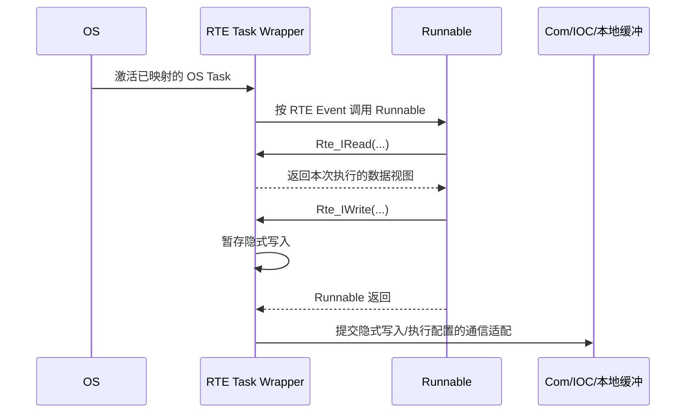

RTE 位于应用软件组件 SW-C 与基础软件 BSW 之间，是 VFB 在 ECU 上的生成式实现。它提供类型化的 Port API，并依据系统描述生成组件连接、数据访问、服务调用及 Runnable 调度所需的适配代码，使 SW-C 不必直接依赖网络拓扑、底层通信模块和具体 OS 调度实现。

RTE 主要隔离四类耦合：

- 接口耦合：SW-C 只看到 `Rte_Read/Write/Call/Switch` 等生成接口
- 调度耦合：Runnable 只描述触发事件，不直接操作 OS Task
- 通信耦合：本地通信、跨核通信、CAN/LIN/FlexRay 通信和以太网通信可保持相似的 SW-C 接口形态
- 数据实现耦合：ApplicationDataType 通过 DataTypeMappingSet 映射到 ImplementationDataType，再落到 C 基础类型

RTE 负责生成和协调适配代码，但并不取代 OS 调度器、Com/PduR 通信栈或 NvM 存储管理。数据最终如何传输、缓存或持久化，仍取决于部署映射和对应 BSW 配置。

## 工作机制

### SW-C Port 接口

SW-C 对 RTE 的契约：

|接口类别|常见生成 API|语义与注意事项|
|---|---|---|
|Sender-Receiver 显式通信|`Rte_Write`、`Rte_Read`|按调用时机读写通信数据；具体可见值和并发一致性由接口及 RTE 配置决定|
|Sender-Receiver 隐式通信|`Rte_IWrite`、`Rte_IRead`|Runnable 可使用执行期间一致的数据视图；隐式写入通常在 Runnable 完成时提交到配置的通信路径|
|队列通信|`Rte_Send`、`Rte_Receive`|以队列元素传递数据；队列长度、满/空时行为及返回状态由配置决定|
|更新状态|`Rte_IsUpdated`|仅适用于配置了更新检测的接收数据，用于判断自上次处理以来数据是否更新|
|Internal Behavior Variable (IRV)|`Rte_IrvWrite`、`Rte_IrvRead`|在 SW-C 内部的 Runnable 之间共享数据，不是总线信号或跨 ECU 通信接口|
|Client-Server|`Rte_Call`、异步调用的 `Rte_Result`|同步调用等待服务端操作返回；异步调用通过 `Rte_Call` 发起、稍后用 `Rte_Result` 取回结果，服务端通常由 `OperationInvokedEvent` 触发|
|Mode-Switch|`Rte_Switch`、`Rte_Mode`|请求或读取模式；模式变化可通过 `ModeSwitchEvent` 触发关联 Runnable，具体同步语义取决于配置|
|NvData/NvBlock|生成的 NvM 服务 Port API|仅在配置了对应 NvM 服务和 Block 映射时可用；镜像数据和 Job 完成通知由生成接口按配置连接|

具体函数名通常包含 Port、DataElement 或 Operation 名称，例如 `Rte_Read_<Port>_<DataElement>()`；以上名称是 API 家族示例，不一定是完整的生成符号。

### RTE 的本质：生成式适配层

RTE 不是一个独立“模块线程”。生成结果可能包含：

```text
RTE Generated Code
├── 生命周期
│   ├── Rte_Start / Rte_Stop
├── SW-C 接口
│   ├── Rte_<SW-C>.h
│   └── Rte_<SW-C>_Type.h
├── 通信实现
│   ├── RTE Buffer
│   ├── Read / Write / Send / Receive
│   ├── Call / Result
│   └── COM / LdCom / NvM 等配置回调
├── 调度实现
│   ├── TASK() wrapper
│   ├── Runnable 调用序列
│   └── Alarm / Event 关联
└── 与 OS/BSW 的集成适配
    ├── IOC
    ├── Spinlock
    ├── ExclusiveArea
    ├── IRV
    └── OsApplication memory section
```

上图中的 IOC、Spinlock、ExclusiveArea 和 OS-Application 内存区域由 OS/BSW 及生成配置提供；RTE 按配置生成调用或映射关系，并不取代这些模块的同步、保护或调度机制。SchM 是 BSW 的调度抽象层，也不等同于 RTE。

### Runnable 事件与 OS Task

Runnable 本身不是 OS Task。系统配置先将 RTE Event 关联到 Runnable，再通过 Event-to-Task Mapping（例如配置工具生成的 `RteEventToTaskMapping`）将其映射到 OS Task。OS 负责激活任务或设置 Event；OS Task 中生成的 RTE 包装代码再按配置顺序调用 Runnable。



隐式通信提供的是按 RTE 语义管理的数据快照/提交边界，并不自动保证端到端的原子性或跨核同步；这些性质仍依赖具体数据映射、IOC/锁配置和通信栈行为。

### Client-Server 调用语义

- **同步调用**：客户端通过 `Rte_Call_<Port>_<Operation>()` 发起调用，并在服务端操作返回后继续执行；若服务处理时间较长，应检查调用上下文、任务期限和阻塞风险。
- **异步调用**：客户端发起调用后可继续运行，稍后通过生成的 `Rte_Result_<Port>_<Operation>()` 获取结果。配置了 `AsynchronousServerCallReturnsEvent` 时，完成事件可用于唤醒关联 Runnable。
- 异步调用是否仍在处理中、结果是否可读取及错误如何返回，遵循生成 API 的返回状态；不能在未确认完成时把结果数据当作有效值。

## 典型接口流程

![[rte-sender-receiver-data.png]]

![[rte-sender-receiver-event.png]]

![[rte-client-server-sync.png]]

![[rte-client-server-async.png]]

## 配置与排查要点

- 核对 SW-C Port 连接、Interface、DataTypeMappingSet 和生成 API 的数据类型/长度。
- 确认 RTE Event 关联到正确 Runnable，并映射到预期 OS Task、核和调度周期。
- 发送接收问题应检查部署映射：本地 RTE Buffer、跨核 IOC 或经 Com/PduR 的总线路径并不相同。
- 对隐式/显式及队列通信，分别检查数据快照时机、更新检测、队列长度和满/空处理。
- 对 Client-Server，核对同步/异步配置、服务端 `OperationInvokedEvent`、调用上下文及异步结果事件。
- 对 NvBlock 服务，检查生成的 RTE Port、NvM Block 映射、RAM Mirror 和 Job 完成通知；不要让 SW-C 无配置地直接依赖底层 NvM API。