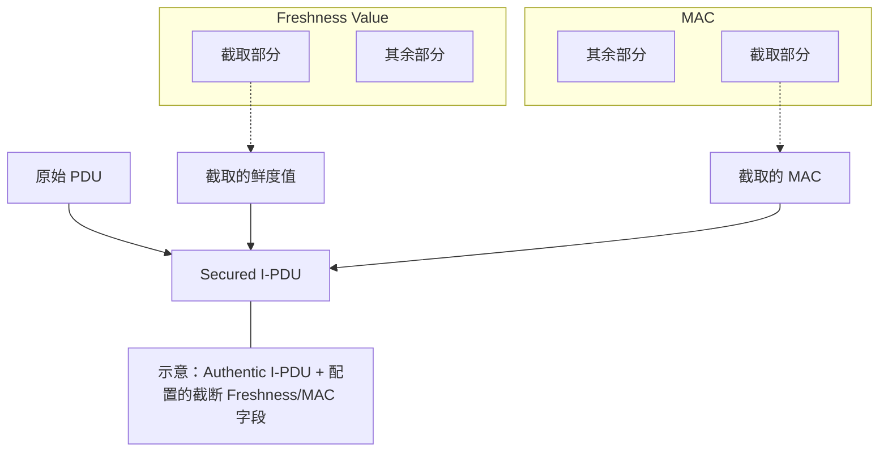
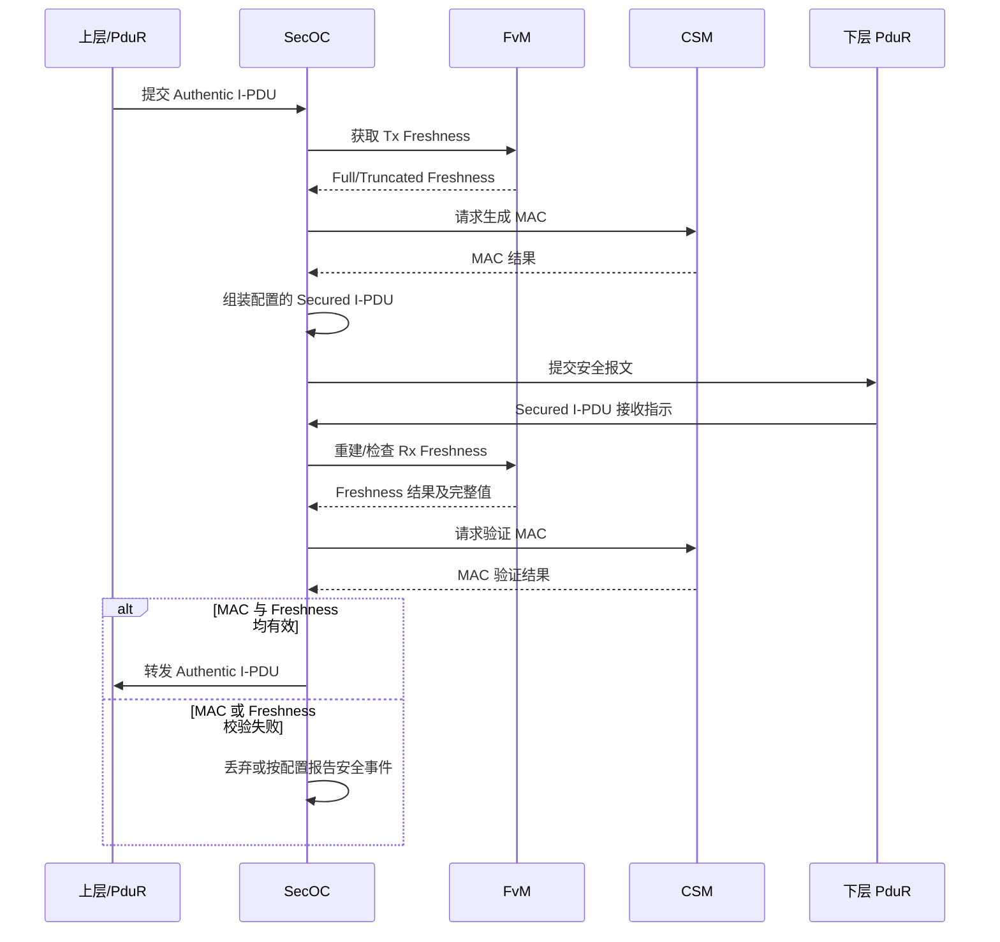

SecOC 在配置的 PduR 路径上保护 I-PDU：发送时根据 Authentic I-PDU、Data ID 和完整 Freshness Value 计算认证信息，并按配置构造 Secured I-PDU；接收时重建/获取 Freshness Value，验证 MAC[^1] 及新鲜度条件，只有通过验证的报文才交付给上层。

[^1]: Message Authentication Code

SecOC 提供来源认证、数据完整性和防重放能力，不负责加密 Payload，也不负责物理网络发送，因此不提供机密性。

## 工作机制

### 安全目标与字段关系

普通通信链路只能说明收到了一帧数据，不能单独证明发送者身份、Payload 完整性或报文新鲜度。SecOC 使用两类输入实现这些保护：

1. **Authenticator/MAC**：由配置的算法对 Data ID、Authentic I-PDU 和完整 Freshness Value 等认证输入计算，用于检测数据篡改并绑定报文身份。
2. **Freshness Value**：通常由计数器、时间信息或复合状态构成，用于区分新旧报文；接收端依据截断字段及本地状态重建或取得完整值，并执行新鲜度检查。

### Freshness 是什么

MAC 本身不能阻止重放：攻击者重发一条历史合法报文时，该报文原有的 MAC 仍可能正确。接收端必须同时验证 Freshness Value，才能根据配置的计数窗口/同步规则拒绝过期或重复报文。Freshness 的初始同步、重启后的连续性和状态持久化策略，是防重放效果的重要组成部分。

线上 Secured I-PDU 通常只携带截断的 Freshness 字段和截断的 MAC。下图仅示意一种将字段附加到 Authentic I-PDU 的布局；字段位置、长度、位序和是否单独传输截断 Freshness 均由 SecOC 配置及 Profile 决定。



### SecOC、FvM 与 CSM 的分工

SecOC 不直接实现密码算法，而是通过 CSM 请求 MAC 生成或验证；CSM 再经 CryIf/底层 Crypto Driver 访问配置的密码服务和密钥。Freshness Value 的获取、重建、校验及相关状态由 Freshness Value Manager (FvM) 接口和配置提供。

因此，SecOC 的接收成功条件至少涉及 MAC 验证和 Freshness 检查两部分。两者的具体调用次序、同步/异步行为和错误重试策略取决于实现及配置；仅 MAC 匹配不代表报文一定新鲜。

### 内部任务模型

SecOC 的核心不是一次同步的 MAC 调用，而是 Tx/Rx 两条按配置独立调度的处理管线。其周期入口、缓冲区和重试限制需与 PduR、CSM、FvM 及 OS 调度配置匹配。

#### Tx 管线

```text
SecOC_IfTransmit
    -> 缓存 Authentic I-PDU
    -> 标记 Tx Job Pending
    -> SecOC_MainFunctionTx
        -> 获取完整/截断 FV
        -> 构造 MAC 输入
        -> 调用 Csm 生成 MAC
        -> 截断 MAC
        -> 构造 Secured I-PDU
        -> 通过 PduR 向下发送
        -> 可选通知 FvM 已启动发送
```

#### Rx 管线

```text
SecOC_RxIndication
    -> 缓存 Secured I-PDU
    -> 标记 Rx Job Pending
    -> SecOC_MainFunctionRx
        -> 拆分 Payload、Truncated FV、Truncated MAC
        -> 获取/重建 Full FV
        -> 构造认证输入并调用 Csm 验证 MAC
        -> 检查 Freshness 是否满足接收规则
        -> 两项均通过才向上层转发
        -> 按配置更新 FvM / Dem 状态
```



上图为同步结果的概念时序。若 CSM/FvM 接口采用异步作业，SecOC 需在后续 MainFunction 周期中推进并检查作业状态，具体过程由相应配置和实现决定。

## 典型流程

![[secoc-receive-secured-ipdu.png]]

`SecOC_RxIndication()` 通常负责接收并缓存安全报文，Freshness 处理和 MAC 验证由后续 Rx 处理推进。若 FvM/CSM 返回忙或异步处理中状态，是否重试、最多重试次数及超时行为应以目标实现配置为准；不能假设所有 `E_BUSY` 都会自动重试。

![[secoc-transmit.png]]

![[secoc-triggertransmit.png]]

![[secoc-transmit-tp.png]]

![[secoc-receive.png]]

![[secoc-receive-tp.png]]

## 配置与排查要点

- **PDU 映射**：核对 Authentic I-PDU、Secured I-PDU、Tx/Rx PDU ID 及 PduR 路由方向，避免误将安全报文直接交付给不匹配的上层。
- **认证参数**：检查 Data ID、认证算法、Key Ref、MAC 截断长度及认证输入的字节/位顺序；发送端和接收端配置必须一致。
- **Freshness 参数**：核对完整值与截断字段长度、重建窗口、初始同步、计数器持久化/重启处理及允许的接收窗口。
- **长度与缓冲区**：确认 Authentic/Secured I-PDU 长度、字段偏移、TP/IF 路径和缓存容量与配置相符。
- **异步调度**：确认 `SecOC_MainFunctionTx/Rx`、CSM 和 FvM 作业推进周期与回调已正确配置，并区分请求已接受、密码作业完成和 PDU 已发送。
- **安全失败**：MAC 错误、Freshness 过期/重复和密钥或同步配置错误应分别定位；被拒绝的报文不会因底层接收成功而自动成为有效业务数据。
