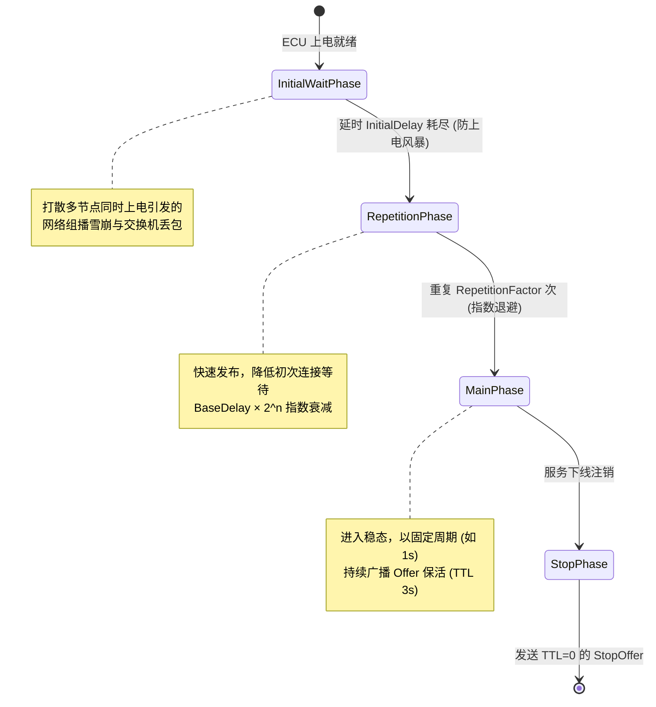
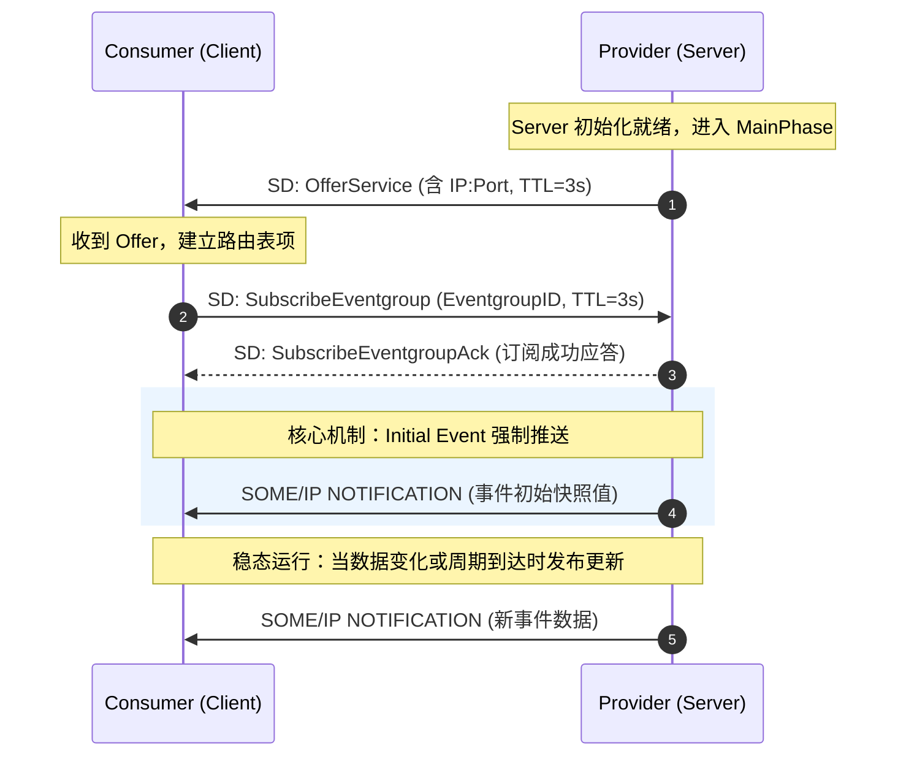
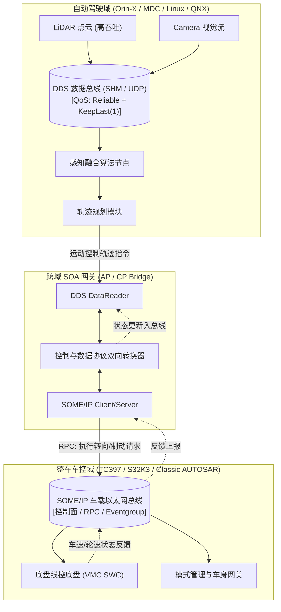

当汽车电子电气（E/E）架构从传统的面向信号（Signal-Oriented）向面向服务（Service-Oriented Architecture, SOA）演进时，车载网络需要具备强通信抽象、动态服务发现与异构系统解耦能力的中间件底座。

在现代跨域与中央计算架构中，存在两大主流服务化中间件：
- **SOME/IP（Scalable service-Oriented MiddlewarE over IP）**：AUTOSAR 联盟原生定制的标准协议，针对嵌入式车控 ECU 深度优化，天生契合 AUTOSAR Classic / Adaptive 生态，支撑控制面方法调用（RPC）、事件通知及信号到服务的网关桥接；
- **DDS（Data Distribution Service）**：由 OMG 制定的以数据为中心（Data-Centric）的发布/订阅实时通信总线，凭借丰富的服务质量（QoS）策略与极高的数据吞吐能力，在自动驾驶（AD/ADAS）、智能座舱多传感器融合等数据面场景被广泛采用。

两者的技术哲学截然不同：SOME/IP 偏向“轻量与契约化”，重在严格受控的方法调用与状态通知；DDS 偏向“解耦与数据自治”，重在海量高频数据的分发契约与时序保障。现代整车电子架构通常采用「控制面走 SOME/IP + 数据面走 DDS」的双轨协同模式。

本文将从协议报文、服务发现状态机、序列化陷阱、分段传输、DDS QoS 决策、E2E 安全防护到实车网络调试，逐层进行工程级剖析。

## SOME/IP 协议规范与报文拓扑

SOME/IP 报文由 **16 字节固定头部（Header）** 与 **变长载荷（Payload）** 组成。头部结构对齐与字段定义如下：

```text
 0                   1                   2                   3
 0 1 2 3 4 5 6 7 8 9 0 1 2 3 4 5 6 7 8 9 0 1 2 3 4 5 6 7 8 9 0 1
+-+-+-+-+-+-+-+-+-+-+-+-+-+-+-+-+-+-+-+-+-+-+-+-+-+-+-+-+-+-+-+-+
|                        Message ID (32)                        |
|       Service ID (16)         |       Method/Event ID (16)    |
+-+-+-+-+-+-+-+-+-+-+-+-+-+-+-+-+-+-+-+-+-+-+-+-+-+-+-+-+-+-+-+-+
|                          Length (32)                          |
+-+-+-+-+-+-+-+-+-+-+-+-+-+-+-+-+-+-+-+-+-+-+-+-+-+-+-+-+-+-+-+-+
|                        Request ID (32)                        |
|        Client ID (16)         |        Session ID (16)        |
+-+-+-+-+-+-+-+-+-+-+-+-+-+-+-+-+-+-+-+-+-+-+-+-+-+-+-+-+-+-+-+-+
|  Proto Ver (8)| Interf Ver (8)| Msg Type (8)  | Ret Code (8)  |
+-+-+-+-+-+-+-+-+-+-+-+-+-+-+-+-+-+-+-+-+-+-+-+-+-+-+-+-+-+-+-+-+
|                                                               |
~                     Payload (Variable Length)                 ~
|                                                               |
+-+-+-+-+-+-+-+-+-+-+-+-+-+-+-+-+-+-+-+-+-+-+-+-+-+-+-+-+-+-+-+-+
```

### 字段深度剖析

1. **Message ID (32 bit)**：路由寻址核心。
   - **Service ID (16 bit)**：服务类型标识（如 `0x1234` 为车速服务）；
   - **Method / Event ID (16 bit)**：
     - `0x0000 ~ 0x7FFF`：**方法调用（Method）**（最高位为 0）；
     - `0x8000 ~ 0xFFFF`：**事件广播（Event）**（最高位为 1，即 `0x8000 | Event_ID`）。
2. **Length (32 bit)**：表示从 `Request ID` 起始至报文末尾的字节总数。
3. **Request ID (32 bit)**：用于多客户端并发请求的应答匹配。
   - **Client ID (16 bit)**：区分发起请求的调用端或 ECU 分区；
   - **Session ID (16 bit)**：递增序列号，用于检测请求/响应丢包与响应乱序。
4. **Message Type (8 bit)**：定义交互语义，其中 **bit 5 为 TP 标志位（0x20）**：

| 类型编码 | 语义标识 | 含义说明 |
| :--- | :--- | :--- |
| **0x00** | REQUEST | 双向方法请求（需要响应 Response） |
| **0x01** | REQUEST_NO_RETURN | 单向方法请求（Fire & Forget，无需服务端回复） |
| **0x02** | NOTIFICATION | 异步事件通知（单向广播或组播） |
| **0x80** | RESPONSE | 方法正常响应 |
| **0x81** | ERROR | 方法执行错误或异常状态回复 |
| **0x20** | TP_REQUEST | 分段传输的方法请求（启用 SOME/IP-TP） |
| **0x21** | TP_REQUEST_NO_RETURN | 分段传输的单向请求 |
| **0x22** | TP_NOTIFICATION | 分段传输的事件通知 |
| **0x23** | TP_RESPONSE | 分段传输的正常响应 |
| **0x24** | TP_ERROR | 分段传输的错误响应 |

5. **Return Code (8 bit)**：仅在 RESPONSE / ERROR 报文中有效（请求报文默认填 `0x00`）：
   - `0x00 E_OK`：调用成功；
   - `0x01 E_NOT_OK`：常规错误；
   - `0x0A E_UNKNOWN_SERVICE`：未注册的 Service ID；
   - `0x0B E_UNKNOWN_METHOD`：未注册的 Method/Event ID；
   - `0x0C E_NOT_READY`：服务未就绪；
   - `0x0D E_NOT_REACHABLE`：端点不可达。

### Field 的复合三态机制

除纯粹的 Method（动作）与 Event（通知）外，SOME/IP 还定义了 **Field（属性字段）**。一个完整的 Field 包含三种标准交互通道：
- **Getter**（Method ID $\le$ 0x7FFF）：客户端主动拉取当前属性值（Request-Response）；
- **Setter**（Method ID $\le$ 0x7FFF）：客户端修改当前属性值（Request-Response）；
- **Notifier**（Event ID $\ge$ 0x8000）：属性值发生变化时，服务端主动推送到事件组。

## 服务发现 SOME/IP-SD 协议与状态机时序

SOME/IP-SD（Service Discovery）是实现 SOA 动态拓扑的基石。它基于 **UDP 组播**（全车默认标准端口 `30490`，IPv4 组播地址通常约定为 `224.244.224.245`），用于：
1. 发布服务可用性（Offer Service / Stop Offer）；
2. 请求查找目标服务（Find Service）；
3. 订阅/退订特定事件组（Subscribe Eventgroup / Stop Subscribe）。

### SD 报文层次拓扑

SD 报文本身就是标准的 SOME/IP 报文（其 `Service ID = 0xFFFF`, `Method ID = 0x8100`, `Message Type = 0x02`），其 Payload 细分为：
- **Flags**：重启标志（Reboot Flag）、单播标志（Unicast Flag）；
- **Entries Array**：容纳多个服务声明或订阅条目（Type 1: Service Entry; Type 2: Eventgroup Entry）；
- **Options Array**：承载网络物理端点（IPv4/IPv6 Endpoint Option，包含 IP 地址、UDP/TCP 端口号、L4 协议）。

### 服务提供方四阶段生命周期状态机



### 服务消费方订阅与初始事件时序（时序陷阱破局）



工程避坑点：
1. **订阅早于 Offer 的丢事件问题**：若客户端过早发送 Subscribe，服务端可能因内部未就绪而回复 Nack 或丢弃，导致客户端进入死锁。务必开启客户端的重订阅机制与订阅超时重发计数器；
2. **Initial Event 必达原则**：服务端收到 SubscribeEventgroupAck 后，**必须立刻发送一次当前事件组所有事件的最新缓存快照**。否则消费端必须等到物理世界下一次状态跳变才能获知当前车速或档位，造成启动数据黑洞。

## 二进制序列化与跨平台对齐陷阱

SOME/IP 采用静态编译期绑定的二进制序列化规范，**报文中不携带任何字段名或自描述 Meta 标签**（极度追求嵌入式带宽利用率与 CPU 效率）。

### 核心序列化规则

1. **字节序（Endianness）**：默认采用 **大端序（Big-Endian / Network Byte Order）**，ARXML 中可按信号配置为小端序；
2. **结构体对齐（Alignment）**：SOME/IP 规范要求按照字段成员自身大小自然对齐（8/16/32/64 bit 对齐），必要时插入 Padding 空字节；
3. **变长类型（String & Dynamic Array）**：
   - 必须前置 **Length Field（1/2/4 字节可选，ARXML 中显式配置）**；
   - String 类型支持 ASCII、UTF-8、UTF-16BE/LE，可配置是否包含 `\0` 结束符与 BOM 标头；
4. **可选字段（Optional Members）**：通过 TLV（Tag-Length-Value）结构编码，未传递的字段不占用带宽。

严重工程反例：C 语言结构体 `memcpy` 灾难

```c
/* 错误代码示范：试图通过 memcpy 直接发包/解包 */
struct VehicleState {
    uint16_t speed;       /* Offset 0, 2 字节 */
    uint8_t  gear;        /* Offset 2, 1 字节 */
    /* 警告：在 32/64 位 CPU 默认 ABI 下，编译器将在此自动填充 1 字节 padding */
    uint32_t timestamp;   /* Offset 4, 4 字节 */
}; /* 总长 8 字节 */
```

灾难诱因：
- 若开发人员误以为 SOME/IP 序列化等于 C 结构体内存镜像，直接将指针 `memcpy` 送入网络栈：
  - **字节序错乱**：ARM Cortex-M / x86 为小端序，直接发送导致 0x0100 变成 0x0001；
  - **编译器 ABI 差异**：Linux 64 位平台与 MCU 32 位编译器的 Padding 规则、位域（Bitfield）高低位排列差异巨大；
- **正解**：必须通过 AUTOSAR 工具链生成专用的 Transformer 序列化/反序列化函数（逐字段字节移位流式拼接），绝对杜绝零拷贝野指针强制类型转换。

## SOME/IP-TP 大包分段传输

标准以太网链路的 MTU 通常为 1500 字节，扣除 IP 头部（20 字节）与 UDP 头部（8 字节），单个 UDP 数据包的安全 Payload 约为 **1472 字节**。

当传输高精定位地图、座舱多媒体诊断元数据、点云概要等超长报文时，直接依赖 IP 层分片极其脆弱（任何一个分片丢包会导致整个 UDP 包重组失败）。因此，AUTOSAR 引入了应用层的 **SOME/IP-TP** 分段传输协议。

### TP 报文头结构

当 SOME/IP Header 的 Message Type 包含 TP 标志（`0x20`）时，在 Payload 头部自动插入 4 字节 TP Header：

```text
 0                   1                   2                   3
 0 1 2 3 4 5 6 7 8 9 0 1 2 3 4 5 6 7 8 9 0 1 2 3 4 5 6 7 8 9 0 1
+-+-+-+-+-+-+-+-+-+-+-+-+-+-+-+-+-+-+-+-+-+-+-+-+-+-+-+-+-+-+-+-+
|                     Offset (28 bit)               | Res(3)|M(1)|
+-+-+-+-+-+-+-+-+-+-+-+-+-+-+-+-+-+-+-+-+-+-+-+-+-+-+-+-+-+-+-+-+
```

- **Offset (28 bit)**：本分段数据在原始大报文中的偏移量，**以 16 字节（128-bit Blocks）为单位**（即真实字节偏移 = Offset $\times$ 16）；
- **Reserved (3 bit)**：保留位，必须填 `000`；
- **More Segments Flag (1 bit)**：`1` 表示后续仍有分段；`0` 表示这是最后一个分段。

分段拆解计算实例（传输 3200 字节大数据包）

假定设定单包最大分段限制为 1400 字节（必须向下对齐为 16 的倍数，$\lfloor 1400 / 16 \rfloor \times 16 = 1392$ 字节）：

| 分段序号 | 数据长度 (Bytes) | 字节区间 | TP Offset 字段值 | More Flag | Message Type |
| :--- | :--- | :--- | :--- | :--- | :--- |
| **Segment 1** | 1392 | 0 ~ 1391 | `0` ($0 / 16$) | `1` | TP_NOTIFICATION (`0x22`) |
| **Segment 2** | 1392 | 1392 ~ 2783 | `87` ($1392 / 16$) | `1` | TP_NOTIFICATION (`0x22`) |
| **Segment 3** | 416 | 2784 ~ 3199 | `174` ($2784 / 16$) | `0` (末包) | TP_NOTIFICATION (`0x22`) |

> **工程实战告警**：接收端重组定时器（Reassembly Timer）需严格匹配网络最差延迟抖动。若在超时窗口内丢失任一中间段，必须果断重置接收缓存并丢弃，防止重组缓冲区发生内存泄漏。

## DDS 架构深度与 QoS 服务质量模型

DDS 是由 OMG 维护的开放式数据分发标准。与 SOME/IP 的“面向服务与 RPC 代理”不同，DDS 构建在 **DCPS（以数据为中心的发布-订阅）** 与 **全局分布式数据空间（Global Data Space）** 哲学之上。

### DDS 核心实体拓扑

- **DomainParticipant**：接入逻辑数据总线的隔离域入口（不同 Domain ID 间网络彻底隔离）；
- **Topic**：强类型化的数据主题（由 TopicName + IDL 结构体唯一确定）；
- **DataWriter / DataReader**：独立的数据发布端点与订阅端点；
- **Publisher / Subscriber**：管理一组 DataWriter/DataReader 的工厂实体与 QoS 策略聚合容器。

### 核心 QoS 策略矩阵与 RxO 协商机制

DDS 之所以统治智驾领域，源于其支持数十种微秒级的 **QoS（Quality of Service）服务质量策略**。许多关键策略遵循 **RxO（Requested vs Offered）契约协商规则**：订阅端请求的严格程度（Requested）不能超过发布端所能承诺的程度（Offered），否则双方匹配失败，无法建立链路。

| QoS 策略名 | 核心枚举 / 参数 | 物理语义与工程应用场景 | RxO 约束 |
| :--- | :--- | :--- | :--- |
| **RELIABILITY** | `BEST_EFFORT` / `RELIABLE` | 数据可靠性。高频点云/相机帧用 Best Effort；核心控制指令/状态机跳转必须用 Reliable | **严格遵循**<br/>Offered $\ge$ Requested |
| **DURABILITY** | `VOLATILE`<br/>`TRANSIENT_LOCAL`<br/>`TRANSIENT` | 晚加入者能否获取历史数据。状态量（如校准参数）必须配 `TRANSIENT_LOCAL`，确保后启动的节点上线立刻获悉最新值 | **严格遵循**<br/>Offered $\ge$ Requested |
| **HISTORY** | `KEEP_LAST(depth)`<br/>`KEEP_ALL` | 节点本地队列缓存深度。高频传感器通常配置 `KEEP_LAST(1)`，避免队列积压老旧数据导致感知滞后 | 节点私有，无 RxO |
| **DEADLINE** | 期望数据更新周期（如 `10ms`） | 若发布者未在规定时间内发送、或订阅者未在限定内收到，DDS 自动触发超时回调报警（死人舵监控） | **严格遵循**<br/>Offered $\le$ Requested |
| **LIVELINESS** | `AUTOMATIC`<br/>`MANUAL_BY_PARTICIPANT` | 节点存活心跳侦测。在租约时长（Lease Duration）内未续约，自动判定节点离线并上报异常 | **严格遵循** |
| **OWNERSHIP** | `SHARED` / `EXCLUSIVE` | 排他性写入。配合 `OwnershipStrength`，可实现主控计算单元与备用安全单元的**毫秒级零丢包热备切换** | **严格匹配** |
| **TRANSPORT** | UDPv4 / SHM (共享内存) / TCP | 跨进程/跨 SOC 传输通道。同 SOC 内部通过共享内存（SHM）实现零拷贝，跨域走 UDP | 节点私有 |

## SOME/IP 与 DDS 对比与融合架构

| 对比维度 | SOME/IP | DDS (Data Distribution Service) |
| :--- | :--- | :--- |
| **标准体系** | AUTOSAR (车规原位标准) | OMG / ROS 2 (工业与机器人标准) |
| **抽象模型** | 面向服务（RPC 方法、事件通知、属性字段） | 以数据为中心（发布-订阅、分布式主题空间） |
| **发现机制** | SOME/IP-SD（基于固定端口与周期的集中组播） | RTPS 动态自发现协议（SPDP + SEDP） |
| **QoS 表达力** | 基础级（E2E、UDP/TCP、基础超时重传） | 工业级极致（20+ 策略组合，精细管控生命周期与队列） |
| **序列化标准** | 静态紧凑二进制布局（针对微控制器优化） | CDR (Common Data Representation) 序列化 |
| **协议开销** | 极低（头部仅 16 字节，内存占用极小） | 较高（RTPS 握手与心跳较重，动态发现消耗流量） |
| **单片机适配** | **完全支持**（可在 8/16/32 位单片机裸机或 CP 上运行）| 困难（标准 DDS 需较多 RAM，Micro-DDS 适度受限） |
| **首选应用域** | 车身控制、动力底盘、仪表、SOA 信号网关 | 自动驾驶多传感器融合、高算力域控进程间通信 |

### 现代智能汽车融合通信架构拓扑



架构落地法则：
- **数据面（Data Plane）**：LiDAR、Radar、Camera 等传感器高频原生数据，统一走 **DDS**，利用零拷贝共享内存与 Deadline QoS 保证极致吞吐与死线监控；
- **控制面（Control Plane）**：规划层下发的减速度、方向盘转角、档位请求，经由协议转换网关转化为 **SOME/IP RPC / Event**，通过 AUTOSAR 通信栈安全下发到底盘执行器。

## 车载以太网 E2E 安全防护机制

车载以太网通信跨越物理线束、网络交换机与复杂操作系统驱动栈，存在硬件位翻转、缓冲区溢出、交换机路由错误、跨核乱序等功能安全隐患。遵循 **ISO 26262** 规范，关键控制信号必须在应用层附加 **E2E 保护（End-to-End Protection）**。

### AUTOSAR E2E 针对以太网的核心 Profile

- **Profile 4 / Profile 7（车载以太网主力方案）**：
  - **Profile 4**：采用 32 位 CRC（IEEE 802.3 校验多项式）+ 16 位循环计数器（Counter）+ 32 位 Data ID，专为以太网中大数据块设计；
  - **Profile 7**：采用 **64 位 CRC**（常基于 CRC-64-ECMA）+ 32 位递增计数器 + 32 位 Data ID，专为 **ASIL D 自动驾驶最高安全等级** 设计，防碰撞与汉明距离极高。

### E2E 报文头部包装与校验闭环

```text
+-------------------------------------------------------+
|              SOME/IP Standard Header (16 B)           |
+-------------------------------------------------------+
| E2E Header (Profile 4/7):                             |
|   ├── CRC (32/64 bit)      : 覆盖 Data ID + Counter + Data |
|   ├── Length (16/32 bit)   : 保护数据实际长度                |
|   └── Counter (16/32 bit)  : 逐包自增递增序列号              |
+-------------------------------------------------------+
|              Actual Application Data Payload          |
+-------------------------------------------------------+
```

1. **发送方保护流程**：
   - 自增本地计数器（Counter++）；
   - 计算 CRC 校验码：输入包括预设的隐式/显式 `Data ID`、当前 `Counter` 与 `Payload` 数据；
   - 将 CRC、Counter 与 Length 写入 E2E 标头并打包外发。
2. **接收方状态机校验机制**：
   - **数据完整性校验**：重算 CRC，不一致直接报 `E2E_E_WRONG_CRC` 并丢弃；
   - **数据时序检查**：检查 Counter 是否单调递增，若发生跳变或回退，判定为丢包（`E2E_E_LOST`）或乱序（`E2E_E_WRONGSEQUENCE`）；
   - **数据新鲜度（Alive Counter Check）**：若连续收到的报文 Counter 停滞不变，判定为发送端假死/回放攻击（`E2E_E_REPEATED`）。

## 实车网络调试与抓包分析指南

以太网通讯是“黑盒”，排查网络不可见、丢包或超时问题必须依靠精准的工具链捕获手段。

### Wireshark 高频调试过滤语法

```text
# 捕获所有 SOME/IP 通信（含服务发现与常规传输）
someip

# 过滤特定服务 ID (如 0x1234)
someip.serviceid == 0x1234

# 仅观察 SOME/IP-SD 服务发现报文
someip.serviceid == 0xffff

# 过滤所有方法请求报文 (Request)
someip.messagetype == 0x00

# 过滤返回错误码的异常报文
someip.returncode != 0x00

# 查看 SOME/IP-TP 分段中的首包
someip-tp.offset == 0 && someip-tp.moresegmentsflag == 1

# 过滤 DDS RTPS 协议报文
rtps
```

### 车机与 Linux 域控终端捕获技巧

若没有硬件 TAP 盒或镜像交换机（SPAN），可直接在 Linux / Android 车机控制台抓包：

```bash
# 抓取包含 SD 组播端口 (30490) 与业务端口 (如 30000) 的报文并写入文件
tcpdump -i eth0 -nn -s 0 -w /tmp/someip_trace.pcap 'udp port 30490 or udp port 30000'

# 实时 ASCII/Hex 打印 SD 组播包
tcpdump -i eth0 -X -vv 'host 224.244.224.245 and udp port 30490'
```

## 生产环境常见避坑清单

1. SD 组播风暴与网络抖动：上电时全车数十个 ECU 同时发布 Offer/FindService 易导致交换机队列溢出。**务必配置合理随机的 `InitialDelay`（如 10~50ms）打散报文**；
2. 结构体字节对齐灾难：手写代码使用裸 `memcpy` 导致的大小端颠倒或 Padding 错位。**必须始终使用官方工具链生成的 Transformer 序列化器**；
3. E2E 计数器启动假死：节点重启后，本地 Counter 归零，接收端因检测到 Counter 跳跃判定持续报错。**必须在 E2E 状态机中支持 Profile 初始化同步周期（Sync Counter 机制）**；
4. 全车 SD 组播地址/端口不统一：A 供应商配置为 `224.244.224.245:30490`，B 供应商配置为 `239.255.0.1:30490`，导致跨域节点彼此失联；
5. 大包未开 TP 导致链路静默截断：UDP 报文长度超过交换机 MTU，又未在 SOME/IP 配置中启用 SOME/IP-TP，导致底层网卡截断或 IP 丢包；
6. 事件组（Eventgroup）粒度划分失当：将 100Hz 的高频轮速信号与 1Hz 的胎压信号划在同一事件组，导致只想获取胎压的节点被迫承受高频冗余带宽吞吐；
7. TTL 过期引发订阅悄然断连：订阅端在 TTL（如 3s）即将耗尽时未自动发起 Renew Subscribe，导致服务到期后静默收不到事件；
8. DDS 发现风暴（Discovery Storm）：动态环境下数百个 Topic 频繁加入，RTPS 频繁通过组播相互询问，占用高达上百兆带宽。**大型工程建议在静态配置期使用 SPDP 预配置静态对端 IP 列表**；
9. 接口版本号（Interface Version）不一致：Client 与 Server 的 Interface Version 哪怕相差 1，服务端也将无情返回 `E_WRONG_INTERFACE_VERSION`，排错时需优先核对 ARXML/IDL 版本号；
10. 跨域无统一时间基准（gPTP）：在分布式传感器融合中，DDS/SOME/IP 传输的时间戳若未接入 IEEE 802.1AS (gPTP) 统一时钟源，将直接导致激光雷达与摄像头感知时钟错乱无法投影。

## 总结

SOME/IP 与 DDS 是汽车行业向软件定义汽车（SDV）与 SOA 演进的“左右手”。

- **SOME/IP** 坚守车规控制面的安全可靠、小内存占用与 AUTOSAR 规范的一致性；
- **DDS** 释放了海量数据分发与复杂多传感器协同场景下的极致 QoS 调度潜能。

理解两者的核心不是非此即彼的争论，而是==在正确的物理域与数据流路径上，通过清晰的契约、严谨的序列化和健壮的 E2E 防护，构建起稳定鲁棒的整车通信网络==。