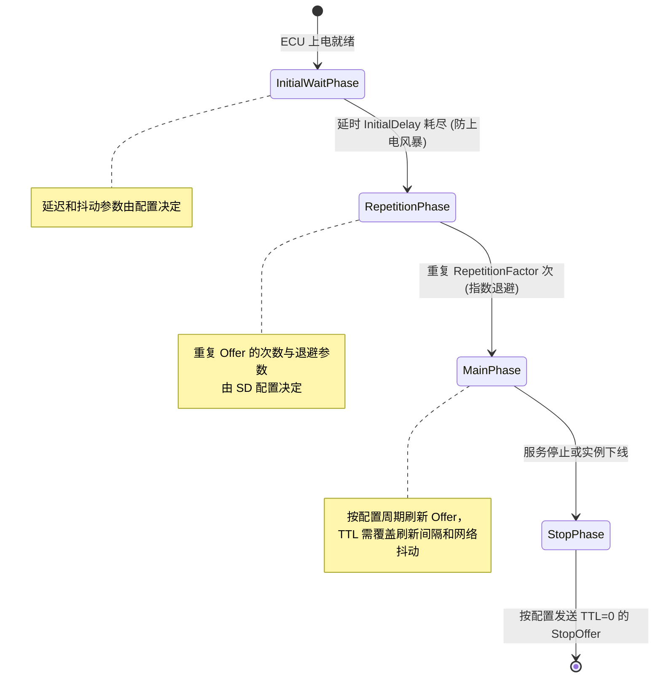
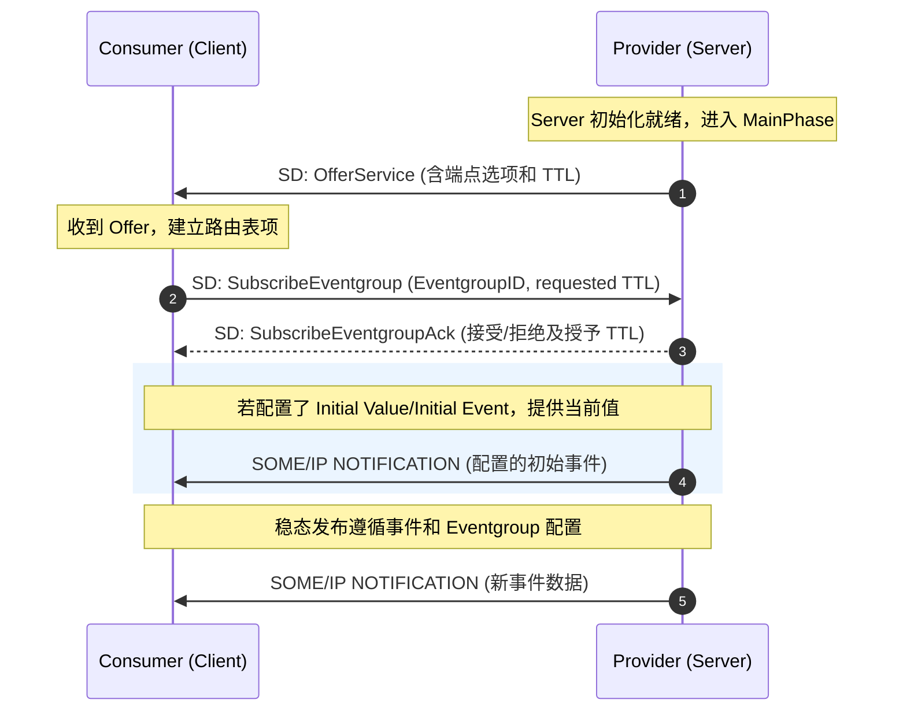
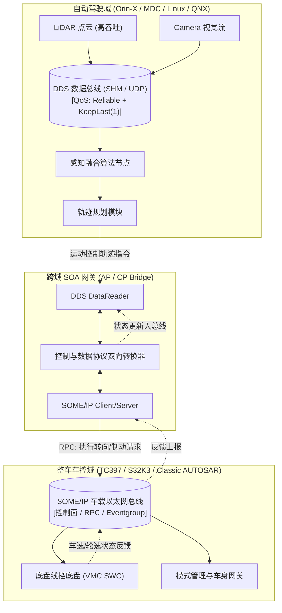

当汽车电子电气（E/E）架构从面向信号逐步演进到面向服务（Service-Oriented Architecture, SOA）时，通信中间件需要提供服务抽象、数据分发、服务发现和异构节点互操作能力。

本文聚焦两种常见的车载通信技术：

- SOME/IP（Scalable service-Oriented MiddlewarE over IP）：由 AUTOSAR 规范定义的 IP 通信协议，支持方法调用、事件通知、属性访问及服务发现，可集成于 Classic/Adaptive 等不同系统架构。
- DDS（Data Distribution Service）：由 OMG 定义的以数据为中心的发布/订阅标准，包含丰富的 QoS 策略；DDSI-RTPS 是常见的互操作线协议，具体实现和传输能力依供应商产品而异。

两者的抽象模型不同：SOME/IP 以服务、方法和事件为核心；DDS 以 Topic、DataWriter/DataReader 和 QoS 契约为核心。控制面使用 SOME/IP、数据面使用 DDS 是一种可行的架构选择，并非所有车辆或系统的固定规则。本文介绍协议报文、服务发现、序列化、分段传输、QoS、E2E 保护和网络诊断中的关键概念。

## SOME/IP 协议规范与报文拓扑

SOME/IP 报文由 ==16 字节固定头部==（Header） 与 ==变长载荷==（Payload） 组成。头部结构对齐与字段定义如下：

```text
 0                   1                   2                   3
 0 1 2 3 4 5 6 7 8 9 0 1 2 3 4 5 6 7 8 9 0 1 2 3 4 5 6 7 8 9 0 1
+-+-+-+-+-+-+-+-+-+-+-+-+-+-+-+-+-+-+-+-+-+-+-+-+-+-+-+-+-+-+-+-+
|                        Message ID (32)                        |
|       Service ID (16)         |       Method/Event ID (16)    |
+-+-+-+-+-+-+-+-+-+-+-+-+-+-+-+-+-+-+-+-+-+-+-+-+-+-+-+-+-+-+-+-+
|                          Length (32)                          |
+-+-+-+-+-+-+-+-+-+-+-+-+-+-+-+-+-+-+-+-+-+-+-+-+-+-+-+-+-+-+-+-+
|                        Request ID (32)                        |
|        Client ID (16)         |        Session ID (16)        |
+-+-+-+-+-+-+-+-+-+-+-+-+-+-+-+-+-+-+-+-+-+-+-+-+-+-+-+-+-+-+-+-+
|  Proto Ver (8)| Interf Ver (8)| Msg Type (8)  | Ret Code (8)  |
+-+-+-+-+-+-+-+-+-+-+-+-+-+-+-+-+-+-+-+-+-+-+-+-+-+-+-+-+-+-+-+-+
|                                                               |
~                     Payload (Variable Length)                 ~
|                                                               |
+-+-+-+-+-+-+-+-+-+-+-+-+-+-+-+-+-+-+-+-+-+-+-+-+-+-+-+-+-+-+-+-+
```

### 字段深度剖析

1. **Message ID (32 bit)**：路由寻址核心。
   - **Service ID (16 bit)**：服务类型标识（如 `0x1234` 为车速服务）；
   - **Method / Event ID (16 bit)**：
     - `0x0000 ~ 0x7FFF`：**方法调用（Method）**（最高位为 0）；
     - `0x8000 ~ 0xFFFF`：**事件广播（Event）**（最高位为 1，即 `0x8000 | Event_ID`）。
2. **Length (32 bit)**：表示从 `Request ID` 字段开始到报文末尾的字节数，即固定头部后 8 字节及载荷长度之和。
3. **Request ID (32 bit)**：用于多客户端并发请求的应答匹配。
   - **Client ID (16 bit)**：区分发起请求的调用端或 ECU 分区；
   - **Session ID (16 bit)**：客户端用于区分请求事务的标识，常按请求递增；它不是通用的网络丢包或报文乱序检测机制。
4. **Message Type (8 bit)**：定义交互语义，其中 **bit 5 为 TP 标志位（0x20）**：

| 类型编码 | 语义标识 | 含义说明 |
| :--- | :--- | :--- |
| **0x00** | REQUEST | 双向方法请求（需要响应 Response） |
| **0x01** | REQUEST_NO_RETURN | 单向方法请求（Fire & Forget，无需服务端回复） |
| **0x02** | NOTIFICATION | 异步事件通知（单向广播或组播） |
| **0x80** | RESPONSE | 方法正常响应 |
| **0x81** | ERROR | 方法执行错误或异常状态回复 |
| **0x20** | TP_REQUEST | 分段传输的方法请求（启用 SOME/IP-TP） |
| **0x21** | TP_REQUEST_NO_RETURN | 分段传输的单向请求 |
| **0x22** | TP_NOTIFICATION | 分段传输的事件通知 |
| **0x23** | TP_RESPONSE | 分段传输的正常响应 |
| **0x24** | TP_ERROR | 分段传输的错误响应 |

5. **Return Code (8 bit)**：用于表达处理结果；标准请求报文通常填 `0x00`。常见标准值包括：
   - `0x00 E_OK`：调用成功；
   - `0x01 E_NOT_OK`：常规错误；
   - `0x02 E_UNKNOWN_SERVICE`：服务未知；
   - `0x03 E_UNKNOWN_METHOD`：方法未知；
   - `0x04 E_NOT_READY`：服务未就绪；
   - `0x05 E_NOT_REACHABLE`：端点不可达；
   - `0x06 E_TIMEOUT`：处理超时；
   - `0x07 E_WRONG_PROTOCOL_VERSION`、`0x08 E_WRONG_INTERFACE_VERSION`：协议/接口版本不匹配；
   - `0x09 E_MALFORMED_MESSAGE`、`0x0A E_WRONG_MESSAGE_TYPE`：报文格式或类型错误。

实际返回码还可能受 SOME/IP 版本、Profile 和实现扩展影响；抓包分析应以对应规范版本及服务端实现为准。

### Field 的复合三态机制

除 Method（方法）和 Event（事件）外，SOME/IP 服务接口还可定义 **Field（属性）**。典型 Field 由三类接口组成，具体 Method/Event ID 由服务接口定义分配：

- **Getter**：客户端通过请求/响应读取属性值。
- **Setter**：客户端通过请求/响应修改属性值。
- **Notifier**：服务端通过 Event 在属性变化或配置的发布时机通知订阅者。

## 服务发现 SOME/IP-SD 协议与状态机时序

SOME/IP-SD（Service Discovery）用于动态发布和发现服务。常见 AUTOSAR 配置使用 UDP 组播，端口 `30490` 和 IPv4 组播地址 `224.244.224.245` 是常见默认值；实际地址、端口、单播/组播方式和发送周期由网络配置决定。主要交互包括：
1. 发布服务可用性（Offer Service / Stop Offer）；
2. 请求查找目标服务（Find Service）；
3. 订阅/退订特定事件组（Subscribe Eventgroup / Stop Subscribe）。

### SD 报文层次拓扑

SD 报文本身就是标准的 SOME/IP 报文（其 `Service ID = 0xFFFF`, `Method ID = 0x8100`, `Message Type = 0x02`），其 Payload 包含：

- **Flags**：包含 Reboot Flag、Unicast Flag 等控制位。
- **Entries Array**：包含 FindService、OfferService、SubscribeEventgroup、SubscribeEventgroupAck 等不同类型条目；条目携带服务/实例/版本、TTL 和 Options 引用等信息。
- **Options Array**：携带 IPv4/IPv6 Endpoint、Configuration 等选项；端点选项可包含 IP 地址、端口和 L4 协议。

### 服务提供方生命周期状态机



这些阶段描述的是常见的服务提供方 SD 状态机。具体定时参数、重试策略和服务状态变化行为由所用 AUTOSAR 版本及实现配置决定。

### 服务消费方订阅与事件接收



订阅应以服务发现结果和服务端对 Eventgroup 的应答为准。收到 Ack 表示订阅请求按应答内容被接受，不应据此假定事件组中的每个 Event 都会立即发送当前值；初始值行为、周期/变化发布和重订阅机制均由服务定义及配置决定。客户端还应处理 Nack、TTL 到期、Stop Offer 和服务重新上线。

## 二进制序列化与跨平台对齐陷阱

SOME/IP 报文头提供协议级字段，但 Payload 通常按服务接口和序列化配置编码，不携带通用的字段名或完整自描述 Schema。接收端必须使用兼容的接口定义及序列化规则。

### 核心序列化规则

1. **字节序**：SOME/IP Header 按协议定义的网络字节序编码；Payload 的元素字节序、长度字段和对齐由接口/Transformer 序列化规则确定，不能简单套用 C 结构体布局。
2. **对齐与填充**：序列化器可能按数据类型和配置插入 Padding；其规则不是目标 CPU 的 C ABI 自然对齐规则。
3. **变长类型**：字符串、数组等的长度字段宽度、编码及终止符行为由接口类型和序列化配置决定，通信双方必须一致。
4. **可选成员**：可选数据的编码方式取决于所使用的 SOME/IP Transformer/序列化规范；不要假定所有接口都使用同一种 TLV 格式。

工程反例：直接把 C 结构体内存镜像当作线上报文

```c
/* 不可移植的做法：不能假定结构体内存布局就是线上序列化布局 */
struct VehicleState {
    uint16_t speed;       /* Offset 0, 2 字节 */
    uint8_t  gear;        /* Offset 2, 1 字节 */
    /* 编译器可能在此插入 Padding */
    uint32_t timestamp;   /* Offset 4, 4 字节 */
}; /* 总长 8 字节 */
```

直接 `memcpy` 可能造成字节序、Padding、位域布局或版本差异问题。应使用项目生成的 Transformer/序列化接口，或严格遵循接口定义逐字段编码；只有在序列化格式、内存布局和平台约束均经过验证时，才可采用专门设计的零拷贝方案。

## SOME/IP-TP 大包分段传输

以太网 IP MTU 为 1500 字节时，IPv4 UDP 数据报可用 UDP Payload 上限通常为 1472 字节；这还要容纳 SOME/IP Header 和（启用 TP 时的）TP Header。忽略 IP Options、IPv6 扩展头等额外开销时，IPv4 SOME/IP-TP 单段的应用数据上限约为 `1500 - 20 - 8 - 16 - 4 = 1452` 字节。实际限制还受网络 MTU、传输协议和配置的 PDU 长度约束。

对于超过单个报文承载能力的 SOME/IP 消息，可按配置使用 SOME/IP-TP 分段；UDP/IP 分片则依赖 IP 层重组，任一 IP 分片丢失都会导致对应数据报无法交付。SOME/IP-TP 的重组、超时和丢弃策略由通信栈实现配置决定。

### TP 报文头结构

启用 SOME/IP-TP 时，Message Type 的 TP 标志位（`0x20`）置位，并在 SOME/IP 消息中携带 4 字节 TP Header：

```text
 0                   1                   2                   3
 0 1 2 3 4 5 6 7 8 9 0 1 2 3 4 5 6 7 8 9 0 1 2 3 4 5 6 7 8 9 0 1
+-+-+-+-+-+-+-+-+-+-+-+-+-+-+-+-+-+-+-+-+-+-+-+-+-+-+-+-+-+-+-+-+
|                     Offset (28 bit)               | Res(3)|M(1)|
+-+-+-+-+-+-+-+-+-+-+-+-+-+-+-+-+-+-+-+-+-+-+-+-+-+-+-+-+-+-+-+-+
```

- **Offset (28 bit)**：本分段数据在原始大报文中的偏移量，**以 16 字节（128-bit Blocks）为单位**（即真实字节偏移 = Offset $\times$ 16）；
- **Reserved (3 bit)**：保留位，必须填 `000`；
- **More Segments Flag (1 bit)**：`1` 表示后续仍有分段；`0` 表示这是最后一个分段。

分段计算示例（3200 字节应用数据）

假设配置的单段应用数据上限为 1400 字节，并按 16 字节边界选取非末段长度，则每个非末段最多承载 `floor(1400 / 16) × 16 = 1392` 字节：

| 分段序号 | 数据长度 (Bytes) | 字节区间 | TP Offset 字段值 | More Flag | Message Type |
| :--- | :--- | :--- | :--- | :--- | :--- |
| **Segment 1** | 1392 | 0 ~ 1391 | `0` ($0 / 16$) | `1` | TP_NOTIFICATION (`0x22`) |
| **Segment 2** | 1392 | 1392 ~ 2783 | `87` ($1392 / 16$) | `1` | TP_NOTIFICATION (`0x22`) |
| **Segment 3** | 416 | 2784 ~ 3199 | `174` ($2784 / 16$) | `0` (末包) | TP_NOTIFICATION (`0x22`) |

接收端需配置合理的重组超时、最大消息长度和缓冲区资源。发生超时、重复/重叠分段或长度不一致时，应按协议栈定义释放/复位重组上下文并报告错误；SOME/IP-TP 本身不应被当作可靠重传机制。

## DDS 架构深度与 QoS 服务质量模型

DDS 是由 OMG 维护的开放式数据分发标准。与 SOME/IP 的服务/方法/事件模型不同，DDS 以 **DCPS（Data-Centric Publish-Subscribe）** 为核心，通过 Topic、发布者和订阅者交换强类型数据。所谓“全局数据空间”是编程抽象，不代表所有实现都共享同一物理内存或网络。

### DDS 核心实体拓扑

- **DomainParticipant**：在指定 Domain 中创建 DDS 实体的入口；Domain ID 用于逻辑隔离和发现匹配，不等于物理网络隔离。
- **Topic**：由 Topic 名称和数据类型共同描述的强类型数据通道；类型信息通常由 IDL 或等效类型定义生成。
- **DataWriter / DataReader**：独立的数据发布端点与订阅端点；
- **Publisher / Subscriber**：分别管理一组 DataWriter/DataReader 及其相关行为和 QoS。

### 核心 QoS 策略矩阵与 RxO 协商机制

DDS 提供多种 **QoS（Quality of Service）策略**，用于表达可靠性、历史数据、时限和存活性等要求。部分策略在 DataWriter/DataReader 匹配时遵循 **RxO（Requested vs Offered）规则**：Writer 提供的能力必须满足 Reader 请求，否则端点不能匹配。兼容关系按各策略定义，不能统一概括成“数值越大越好”。

| QoS 策略名 | 核心枚举 / 参数 | 物理语义与工程应用场景 | RxO 约束 |
| :--- | :--- | :--- | :--- |
| **RELIABILITY** | `BEST_EFFORT` / `RELIABLE` | 选择尽力交付或可靠交付；重传/缓存成本及端到端时延需结合负载评估 | Offered 必须满足 Requested |
| **DURABILITY** | `VOLATILE`、`TRANSIENT_LOCAL`、`TRANSIENT` 等 | 控制新匹配 Reader 是否能获得历史样本。`TRANSIENT_LOCAL` 的历史数据由仍存活的 Writer 保留；更持久的行为还需要相应服务/实现支持 | Offered 持久性等级不得低于 Requested |
| **HISTORY** | `KEEP_LAST(depth)` / `KEEP_ALL` | 控制每个实例保留样本的历史策略；还受 `RESOURCE_LIMITS` 等资源策略制约。`KEEP_LAST(1)` 适合只关心最新值的部分流，不适用于所有数据 | 不属于 RxO 兼容策略 |
| **DEADLINE** | Writer Offered / Reader Requested 周期 | 表达预期最大更新间隔；Writer 提供周期应不大于 Reader 请求周期。违约通过状态/监听器等机制报告，应用需处理状态事件 | Offered period $\le$ Requested period |
| **LIVELINESS** | `AUTOMATIC` / `MANUAL_BY_PARTICIPANT` / `MANUAL_BY_TOPIC` | 表达 DataWriter 的存活声明方式及 Lease Duration；匹配条件同时涉及 Kind 和租约时间 | Offered Kind/Lease 必须满足 Requested |
| **OWNERSHIP** | `SHARED` / `EXCLUSIVE` | `EXCLUSIVE` 配合 `OWNERSHIP_STRENGTH` 可在多个 Writer 中选择拥有者；切换时延、数据连续性和丢样由租约、实现及应用设计决定 | Ownership Kind 必须匹配 |

传输方式（UDP、共享内存、TCP 等）通常属于 DDS 实现或部署配置，不是上述标准 QoS 策略。共享内存、零拷贝、Discovery 方式及可用传输均依赖具体 DDS 实现。

## SOME/IP 与 DDS 对比与融合架构

| 对比维度 | SOME/IP | DDS (Data Distribution Service) |
| :--- | :--- | :--- |
| **标准体系** | AUTOSAR SOME/IP 规范 | OMG DDS；ROS 2 通常通过 RMW 使用 DDS 实现，也可采用其他中间件 |
| **抽象模型** | 服务、方法调用、事件通知和属性字段 | Topic、DataWriter/DataReader 与数据中心发布/订阅 |
| **发现机制** | SOME/IP-SD；地址、端口、TTL 和重试由配置决定 | DDSI-RTPS 实现常用 SPDP/SEDP；静态/动态发现能力依实现配置 |
| **服务质量** | 传输协议、服务发现和相关 Profile 提供各自能力；不等同于通用 QoS 协商 | 提供标准 QoS 策略，端点匹配受策略兼容规则约束 |
| **序列化** | SOME/IP Transformer/接口配置定义 Payload 编码 | 通常使用 CDR 或其扩展，具体由 DDS 版本及类型配置决定 |
| **开销与性能** | 固定 SOME/IP Header 为 16 字节；实际开销还包括传输层、SD、序列化和安全字段 | RTPS/DDS 开销和性能随 QoS、发现方式、传输及实现而变 |
| **资源与平台** | 适用于以太网/IP 环境；资源占用取决于协议栈和目标平台 | 资源需求取决于 DDS 实现、QoS 和传输；轻量级实现可用于受限平台 |
| **常见使用方式** | 服务调用、事件/属性分发及 AUTOSAR 通信集成 | 分布式数据发布/订阅、跨进程及多节点数据交换 |

### 现代智能汽车融合通信架构拓扑



这张图展示一种可能的跨域组合方案，而不是强制架构：

- 高吞吐数据可使用 DDS 发布/订阅；共享内存和零拷贝需目标实现支持，并应结合资源限制、数据生命周期和 QoS 验证。
- 控制请求可通过 SOME/IP 方法或事件承载；是否跨越协议网关、如何做安全与功能安全保护，应由系统架构和危害分析决定。
- 协议转换网关需要明确数据类型、单位、时间戳、超时、错误处理及端到端语义，不能只做字段格式搬运。

## 端到端（E2E）保护与 SecOC 的边界

AUTOSAR E2E Library 用于在通信链路端到端检测符合安全需求的通信错误，例如数据损坏、重复、丢失或序列异常。是否以及如何为信号/数据元素启用 E2E，由系统安全概念、接口配置和危害分析决定；不是所有车载以太网报文都必须使用同一 Profile。

**E2E 是功能安全通信保护，不是密码学安全机制**：CRC 和计数器不提供发送者身份认证或机密性，也不能可靠抵御主动攻击者伪造报文。若需要来源认证和防重放，应结合 [[SecOC]] 等机制；两者目标不同，可按架构要求组合使用。

### Profile 与数据布局

AUTOSAR E2E Profiles 定义各自的 CRC、Data ID、Counter、长度/字段布局、允许数据长度及接收状态检查规则。Profile 4、Profile 7 等 Profile 的字段宽度和算法不同，不能用一套通用的“E2E Header”格式概括，也不应仅凭 Profile 编号推断其 ASIL 等级。

保护字段可能嵌入被保护的数据区域或由配置的 Transformer 处理；在 SOME/IP 报文中的具体位置由通信映射和 E2E Profile 配置决定。CRC 覆盖范围、Data ID 的使用方式和 Counter 位宽也必须按所选 Profile 实现。

### 发送与接收闭环

1. **发送端**：按 Profile 更新 Counter，调用对应 Protect/Transformer 处理生成 CRC 和保护字段，再将结果交给配置的通信路径。
2. **接收端**：对收到的数据调用对应 Check 处理；检查 CRC、Counter/序列窗口及 Profile 定义的其他条件。
3. **错误处理**：E2E Check 通常返回状态结果；由上层按安全需求决定接受、丢弃、降级或触发故障反应。状态名和恢复规则以对应 Profile API 为准。

Counter 检查可发现一定范围内的重复、丢失或乱序，但它不等同于安全意义上的抗重放认证。Counter 回绕、初始化、丢包容忍窗口和接收状态机复位都必须纳入配置及系统验证。

## 实车网络调试与抓包分析指南

以太网通讯是“黑盒”，排查网络不可见、丢包或超时问题必须依靠精准的工具链捕获手段。

### Wireshark 高频调试过滤语法

```text
# 捕获所有 SOME/IP 通信（含服务发现与常规传输）
someip

# 过滤特定服务 ID (如 0x1234)
someip.serviceid == 0x1234

# 仅观察 SOME/IP-SD 服务发现报文
someip.serviceid == 0xffff

# 过滤所有方法请求报文 (Request)
someip.messagetype == 0x00

# 过滤返回错误码的异常报文
someip.returncode != 0x00

# 查看 SOME/IP-TP 分段中的首包
someip.messagetype & 0x20

# 过滤 DDS RTPS 协议报文
rtps
```

Wireshark 的字段名称和 SOME/IP-TP 解码能力会随版本及 dissector 配置变化；使用前可通过过滤器自动补全确认字段是否存在。

### 车机与 Linux 域控终端捕获技巧

若没有硬件 TAP 盒或镜像交换机（SPAN），可直接在 Linux / Android 车机控制台抓包：

```bash
# 抓取包含 SD 组播端口 (30490) 与业务端口 (如 30000) 的报文并写入文件
tcpdump -i eth0 -nn -s 0 -w /tmp/someip_trace.pcap 'udp port 30490 or udp port 30000'

# 实时 ASCII/Hex 打印 SD 组播包
tcpdump -i eth0 -X -vv 'host 224.244.224.245 and udp port 30490'
```

## 生产环境常见避坑清单

1. **SD 组播拥塞**：多 ECU 同时启动可能造成发现报文突发；依据拓扑、带宽和响应时间目标配置 Initial Delay、Repetition 与 Offer 周期，并在交换机/网络仿真环境验证。
2. **序列化不兼容**：核对双方的接口版本、类型定义、字节序、长度字段及 Transformer 配置；避免把 C 结构体内存布局直接当作线上格式。
3. **Freshness/Counter 状态丢失**：节点重启、计数器回绕或接收端状态重置可能影响 E2E 检查结果；应按 Profile 设计初始化和恢复流程。若要求抵御恶意重放，应使用密码学机制，而不是仅依赖 E2E Counter。
4. **SD 端点配置不一致**：核对组播地址、端口、L4 协议、Endpoint Option、TTL 和路由/防火墙策略；示例地址不是所有项目的强制值。
5. **SOME/IP-TP 与 MTU**：按实际 IP MTU、IP 版本、SOME/IP/TP Header 及分段配置计算每段可承载的数据量，并验证重组缓存、超时和丢段行为。
6. **Eventgroup 粒度不合适**：将更新频率和消费方不同的事件放在同一组，可能导致订阅方接收不需要的数据；按订阅需求、带宽和发布策略划分。
7. **TTL/订阅续租**：检查 Offer 与 Subscribe 的 TTL、刷新周期、Ack/Nack 和服务重启处理，避免过期后订阅状态与应用预期不一致。
8. **DDS 发现和资源占用**：检查 Domain/Participant、发现模式、组播范围、Endpoint 数量和历史缓存；若实现支持静态发现或静态 Peer 配置，可评估其对部署和运行期开销的影响。
9. **接口版本不匹配**：核对 SOME/IP Interface Version、服务定义和部署配置；实际错误码及服务端处理行为应结合规范版本和抓包确认。
10. **跨 ECU 时间戳**：只有在数据融合要求跨节点比较时间时，才需规划统一时钟源（例如 IEEE 802.1AS/gPTP）及时间戳语义、精度和同步监控。

## 总结

SOME/IP 与 DDS 提供不同的通信抽象，可按服务交互、数据分发、时延、可靠性、资源和互操作需求组合使用。

- SOME/IP 适合需要明确服务、方法、事件和 AUTOSAR 集成契约的场景。
- DDS 适合需要数据中心发布/订阅及细粒度 QoS 契约的分布式场景。

选型时应结合部署平台、网络拓扑、数据模型、端到端时序、资源预算和安全/功能安全目标；协议本身不自动保证应用层业务正确性、功能安全或密码学安全。