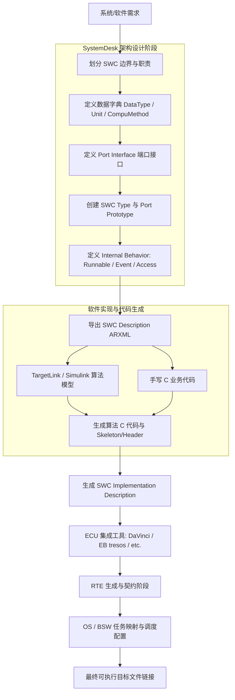

> 本指南主要面向基于 **dSPACE SystemDesk** 工具的 AUTOSAR Classic 软件组件建模实践。

dSPACE 官方将 SystemDesk 定位为 AUTOSAR 软件架构建模工具，用于创建 SWC、Composition、系统架构和 ECU 映射，并通过 ARXML 与其他工具交换 AUTOSAR 描述。在工程开发流中，SystemDesk 常与 TargetLink / Simulink 配合，完成 SWC 架构、算法模型、代码和 ARXML 之间的往返开发，或者作为手写代码的上层架构约束输出端，本指南侧重后者。

## SWC 建模全景工作流

软件组件建模是 AUTOSAR V 流程系统设计向具体软件开发过渡的关键纽带。完整的开发闭环如下图所示：



## AUTOSAR 对象层次

### Package

**Package** 是 AUTOSAR 对象的组织容器，相当于编程语言中的命名空间或文件系统的目录层级。合理的分包结构不仅便于在 SystemDesk 树状视图中检索，更有利于后续 ARXML 文件的模块化拆分、版本管理以及跨项目复用。

推荐的标准项目分包结构：

```text
/MyProject
    /DataTypes
        /ApplicationDataTypes
        /ImplementationDataTypes
        /CompuMethods
        /Units

    /PortInterfaces
        /SenderReceiver
        /ClientServer
        /ModeSwitch

    /ComponentTypes
        /Applications
        /Compositions

    /Implementations

    /Systems
```

在 SystemDesk 中，右键点击 Package 即可创建各类 AUTOSAR 对象：

![[systemdesk-cp-objects.png]]

### Application SW Component Type

这是普通的应用软件组件类型，也就是你最常创建的 SWC-T。承载具体业务功能算法（如车速控制、电池管理、热管理、车身门控等），与底层硬件完全解耦。SWC Type 里面主要包含：

```text
ApplicationSwComponentType
 ├─ Port Prototypes
 │  ├─ P-Port
 │  └─ R-Port
 └─ Internal Behavior
    ├─ Runnables
    ├─ Events
    ├─ Data Access
    ├─ Server Call Points
    └─ SWC Implementation
```

### Composition SW Component Type

SWC 的逻辑组合容器，内部包含多个 SWC 实例，并通过 Connector 描述实例间的 Assembly 连接和端口向外暴露的 Delegation 连接。Composition 用来表达组件如何组装，不替代 SWC Type 的接口或 Internal Behavior。如果现阶段只交付单一功能 SWC，可以先不创建 Composition；进入系统集成时再补齐组合和连接关系。

## 建模步骤

### 第一步：数据字典建模

在定义任何接口之前，必须先建立严格的数据字典。AUTOSAR 4.x 将数据定义清晰地区分为 **应用层物理语义** 与 **底层实现语义** 两个世界。

```text
Application Data Type (0~300 km/h)
      │
      ├──> Compu Method (Raw * 0.01 = Physical)
      │         │
      │         └──> Unit (km/h)
      │
      ▼ 
Implementation Data Type (uint16, typedef)
```

#### 三类核心数据定义

| 数据对象 | 核心职责 | 工程示例 |
|---|---|---|
| **Application Primitive Data Type (ADT)** | 描述物理含义与有效范围，不绑定具体编程语言数据格式 | `VehicleSpeed_T`: 物理范围 `0.0 ~ 300.0`，物理单位 `km/h` |
| **Implementation Data Type (IDT)** | 描述最终 C 代码和内存布局，决定变量的实际字节大小与符号性 | `uint16`, `float32`, `boolean`，对应基础标准类型头文件 |
| **Compu Method** | 描述底层原始数值（Raw/Internal Value）与工程物理值（Physical Value）之间的转换算式 | 原始值 `0 ~ 30000`，系数 `0.01`，偏移 `0`，换算为 `0.0 ~ 300.0 km/h` |
| **Unit** | 规范物理量单位，防止单位混淆 | `km/h`, `degC`, `rpm`, `V`, `A` |

### 第二步：端口与接口定义

#### 层次结构与关系总览

```text
SWC (Component Type)
 └─ Port Prototype (Rp... / Pp...)
      └─ Port Interface (S/R, C/S, Mode, etc.)
           └─ Data Element / Operation / Mode Declaration Group
                └─ Data Type (ADT / IDT)
```

- **Port Interface** 是抽象的契约模板（定义了传什么数据或提供什么操作）
- **Port Prototype** 是 SWC 上的具体交互端口（实例化该契约，并指明方向：R-Port 或 P-Port）

#### 常见 Interface 类型及其工程语义

##### Sender-Receiver Interface (S/R) - 数据流通信

应用层 SWC 最普遍的接口，用于周期性或事件驱动的数据流传递（如传感器读数、控制目标值、状态标记）：
- **组成**：包含一个或多个 `Data Element`。
- **传输模式**：
  - **Unqueued（默认，非队列）**：覆盖写入，接收端永远只能读取最新值，适合连续物理量。
  - **Queued（队列）**：按 FIFO 暂存多条数据，适合事件或需逐条处理的数据；队列容量有限，必须设计队列满时的处理策略，不能默认认为数据永不丢失。
- **初值 (Init Value)**：按接口和 RTE 配置为接收数据定义初始值或初始化行为，降低首个有效数据到达前的不确定性。初值不等于已收到有效数据，应用仍应处理数据可用性和超时状态。
- **典型 RTE 代码**：
  ```c
  /* 接收端读取 (R-Port) */
  Std_ReturnType status = Rte_Read_RpVehicleSpeed_VehicleSpeed(&speed);

  /* 发送端输出 (P-Port) */
  Rte_Write_PpTorqueRequest_TorqueRequest(torque);
  ```

##### Client-Server Interface (C/S) - 服务请求与响应

用于函数式过程调用（RPC）。Client 端请求操作，Server 端响应并执行该操作：
- **组成**：包含一个或多个 `Operation`。每个 Operation 定义 `IN`、`OUT` 或 `INOUT` 参数，并可声明 `ApplicationError` 错误码；错误码不是普通输出参数，具体由 RTE 调用接口的返回语义承载。
- **同步/异步**：
  - **同步调用**：Client 等待服务端操作返回结果；调用耗时和服务端调度会影响 Client 的执行时间。
  - **异步调用**：Client 发起请求后先返回，之后通过 `Rte_Result()` 获取结果；模型需配置匹配的异步调用点和完成处理路径，具体通知机制依赖 RTE 配置和实现。
- **典型 RTE 代码**：
  ```c
  /* Client 端调用服务 (R-Port) */
  Std_ReturnType ret = Rte_Call_RpNvService_ReadData(blockId, buffer);
  ```

##### Mode Switch Interface - 模式切换通知

用于向 SWC 广播明确的系统/运行模式（如上下电管理、ECU 降级模式、网络管理状态）。

```text
VehicleModeDeclarationGroup
 ├─ STARTUP
 ├─ NORMAL
 ├─ DEGRADED
 └─ SHUTDOWN
```

> **架构设计准则**：如果数据表达的是 SWC 的运行模式，优先评估 Mode Switch Interface，而不是仅用 S/R 传递一个 `uint8` 枚举值。Mode Switch 除了传递模式值，还定义了模式声明和切换语义，可与 ModeSwitchEvent、模式访问及 Runnable 禁用依赖等配置协同。若需求只是传递普通枚举数据，S/R 仍然合适。

### 第三步：内部行为建模（Internal Behavior）

创建完 Ports，SWC 依然只是一个无业务逻辑的“黑盒外壳”。必须通过 **Internal Behavior** 为其赋予血肉。下图是 IB 配置窗口，核心是 Runnable：

![[systemdesk-internal-behavior-setting.png]]

Runnable（可运行实体）是 RTE 可通过事件触发的执行单元。在 C 语言层面，Runnable 通常映射为一个 C 函数符号（`Symbol`）；RTE 再依据事件、任务映射和系统调度配置安排其执行，Runnable 并不等同于一个独立 OS Task。

#### Runnable 和 Port 的关系

初学者建模时常有一种误解：“给 SWC 创建了 Port，内部的 Runnable 就能自动收发数据”。实际上，**Port 只是 SWC 暴露给外部世界的通信端点，而 Runnable 是内部的代码执行入口**。两者之间的绑定关系必须在 `InternalBehavior` 中显式定义。

先看整体概念拓扑：

```text
Application SWC
│
├── Ports (对外暴露的通信门面)
│   ├── R-Port (需求端口: 输入信号 / 外部服务请求)
│   └── P-Port (提供端口: 输出信号 / 本地服务响应)
│
└── Internal Behavior (内部实现细节)
    ├── Runnables (执行实体)
    ├── RTE Events (激活触发源)
    ├── Data Access Points (变量读写访问点)
    └── Server Call Points (服务调用点)
```

> **核心原则**：Runnable 的访问点关联到 Port Interface 中具体的 **Data Element、Operation 或 Mode**，而不是直接对整个 Port 执行业务读写。

在实际工程中，Runnable 与 Port 之间主要演化出以下**三种经典拓扑关系**：

```text
关系一 (数据流动):  Runnable ──[Data Access: Read/Write]──> S/R Port (Rp / Pp)
关系二 (发起调用):  Runnable ──[Server Call Point]─────────> C/S R-Port
关系三 (被动响应):  C/S P-Port ─[OperationInvokedEvent]────> Server Runnable
```

##### 1. 数据交互关系：通过 Data Access 关联 Sender-Receiver Port

- **场景角色**：Runnable 作为数据的**消费者**（读取输入）或**生产者**（发布输出）。
- **绑定载体**：Runnable 的 `Data Access`（在 SystemDesk 中对应 Data Read/Write Access 页签）。
- **架构流向**：

```text
[R-Port: RpVehicleSpeed] (Interface: VehicleSpeed_I)
        └── Data Element: VehicleSpeed
                  ▲
                  │ 关联配置 (Read Access)
       [Runnable: Control_10ms]
                  │ 关联配置 (Write Access)
                  ▼
[P-Port: PpTorqueRequest] (Interface: Torque_I)
        └── Data Element: TorqueRequest
```

- **代码与 RTE 影响**：
  Data Access 配置决定 Runnable 可用的访问语义和 RTE API。Implicit Read/Write 通常对应 `Rte_IRead`/`Rte_IWrite`；Explicit Read/Write 通常对应 `Rte_Read`/`Rte_Write`。若未在 Internal Behavior 中声明相应访问点，生成的 RTE 契约通常不会提供该 Runnable 所需的访问接口。下面是 Explicit Access 的调用示例：

```c
/* 读取关联的 R-Port 数据元素 */
Std_ReturnType ret = Rte_Read_RpVehicleSpeed_VehicleSpeed(&vehicleSpeed);

/* 写入计算结果至关联的 P-Port 数据元素 */
(void)Rte_Write_PpTorqueRequest_TorqueRequest(targetTorque);
```

##### 2. 服务发起关系：通过 Server Call Point 关联 Client R-Port

- **场景角色**：Runnable 作为 **Client 端**，在执行业务逻辑时主动请求外部构件/BSW 提供的功能服务（例如读取 NvM 存储块、请求诊断服务、触发硬件执行机构）。
- **绑定载体**：Runnable 的 `Server Call Points`（SystemDesk 中对应 Operations/Server Call Points 页签）。
- **架构流向**：

```text
[Runnable: App_SaveData] (扮演 Client)
         │
         ▼ 声明 Server Call Point
[R-Port: RpNvMService] (Client-Server Interface)
         └── Operation: ReadBlock(...)
                  │ (跨 SWC / 跨层 RPC 调用)
                  ▼
              RTE 路由分发
```

- **代码与 RTE 影响**：
  RTE 按调用点的同步/异步配置生成相应接口。同步调用等待操作结果；异步调用通常由 `Rte_Call()` 发起，再通过 `Rte_Result()` 获取结果，并可配置异步返回事件来激活后续处理：

```c
/* 当前 Runnable 主动发起服务调用 (Client 角色) */
Std_ReturnType status = Rte_Call_RpNvMService_ReadBlock(BLOCK_ID, dataBuffer);
```

##### 3. 服务响应关系：通过 OperationInvokedEvent 关联 Server P-Port

- **场景角色**：Runnable 作为 **Server 端**，本身不主动执行，而是被动等待外部 Client 调用本 SWC 提供的服务。
- **绑定载体**：**RTE Events 体系中的 `OperationInvokedEvent`**。
- **架构流向**：

```text
外部 Client 发起调用请求
         │
         ▼
[P-Port: PpDid5005] (Client-Server Interface)
         └── Operation: ReadData(...)
                  │
                  ▼ 触发对应的事件
         [OperationInvokedEvent]
                  │ 激活绑定的服务端函数
                  ▼
[Server Runnable: UDS_Did_5005_ReadData]
```

- **关键辨析**：
  Server Runnable 与 P-Port 的关联**并不配置在 Data Access 页签**，而是通过 **Triggered by (激活源)** 绑定到 `OperationInvokedEvent`。
  当外部调用到达该 P-Port 的对应 Operation 时，RTE 按事件和调度配置激活 Server Runnable；操作完成后，RTE 按同步或异步调用语义将结果交还 Client。

##### 快速决策速查

| 交互诉求 | 涉及端口 | 关联机制 (在 SystemDesk 中的配置位置) | 典型生成的 RTE 语义 |
|---|---|---|---|
| **获取外界输入信号** | S/R R-Port | Runnable $\rightarrow$ `Data Access` $\rightarrow$ 按需配置 Read 或 Receive | Implicit Read 为 `Rte_IRead`；Explicit Read 为 `Rte_Read`；Queued 接收为 `Rte_Receive` |
| **向外界发布计算结果** | S/R P-Port | Runnable $\rightarrow$ `Data Access` $\rightarrow$ 按需配置 Write 或 Send | Implicit Write 为 `Rte_IWrite`；Explicit Write 为 `Rte_Write`；Queued 发送为 `Rte_Send` |
| **主动请求外部功能/服务** | C/S R-Port | Runnable $\rightarrow$ `Operations` (Server Call Points) | `Rte_Call_<Port>_<Operation>()` |
| **承接并执行外部发来的操作** | C/S P-Port | InternalBehavior $\rightarrow$ `RTE Events` (`OperationInvokedEvent`) $\rightarrow$ 绑定此 Runnable | 被调用入口：`Runnable_Symbol(...)` |

#### Runnable 与普通 C 函数的区别

```text
SWC
├── AUTOSAR RTE 暴露层 (在 ARXML 中声明)
│   ├── Runnable: Temperature_Init
│   └── Runnable: Temperature_10ms
│
└── C 内部私有实现层 (仅在 .c 内部，无需在 ARXML 建模)
    ├── FilterSensorNoise()
    ├── CheckBoundaryLimits()
    ├── LinearInterpolation()
    └── FloatToFixed()
```

| 维度 | AUTOSAR Runnable | 普通 C 函数 / Helper Function |
|---|---|---|
| **调度入口** | 由 RTE Event 激活，并由 RTE/OS 配置映射到执行上下文 | 由内部代码直接调用，不被 RTE 感知 |
| **ARXML 声明** | 必须有 `RUNNABLE-ENTITY` 元素与配置 | 无需在 ARXML 中体现 |
| **端口数据访问** | 需配置 Access Point 才能使用 `Rte_Read/Write` | 只能通过入参或全局变量传递数据 |
| **系统开销** | 占用 RTE 调度上下文与栈开销 | 普通栈帧调用，开销极低 |

#### Runnable 划分决策

> 不要把每个子函数都建模成 Runnable。Runnable 会参与 RTE 契约、事件和调度配置；过度拆分会增加配置复杂度与运行时开销，但 Runnable 不一定各自对应 OS Task 或任务切换。

在决定是否为一个功能新建 Runnable 时，只需问一个核心问题：

> **“这个函数是否需要拥有独立的 AUTOSAR 执行语义？”**

以下情况可作为是否建模为独立 Runnable 的判断依据（满足其一即可评估，仍需结合调度和并发约束）：

1. **独立触发源或执行周期**：例如 10ms 与 100ms 周期执行，或由数据/操作事件触发
2. **独立服务入口**：作为 Server 响应外部 Client-Server Operation 请求（通过 `OperationInvokedEvent` 激活）
3. **独立模式响应**：在特定模式进入（Entry）或退出（Exit）时单独激活/挂起
4. **独立 Task 映射需求**：该功能属于高优先级核心控制回路，需要独占分配到高优先级 OS Task
5. **独立并发与互斥控制**：具有特殊的并发（`canBeInvokedConcurrently`）或临界区隔离需求
6. **独立的数据一致性边界**：需要为该 Runnable 的数据访问配置隐式读写或其他一致性语义

如果一个函数仅仅是为了**拆分代码长短、算法分步、提高复用性或改善可读性**，它只是**普通私有函数**，不能建模为 Runnable。

#### RTE Events：何时激活 Runnable

Event 决定了 Runnable 在什么时刻、由谁来触发运行：

| Event 类型 | 典型应用场景 | 对应的 Runnable 角色 |
|---|---|---|
| **TimingEvent** | 1ms、5ms、10ms、100ms 等固定周期任务；周期按 ARXML 时间单位配置（示例 `0.01s` 为 10ms） | 周期算法主函数（如 `Ec_MainFunction`） |
| **InitEvent** | 上电或模块复位后的单次初始化逻辑 | 初始化函数（如 `Ec_Init`） |
| **DataReceivedEvent** | 指定的 R-Port 收到新数据后触发 RTE Event，由调度配置安排执行 | 事件驱动型接收处理函数 |
| **OperationInvokedEvent** | 外部 Client 调用了本 SWC 提供的 Server 接口 | Server 端处理函数（如 `Uds_ReadData_Op`） |
| **ModeSwitchEvent** | 系统切换到特定模式（On Entry / On Exit）时触发 | 模式切换处理函数（如 `OnEnter_Sleep`） |
| **BackgroundEvent** | 系统空闲时运行 | 低优先级后台巡检或自检任务 |

对应 Event 需要先在该 Internal Behavior 的 RTE Events 中配置。

![[systemdesk-rte-events.png]]

定义 Event 只是建模 Runnable 的触发条件，不会自动完成 ECU 的 OS Task 分配。集成时还要检查 RTE 生成的任务映射、任务优先级和周期、Runnable 的可重入性及共享数据保护，确保实际调度满足响应时间和资源约束。

#### Data Access 访问模式

在 SystemDesk 中为 Runnable 关联端口数据时，应理解不同访问选项对应的 RTE 语义。图中选项展示的是工具的配置界面；最终生成的 API 还受 AUTOSAR 配置和 RTE 实现影响。

Implicit Access 通常在 Runnable 执行边界建立读写数据的快照/缓冲语义，有助于定义一致性，但可能带来复制开销；Explicit Access 在代码调用 RTE API 时访问数据，时机更灵活，但应用需考虑多次读写之间的数据变化。是否采用队列、显式接收或隐式访问，应按数据是否需要逐条保留、事件触发方式及一致性要求决定。

##### Receiver Port

![[systemdesk-rp-access-options.png]]

| Access/Direction | 典型 RTE 接口 | 适用场景与注意事项 |
|---|---|---|
| Read（Implicit） | `Rte_IRead_xxx()` | Runnable 内读取隐式数据快照；常用于周期性消费 |
| Receive by value | `Rte_Receive_xxx()` | 从 Queued 接口逐条接收；按工具生成的接口签名传递数据 |
| Receive by argument | `Rte_Receive_xxx(&value)` | 从 Queued 接口逐条接收；通过参数写入较大数据对象 |
| Read + Receive 组合 | 同时生成对应的读取接口 | 仅在同一端口确实需要两种访问语义时配置；使用代码和模型配置保持一致 |

##### Provider Port

![[systemdesk-pp-access-options.png]]

| Access/Direction | 典型 RTE 接口 | 适用场景与注意事项 |
|---|---|---|
| Write（Implicit） | `Rte_IWrite_xxx()` | 写入 Runnable 的隐式输出缓冲；常用于周期性输出 |
| Send | `Rte_Send_xxx()` | 向 Queued 接口发送一条数据；按队列语义处理接收 |
| Write + Send | 同时生成对应的写入接口 | 仅在同一端口确实需要两种访问语义时配置；不能将两种语义视为等价 |

#### Server Call Point：如何调用外部服务

当 Runnable 需要作为 Client 主动请求外部操作时，需要在 Runnable 下建立 **Server Call Point**：

![[systemdesk-runnable-operation.png]]

```text
Runnable
 └─ Server Call Points
      └─ RpNvMService.ReadBlock (引用 R-Port 及其具体 Operation)
```

- **同步调用**：配置为 Synchronous 时，通过 `Rte_Call_<Port>_<Op>()` 调用并等待操作结果返回。
- **异步调用**：配置异步调用点后，通过 `Rte_Call()` 发起请求，再用 `Rte_Result()` 获取结果；模型还需定义异步返回后的处理方式。

### 第四步：实现描述

SWC 建模完成内部行为后，如果需要将模型交接给具体代码实现或编译器，需要创建 `Swc Implementation`。

```text
ApplicationSwComponentType 声明架构与接口
        │
        ▼ describes architecture
SwcInternalBehavior 声明调度事件、数据访问与执行入口
        │
        ▼ implemented by
SwcImplementation 声明编译属性、代码依赖与源码交接
        │
        ▼ maps to
C Source Code (*.c) / Headers (*.h) / Object / Library
```

- Code Descriptors：按工具链支持配置源文件、头文件或其他实现制品的引用信息；实际文件名和路径应与交付包及构建工程一致
- Resource Consumption：仅在项目和工具链使用时填写相应资源描述；Memory Section、链接段和执行时间预算通常还需在实现、编译器、链接器及 ECU 集成配置中共同定义，不能仅靠 SWC 建模项保证
- 交接提示：若前期仅做纯架构接口定义，把 ARXML 交由算法团队（如 Matlab/TargetLink）去生成算法代码，可在算法模型定型生成代码后再行补全 SwcImplementation

## 工程实战案例

### `TemperatureMonitor`

#### 1. 功能需求

- 周期 10 ms 采样温度数据。
- 上电时复位报警状态。
- 如果温度高于报警阈值（$100^\circ\text{C}$），输出 `OverTemperature = TRUE`，否则输出 `FALSE`。

#### 2. 对象建模结构树

```text
DataTypes
 ├─ Temperature_T (ADT, 0~150 degC) --> uint16 (IDT)
 └─ Boolean_T (ADT) --> boolean (IDT)

PortInterfaces
 ├─ Temperature_I (Sender-Receiver)
 │    └─ Temperature: Temperature_T
 └─ OverTemperature_I (Sender-Receiver)
      └─ OverTemperature: Boolean_T

ComponentTypes
 └─ TemperatureMonitor (ApplicationSwComponentType)
      ├─ R-Port: RpTemperature (Interface: Temperature_I)
      ├─ P-Port: PpOverTemperature (Interface: OverTemperature_I)
      └─ SwcInternalBehavior
           ├─ Runnable: TemperatureMonitor_Init (Symbol: TemperatureMonitor_Init)
           │    └─ Triggered by: InitEvent
           │
           └─ Runnable: TemperatureMonitor_10ms (Symbol: TemperatureMonitor_10ms)
                ├─ Triggered by: TimingEvent_10ms (Period: 0.01 s)
                ├─ Data Read Access: RpTemperature.Temperature
                └─ Data Write Access: PpOverTemperature.OverTemperature
```

#### 3. 期望生成的 C 代码框架

```c
#include "Rte_TemperatureMonitor.h"

#define TEMPERATURE_LIMIT (10000U) /* 100.00 degC；假设代码使用 0.01 degC 为单位的整数内部值 */

void TemperatureMonitor_Init(void)
{
    /* 上电初值输出 */
    (void)Rte_Write_PpOverTemperature_OverTemperature(FALSE);
}

void TemperatureMonitor_10ms(void)
{
    Temperature_T temperature = 0U;
    Boolean_T overTempFlag = FALSE;
    Std_ReturnType ret;

    /* 1. Explicit Access 示例；Data Access 配置需与此 API 匹配 */
    ret = Rte_Read_RpTemperature_Temperature(&temperature);
    if (ret == RTE_E_OK)
    {
        /* 2. 执行逻辑判断 */
        if (temperature > TEMPERATURE_LIMIT)
        {
            overTempFlag = TRUE;
        }
        else
        {
            overTempFlag = FALSE;
        }

        /* 3. 显式输出超温状态 */
        (void)Rte_Write_PpOverTemperature_OverTemperature(overTempFlag);
    }
}
```

### `EcControl`

在复杂的控制器中，一个 MainFunction 通常同时汇聚多路数据输入、算法决断、调用底层执行器驱动服务并反馈状态。

下图展示了在 SystemDesk 中为 `Ec_MainFunction` 配置各项 `Data Read Access` 与 `Data Write Access` 的典型设置视图：

![[systemdesk-ec-main.png]]

下图展示了该 Runnable 绑定的触发事件 `TimingEvent_10ms` 以及调用的底层驱动服务 `Server Call Points`：

![[systemdesk-ec-main-ops.png]]

## 项目命名建议

| 对象分类 | 命名模板 | 实例 | 说明 |
|---|---|---|---|
| **SWC Type** | `<Module>_<Function>_Swc` | `ThermalControl_Swc`, `ChassisCoordinator_Swc` | 明确功能语义，带 `_Swc` 后缀区分类型 |
| **R-Port** | `Rp<DataOrService>` | `RpVehicleSpeed`, `RpNvMService` | `Rp` 前缀表示 Required 端口 |
| **P-Port** | `Pp<DataOrService>` | `PpTorqueRequest`, `PpAutoDimStatus` | `Pp` 前缀表示 Provided 端口 |
| **PR-Port** | `Prp<DataOrService>` | `PrpVehicleMode` | 提供且接收的双向端口 |
| **S/R Interface** | `<DataName>_I` 或 `<DataName>_SR_I` | `VehicleSpeed_I`, `MotorTemperature_SR_I` | `_I` 结尾标明接口 |
| **C/S Interface** | `<ServiceName>_CSI` | `NvMService_CSI`, `EcDrive_CSI` | `_CSI` 标明 Client-Server 接口 |
| **Data Element** | `<PascalCase>` | `VehicleSpeed`, `MotorTemperature` | 大驼峰，准确表达物理量业务名 |
| **Operation** | `<Verb><Object>` | `ReadBlock`, `SetEcPwmDuty` | 动宾结构表达执行动作 |
| **Runnable** | `<Module>_<Period/Event>` | `Ec_MainFunction_10ms`, `Ec_Init`, `Uds_ReadData_Op` | 包含模块名与触发源/执行周期 |
| **RTE Event** | `TE_<Runnable>_<Period>` / `OIE_...` | `TE_Ec_MainFunction_10ms`, `OIE_ReadBlock` | 前缀标明 Timing/Operation 类型 |

## SystemDesk 建模 Checklist

在完成 SWC 建模并准备导出 ARXML 前，可用以下检查项核对模型、代码契约和集成配置：

- [ ] **1. ADT-IDT 映射完整性**：所有用到的 `ApplicationDataType` 是否已在 `DataTypeMappingSet` 中映射到有效的 `ImplementationDataType`？
- [ ] **2. Runnable Symbol 合法性**：每个 Runnable 的 `Symbol` 是否为合法且不冲突的 C 标识符，并与实现中的函数定义一致？
- [ ] **3. Event 绑定有效性**：Runnable 是否绑定了符合需求的 Event？周期是否与调度设计一致（示例 `0.01s` 表示 10ms）？不要把事件周期误认为最终 OS Task 周期或端到端响应时间。
- [ ] **4. Server Runnable 触发方式**：提供服务的 Server 端 Runnable 是否正确绑定了 `OperationInvokedEvent`，而不是误配成了 TimingEvent？
- [ ] **5. Data Access 与 API 一致**：Runnable 的 Data Access 配置是否与实现中使用的 Implicit、Explicit 或 Queued API 相匹配？缺少相应访问点可能导致契约生成或 RTE 校验失败。
- [ ] **6. 首值和数据有效性**：需要初始值时是否按接口/ComSpec/RTE 配置初始化？应用是否区分初始值与有效接收数据，并处理超时或数据不可用？
- [ ] **7. 避免滥用 Runnable**：内部辅助算法函数是否已被排除在 Runnable 之外？SWC 的 Runnable 数量是否已做到尽可能收敛精简？
- [ ] **8. 区分 Explicit 与 Implicit**：根据访问时机、数据一致性和执行开销选择访问语义；Implicit Access 可能涉及 Runnable 边界的数据快照，Explicit Access 则通过调用 API 读取或写入，不能简单认为其中一种总是更快。
- [ ] **9. 内部共享变量安全性**：同一个 SWC 内部被多个 Runnable 访问的共享全局变量，是否配置为了 `Inter-Runnable Variable (IRV)` 或在 `Exclusive Area` 中保护？
- [ ] **10. Package 层次整洁**：导出的 ARXML 是否按照约定的分包路径存放，没有杂乱无章散落在 Root Package 下？