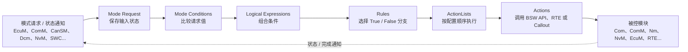
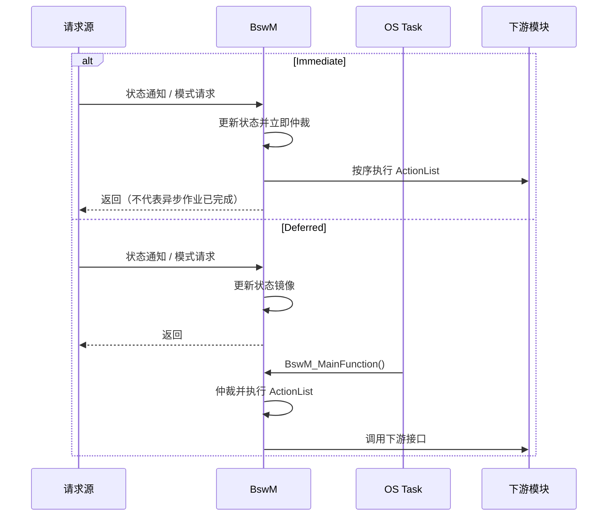
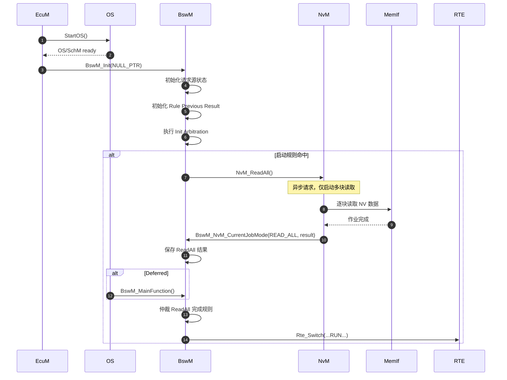
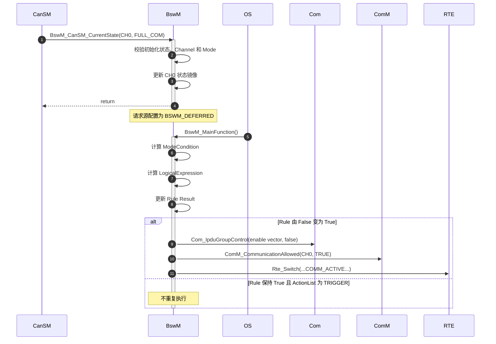
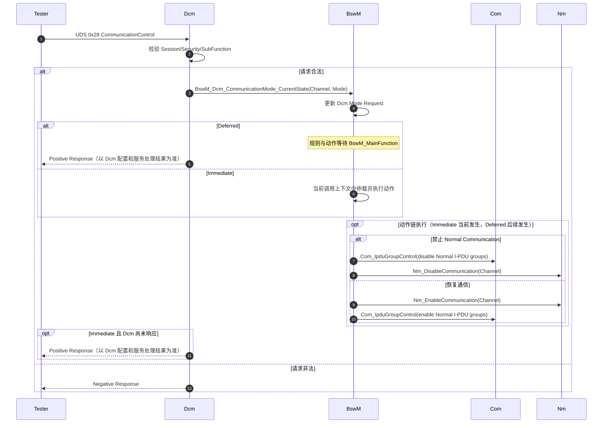
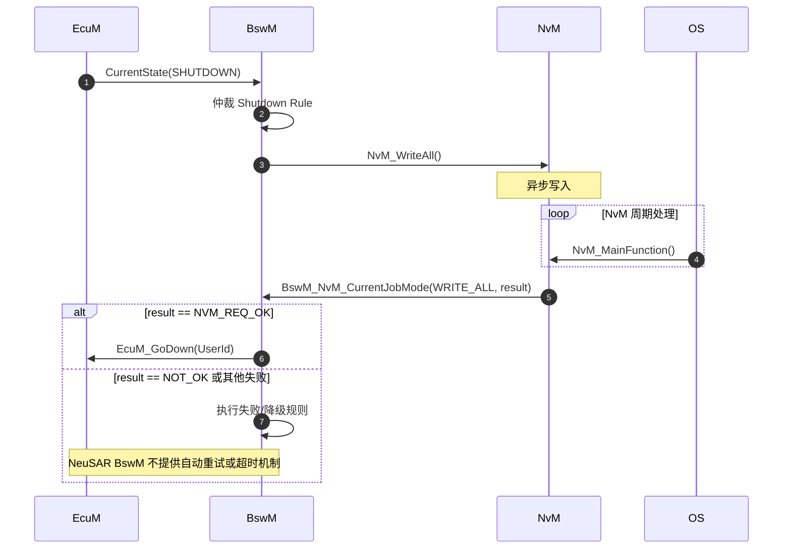

BswM 是 ECU 内部的==模式决策与动作编排器==：它把来自 SWC、[[EcuM]]、[[ComM]]、[[CanSM]]、[[Dcm]]、[[NvM]] 等模块的离散状态或模式请求，转换成规则判断，并按确定顺序调用其他模块的控制接口。它解决的核心问题不是“保存状态”，而是：

- 避免各 BSW 模块互相直接耦合形成网状依赖
- 把启动、休眠、通信控制、诊断抑制、NvM 存取等系统级策略集中配置
- 将`状态输入 → 条件判断 → 动作序列`固化为可生成、可审查的规则网络

因此，BswM 更接近配置驱动的规则引擎和动作调度器，而不是拥有固定状态集合的传统有限状态机。它负责作出策略决策并发出动作，不负责保存业务数据，也不保证被调用模块最终完成请求。

这条链路描述的是策略控制而非事务保证：请求方提供输入，BswM 作出仲裁并发出动作；被控模块的实际状态或异步作业结果通常需要通过后续通知再次进入规则链。

## 核心模型与运行方式

### 运行模型

BswM 的一次处理可分为三个阶段：

1. **接收输入**：上游模块通过通知接口或模式请求接口提交状态；BswM 更新对应的内部状态镜像。
2. **仲裁规则**：Immediate 请求在当前调用上下文中仲裁；Deferred 请求等待 `BswM_MainFunction()`。BswM 根据请求值计算 ModeCondition、LogicalExpression 和 Rule。
3. **执行动作**：Rule 结果决定选择 True 或 False ActionList；ActionList 按配置顺序执行其中的 Action。具体执行时机还受 ActionList 的 `CONDITION`/`TRIGGER` 策略和初始化状态影响。

请求接口返回只表示这次 BswM 调用已处理，不代表异步动作（例如 NvM 作业）已经完成。Deferred 模式下，如果同一请求源在两次仲裁之间多次更新，规则通常依据仲裁时保存的最新状态计算，不能假定每个中间状态都会逐一触发动作。

## 与其他模块的接口

### 输入侧接口契约

从规则建模角度，可以把外部输入统一看作 **Mode Request**；这是一种逻辑抽象，不意味着所有模块都使用同一个 API 或同一种语义。输入可能是“请求”，也可能只是“当前状态指示”，实际接口由模块和生成配置决定。

| 上游模块     | 典型输入接口                                               | BswM 保存的信息                     | 关键契约                                              |
| ------------ | ---------------------------------------------------------- | ----------------------------------- | ----------------------------------------------------- |
| CanSM        | `BswM_CanSM_CurrentState()`                                | 某 CAN Channel 当前模式，如 BUS-OFF | `NetworkHandle` 必须与 `BswMCanSMChannelRef` 映射一致 |
| ComM         | `BswM_ComM_CurrentMode()`                                  | Channel 的 NO/SILENT/FULL 通信模式  | 通道引用必须与 `ComMChannel` 一致                     |
| EcuM         | `BswM_EcuM_CurrentState()`、`BswM_EcuM_CurrentWakeup()`    | ECU 状态及唤醒源状态                | 必须在 BswM 初始化后调用                              |
| Dcm          | `BswM_Dcm_CommunicationMode_CurrentState()`                | UDS 0x28 导出的通信控制模式         | BswM 只负责执行通信控制，诊断合法性仍由 Dcm 判断      |
| NvM          | `BswM_NvM_CurrentJobMode()`、`BswM_NvM_CurrentBlockMode()` | 多块作业或单块作业结果              | 这是异步 NvM 作业的完成状态输入，不是实际数据传输     |
| LinSM/LinTp  | `BswM_LinSM_CurrentState()`、`BswM_LinTp_RequestMode()`    | LIN 状态或诊断调度表需求            | Channel 与 Schedule 引用必须一致                      |
| Sd           | Client/EventGroup/EventHandler 状态通知接口                | SOME/IP-SD 服务和事件组状态         | HandleId 必须匹配 Sd 配置                             |
| SWC/RTE      | `Rte_Read`、`Rte_Mode` 或通用请求                          | 应用模式输入                        | 依赖 RTE 端口和数据类型映射                           |
| 非标准请求方 | `BswM_RequestMode()`                                       | `requesting_user` 对应的自定义模式  | 请求者 ID 必须匹配 `BswMModeRequesterId`              |

- 上游接口多为同步的状态通知函数；是否可重入取决于具体接口和配置。“接口同步”不代表系统级动作立即完成
- 对 Deferred 请求，接口通常只更新 BswM 内部镜像，真正仲裁在下一次 `BswM_MainFunction()` 中发生
- 对 Immediate 请求，调用栈可能直接进入规则仲裁和 ActionList，因而接口最坏执行时间取决于整个动作链
- 同步调用也不自动保证并发安全；需结合 BswM 的重入配置、OS 任务优先级和调用路径，检查并发更新、嵌套回调及循环触发

### 输出侧接口契约

BswM 不直接操作总线控制器或 NVRAM 硬件，而是通过 Action 调用其他 BSW 模块的高层接口：

| 下游模块 | 典型动作/API                                                               | BswM 的责任边界                                             |
| -------- | -------------------------------------------------------------------------- | ----------------------------------------------------------- |
| Com      | `Com_IpduGroupControl()`、`Com_ReceptionDMControl()`                       | 组织 I-PDU Group Vector，控制应用报文和 Deadline Monitoring |
| ComM     | `ComM_CommunicationAllowed()`、`ComM_RequestComMode()`                     | 允许通信或请求用户通信模式                                  |
| Nm       | `Nm_EnableCommunication()`、`Nm_DisableCommunication()`                    | 控制 NM 报文通信                                            |
| EcuM     | `EcuM_SelectShutdownTarget()`、`EcuM_GoDown()`、`EcuM_GoHalt()`/`GoPoll()` | 选择并触发关机、复位或睡眠流程                              |
| NvM      | 常通过 `BswMUserCallout` 调用 `NvM_ReadAll()`、`NvM_WriteAll()`            | 只发起异步作业，完成结果由 NvM 再通知回来                   |
| LinSM    | `LinSM_ScheduleRequest()`                                                  | 请求切换 LIN Schedule                                       |
| Sd       | `Sd_ClientServiceSetState()`、`Sd_ServerServiceSetState()` 等              | 控制服务实例或 EventGroup 状态                              |
| RTE/SWC  | `Rte_Switch_<...>()`                                                       | 向应用发布模式变化                                          |
| 用户代码 | `BswMUserCalloutFunction`                                                  | 扩展标准动作；返回值是否参与错误处理取决于具体实现          |

边界原则：BswM 负责“决定调用什么、以什么顺序调用”，不负责保证被调模块最终成功。

### 接口关系

![[bswm-interfaces.png]]

## 规则对象与请求处理

### 内部数据组织

BswM 的配置关系可以抽象为六层：

1. **Mode Request Port**
   - 保存某个外部请求源的最新状态
   - 决定采用 Immediate 还是 Deferred 仲裁
2. **Mode Condition**
   - 将一个请求源与目标值比较
   - NeuSAR 相关手册列出 `BSWM_EQUALS` 和 `BSWM_EQUALS_NOT`；其他实现的可用操作以其手册为准
3. **Logical Expression**
   - 用 `AND`、`OR`、`XOR`、`NAND` 组合多个条件或子表达式
   - 某些实现手册指出表达式内部的计算顺序未定义，因此不应依赖 C 语言式短路或求值顺序
4. **Rule**
   - 引用一个逻辑表达式
   - 根据 True/False 选择对应 ActionList
   - 保存上次仲裁结果，用于判断是否发生边沿变化
5. **ActionList**
   - 定义有序动作序列
   - `BSWM_CONDITION`：规则满足时，每次相应的仲裁都可能执行
   - `BSWM_TRIGGER`：仅在规则结果发生变化时执行
6. **Action**
   - 调用标准 BSW API、RTE Switch、用户 Callout，或者引用另一条 Rule

这里的“可能执行”很重要：ActionList 是否执行还取决于 Rule 的 True/False 结果、`BswMRuleInitState`、仲裁类型及具体配置。对于 `TRIGGER`，初始化值会影响首次仲裁是否被视为一次状态变化；设计时应显式核对上电后的初始结果和期望动作。

表达式由多个条件组成时，不应依赖未定义的内部求值顺序，也不应把某个条件的副作用作为另一个条件的前置条件。条件判断应保持无副作用，动作统一放在 ActionList 中。

### Immediate 与 Deferred 任务模型

**Immediate** 在请求方的当前调用上下文中完成“状态更新、规则仲裁和动作执行”。**Deferred** 的输入 API 仅更新状态镜像，规则仲裁和动作执行延迟到下一次 `BswM_MainFunction()`。

| 模式      | 请求接口返回前可能发生什么       | 主要收益                     | 主要代价与适用条件                                         |
| --------- | -------------------------------- | ---------------------------- | ---------------------------------------------------------- |
| Immediate | 仲裁规则并执行 ActionList        | 响应及时，调用路径清晰       | 整条动作链的 WCET 计入请求方；需避免阻塞、重入和回调环路   |
| Deferred  | 记录状态并返回；稍后由主函数仲裁 | 缩短请求方执行时间，集中处理 | 增加仲裁延迟；主函数两次调用间的多次更新可能只留下最新状态 |

若输入代表必须逐个处理的事件或脉冲，不能仅因更新频繁就选择 Deferred：先确认接口或上游机制能保留事件，不会因状态合并而丢失中间变化。

#### Immediate：请求上下文内完成仲裁

![[bswm-immediate.png]]

请求函数返回前，BswM 可能已经执行完整个 ActionList。因此需要把仲裁与动作链的最坏执行时间计入调用方预算，并确认动作不会阻塞、造成不可接受的优先级反转，或经回调再次进入 BswM 形成环路。

#### Deferred：主函数周期处理

![[bswm-deferred.png]]

输入函数通常只更新状态镜像；规则在后续 `BswM_MainFunction()` 中仲裁。它降低了上游调用的执行负担，但会增加响应延迟，并可能合并两次主函数调用之间的多次状态更新。应根据状态是否允许丢失中间变化来选择处理模式。

## 典型流程

### 启动初始化与 NvM ReadAll

架构关注点：

- 明确初始仲裁的配置和执行时机，并确认相关模块已处于可接收请求的状态
- `NvM_ReadAll()` 返回不代表 RAM Block 已经可用
- 必须以 `BswM_NvM_CurrentJobMode(NVM_READ_ALL, NVM_REQ_OK)` 或项目定义的可接受结果作为启动阶段放行条件
- 若规则仅接受 `NVM_REQ_OK`，则 `NVM_REQ_RESTORED_FROM_ROM` 是否允许进入 RUN 必须由项目策略明确
- 如果 ReadAll 失败后没有 FalseActionList 或故障降级路径，系统可能永远停留在初始化状态

### Deferred 通信状态仲裁

### UDS 0x28 通信控制

`BswM_Dcm_CommunicationMode_CurrentState()` 是状态通知，不等价于让 BswM 执行诊断合法性检查。Dcm 对请求的校验与正/负响应行为由 Dcm 服务处理和配置决定；BswM 的动作完成也不意味着底层通信模块已达到目标状态。

禁用通信时通常应考虑：

1. 停止应用报文
2. 再禁止 NM 通信

恢复时可考虑：

1. 恢复 NM
2. 再恢复应用 I-PDU Group

但具体顺序取决于网络管理和诊断响应要求。BswM 不会自动推导安全顺序，ActionList 的配置顺序就是实际调用顺序。

### 下电 WriteAll 与失败处理

BswM 只看见 NvM 报告的状态，不会自动实现：

- WriteAll 超时
- 自动重试次数
- 失败后强制下电
- 失败上报 Dem
- 关键块与非关键块差异化处理

这些需要由项目显式设计，例如使用实现支持的 BswM Timer、OS Alarm、用户 Callout 或专门的 Shutdown Manager，并定义超时后的安全策略。

## 配置要点

### BswMRequestProcessing

取值：

- `BSWM_IMMEDIATE`
- `BSWM_DEFERRED`

联动约束：

- Immediate 将整个 ActionList 的 WCET 加到请求方调用上下文
- Deferred 的最大仲裁延迟由 `BswMMainFunctionPeriod` 和 OS Task 抖动决定
- 高频、以“当前值”为语义的状态输入可考虑 Deferred；多个变化可能在主函数前合并为最新状态，事件/脉冲输入则须确认不会丢失
- Immediate 规则中的 Action 不应触发不可控的阻塞操作，也应避免经其他模块回调再次进入 BswM 形成环路

### BswMMainFunctionPeriod

该值必须与调用 `BswM_MainFunction()` 的 OS Task 实际周期一致。

联动约束：

- 决定 Deferred 请求的响应上界
- 决定 BswM Timer 的时间基准和误差
- 影响 Deferred 规则的仲裁频率；`CONDITION` ActionList 是否重复执行还取决于相关规则被仲裁的时机
- 影响主函数单周期 CPU 峰值
- 实际 Task 周期与配置值不一致时，Timer 会快走或慢走
- 响应上界还应计入 OS 调度延迟、主函数执行时间及下游模块处理时间；不能只用配置周期作为端到端完成时间

### BswMActionListExecution

取值：

- `BSWM_CONDITION`
- `BSWM_TRIGGER`

联动约束：

- `CONDITION` 要求列表中所有动作可重复执行，或下游 API 明确支持重复请求
- `TRIGGER` 与 `BswMRuleInitState` 联合决定第一次仲裁是否执行
- 对 NvM ReadAll/WriteAll、EcuM GoDown、一次性 RTE Start 等动作，应特别警惕 `CONDITION` 导致周期重复调用
- 对 TrueActionList 和 FalseActionList 都要检查触发条件；反向切换可能执行 FalseActionList，并非只有进入 True 时才有动作

推荐经验：

| 动作类型                       | 推荐策略                            |
| ------------------------------ | ----------------------------------- |
| 设置型、幂等型动作             | 可考虑 `CONDITION`                  |
| 启动作业、切换状态、一次性通知 | 优先 `TRIGGER`                      |
| 明确要求持续刷新               | `CONDITION`，但必须核算周期调用成本 |

## 配置评审清单

建模完成后，可按以下顺序做一次端到端检查：

1. **输入映射**：每个请求源的通道、用户 ID、HandleId 和模式值都与对应模块配置一致；确认首次输入发生在 BswM 初始化之后。
2. **规则覆盖**：分别检查 Mode Condition、逻辑表达式和 Rule 的正常、边界及失败状态；确认 False 分支有明确行为，而非意外静默。
3. **初始化行为**：核对请求源默认值、`BswMRuleInitState` 和 Init Arbitration 的执行顺序，验证上电后第一次仲裁是否会执行预期动作。
4. **动作安全性**：逐项检查 True/False ActionList 的顺序、重复调用安全性、错误处理和可能的重入；不能把 API 返回等同于下游状态已完成切换。
5. **实时性**：将 Immediate 动作链 WCET 纳入请求方预算；对于 Deferred，结合主函数周期、OS 抖动和仲裁执行时间评估延迟与 CPU 峰值。
6. **异步闭环**：针对 NvM、通信切换等异步动作，确认完成/失败通知可回到 BswM，并为失败、超时及无法恢复的情况配置降级路径。
7. **版本与实现**：对照项目采用的 AUTOSAR 版本、供应商手册和生成代码，确认接口名、支持的 Action 类型及错误处理语义。

本文中标注 NeuSAR 的行为来自对应实现资料，不应直接推广为所有 AUTOSAR BswM 实现的通用保证；具体行为以项目采用的版本、供应商手册及生成配置为准。
