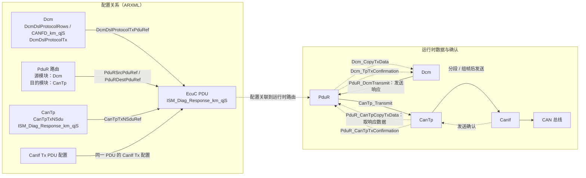

## 1. 模块定位

CanTp 位于 [[PduR]] 与 [[CanIf]] 之间，负责诊断数据在 CAN/CAN FD 上的分段、重组、流量控制和超时管理。

```text
Dcm / Cdd / DoIP
       |
      PduR
       |
     CanTp
       |
      CanIf
       |
     CAN Driver
```

典型诊断链路：

```text
Tester <-> CAN Bus <-> CanIf <-> CanTp <-> PduR <-> Dcm
```

核心职责：

- 小数据使用单帧 SF 传输。
- 大数据拆分为 FF + 多个 CF，并在接收端重组。
- 接收端通过 FC 控制发送端的发送节奏。
- 通过 `N_As/N_Ar/N_Bs/N_Br/N_Cs/N_Cr` 管理时序和超时。
- 通过 PduR 的 TP Buffer API 与上层交换数据。
- 支持 CAN 2.0 和 CAN FD，但该 NeuSAR 版本说明两者不能同时支持。

## 2. 四种 N-PDU 帧类型

| 类型 | PCI 高 4 bit | 用途 | 关键字段 |
|---|---:|---|---|
| SF, Single Frame | `0x0` | 一帧即可承载完整 N-SDU | `SF_DL` |
| FF, First Frame | `0x1` | 多帧传输的第一帧 | `FF_DL` |
| CF, Consecutive Frame | `0x2` | FF 之后承载剩余数据 | `SN` |
| FC, Flow Control | `0x3` | 接收方控制 CF 发送 | `FS`, `BS`, `STmin` |

### 2.1 SF

未分段数据的完整传输。对于经典 CAN，通常用于可在一个 8-byte CAN 帧内完成的诊断数据。PCI 中携带有效载荷长度 `SF_DL`。

### 2.2 FF

当 N-SDU 无法由 SF 完成时，发送方先发送 FF：

- FF 携带整包数据长度 `FF_DL`。
- 接收方检查上层接收 Buffer 是否足够。
- 接收方返回 FC，之后发送方才能继续发送 CF。

### 2.3 CF

CF 使用 4-bit `SN` 进行顺序检查：

- FF 后第一个 CF 的 `SN = 1`。
- 后续逐帧加 1。
- `SN = 15` 后回绕到 `0`。
- SN 不连续通常意味着协议错误，当前接收会话应终止。

### 2.4 FC

FC 格式核心字段：

| 字段 | 含义 |
|---|---|
| `FS` | Flow Status，接收端状态 |
| `BS` | Block Size，一次允许发送的 CF 数量 |
| `STmin` | 相邻 CF 之间的最小间隔 |

`FS` 状态：

- `FC.CTS`：Continue To Send，允许继续发送。
- `FC.WAIT`：接收端暂时没有准备好，发送端暂停 CF。
- `FC.OVFLW`：接收 Buffer 不足，发送端终止本次传输。

`BS = 0` 表示发送方可连续发送余下 CF，不必在每个 Block 后等待新的 FC。

## 3. 数据接收流程

### 3.1 接收 SF

```text
CanIf
  -> CanTp_RxIndication(SF)
  -> PduR_CanTpStartOfReception
  -> PduR_CanTpCopyRxData
  -> PduR_CanTpRxIndication(result)
```

处理重点：

1. 解析 PCI 和 `SF_DL`。
2. 请求上层接收 Buffer。
3. Buffer 足够时复制数据。
4. 完成后通知上层成功或失败。

### 3.2 接收 FF 和 CF

```text
收到 FF
  -> 解析 FF_DL
  -> StartOfReception，检查上层 Buffer
  -> CopyRxData，复制 FF 中的数据
  -> 发送 FC(CTS/WAIT/OVFLW)
  -> 逐帧接收 CF
  -> 检查 SN、BS、总长度和 N_Cr
  -> 必要时再次发送 FC
  -> CopyRxData
  -> RxIndication(E_OK / E_NOT_OK)
```

关键检查：

- `FF_DL` 是否超过上层 Buffer。
- CF 的 SN 是否连续。
- 实际累计数据长度是否与 `FF_DL` 一致。
- 两个 CF 之间是否触发 `N_Cr` 超时。
- 达到 BS 后是否及时发送下一帧 FC。

### 3.3 多帧接收被新报文打断

NeuSAR 手册描述的行为：

- 接收多帧期间收到新的 SF：放弃原多帧请求，处理新的 SF。
- 接收多帧期间收到新的 FF：放弃原请求，开始处理新的 FF，并返回对应 FC。

这类行为必须纳入诊断并发和异常报文测试，尤其要确认上层是否收到原会话失败通知，以及资源是否完整释放。

## 4. 数据发送流程

### 4.1 发送 SF

```text
Upper Layer
  -> PduR_CanTpTransmit
  -> CanTp_Transmit
  -> PduR_CanTpCopyTxData
  -> CanIf_Transmit(SF)
  -> CanTp_TxConfirmation
  -> PduR_CanTpTxConfirmation(result)
```

`CanTp_Transmit()` 接收的是发送请求。实际发送完成是异步的，最终结果由 `PduR_CanTpTxConfirmation()` 通知上层。

### 4.2 发送 FF 和 CF

```text
Transmit request
  -> 发送 FF
  -> 等待 FC，监控 N_Bs
  -> FC.CTS: 更新 BS / STmin
  -> 按 STmin 发送 CF，监控 N_As / N_Cs
  -> 达到 BS 后重新等待 FC
  -> 最后一帧确认后通知上层
```

收到 FC 后：

- `CTS`：读取 BS 和 STmin，继续发送。
- `WAIT`：暂停发送，并受 WFTmax 等限制。
- `OVFLW`：放弃本次发送，向上层报告失败。

## 5. 六个关键定时参数

可以按“谁在等待谁”记忆：

| 参数 | 角色 | 监控对象 | 常见触发点 |
|---|---|---|---|
| `N_As` | 发送方 | 本端 CAN 帧发送确认 | 调用 `CanIf_Transmit` 后 |
| `N_Ar` | 接收方 | 本端 FC 发送确认 | 接收方发送 FC 后 |
| `N_Bs` | 发送方 | 等待对端 FC | 发送 FF 或一个 Block 后 |
| `N_Br` | 接收方 | 准备并请求发送下一 FC | 收到 FF 或达到 BS 后 |
| `N_Cs` | 发送方 | 准备并请求发送下一 CF | 已获准继续发送时 |
| `N_Cr` | 接收方 | 等待对端下一 CF | 发送 FC CTS 或收到前一 CF 后 |

供应商工具约束：

- 六个超时参数范围：`0.001 s` 至 `65.535 s`。
- `CanTpMainFunctionPeriod` 范围：`0.001 s` 至 `0.255 s`。
- `N_Ar`、`N_As`、`N_Bs`、`N_Cs` 等不能小于主函数周期。
- 实际 OS 调度周期必须与 `CanTpMainFunctionPeriod` 一致，否则计时精度和协议行为会偏离配置。

> 实践建议：配置值必须覆盖 MainFunction 调度抖动、CanIf 排队、总线仲裁延迟和上层 Buffer 处理时间。不要只按协议理论最小值配置。

## 6. 关键配置项

### 6.1 General

| 配置项 | 作用 | 注意事项 |
|---|---|---|
| `CanTpChangeParameterApi` | 开启 `CanTp_ChangeParameter` | 用于动态修改 BS/STmin |
| `CanTpDevErrorDetect` | 开启 DET | 开发阶段建议开启 |
| `CanTpPaddingByte` | Padding 内容 | 范围 `0x00..0xFF` |
| `CanTpReadParameterApi` | 开启 `CanTp_ReadParameter` | 读取 BS/STmin |
| `CanTpVersionInfoApi` | 开启 `CanTp_GetVersionInfo` | 非必需功能 |
| `CanTpMainFunctionPeriod` | 主函数周期 | 必须匹配 OS Task 周期 |

### 6.2 Rx N-SDU

| 配置项 | 作用 |
|---|---|
| `CanTpBs` | 接收方允许发送端一次发送的 CF 数 |
| `CanTpNar` | `N_Ar` |
| `CanTpNbr` | `N_Br + N_Ar` 的性能约束 |
| `CanTpNcr` | `N_Cr` |
| `CanTpRxAddressingFormat` | `CANTP_STANDARD` 或 `CANTP_EXTENDED` |
| `CanTpRxNSduId` | CanTp 内部 Rx N-SDU ID |
| `CanTpRxTaType` | `CANTP_FUNCTIONAL` 或 `CANTP_PHYSICAL` |
| `CanTpRxWftMax` | 允许的 FC.WAIT 最大数量 |
| `CanTpSTmin` | 接收端要求的 CF 最小间隔 |
| `CanTpRxMsgType` | `CANTP_CAN20` 或 `CANTP_CANFD` |
| `CanTpRxNSduRef` | 引用接收 PDU，连接 CanIf/PduR 路由 |

### 6.3 Tx N-SDU

| 配置项 | 作用 |
|---|---|
| `CanTpNas` | `N_As` |
| `CanTpNbs` | `N_Bs` |
| `CanTpNcs` | `N_Cs + N_As` 的性能约束 |
| `CanTpTxAddressingFormat` | 标准或扩展寻址 |
| `CanTpTxNSduId` | CanTp 内部 Tx N-SDU ID |
| `CanTpTxPaddingActivation` | 发送 Padding 开关 |
| `CanTpTxTaType` | 功能或物理寻址 |
| `CanTpTxMsgType` | CAN 2.0 或 CAN FD |
| `CanTpTxNSduRef` | 引用发送 PDU，连接 PduR/CanIf 路由 |

> 手册中 `CanTpTxPaddingActivation` 的枚举文字说明存在疑似反向描述，同时示例又说明 `CANTP_ON` 为启用。项目中应以生成代码、供应商 release note 和实测报文为准。

## 7. PduR 与 PDU 引用关系

正常诊断路径：

```text
CanIf -> CanTp -> PduR -> Dcm
```

配置核对原则：

1. `CanTpRxNSduRef` 与对应 `CanIfRxPduRef` 应指向同一接收 PDU。
2. PduR 的 `PduRSrcPduRef` 必须与源模块使用的 PDU 引用一致。
3. `PduRDestPduRef` 必须与目标模块的 PDU 引用一致。
4. CanTp 在 PduR 中配置为 Lower Module 和 Transport Protocol。
5. Dcm 为 Upper Module，并使用 Transport Protocol API。
6. CanIf 是 Communication Interface 类型的 Lower Module。
7. ID 名称相似不代表引用正确，必须检查实际 Ecuc PDU reference。

典型问题：

- Rx 能进 CanIf，但 CanTp 无回调：检查 CanIf RxPdu 到 CanTp RxIndication 的 User/Target 配置。
- CanTp 收到数据，但 Dcm 无请求：检查 PduR Source/Destination PDU 引用及模块类型。
- `CanTp_Transmit` 返回成功但总线无报文：检查 `CopyTxData`、CanIf TxPdu 引用和 Tx Confirmation 路径。
- 多帧停在 FF：检查 FC 是否正确路由到对应 Tx N-SDU，以及 `N_Bs` 是否超时。

## 8. 常用 API 与回调

| API | 类型 | 用途 |
|---|---|---|
| `CanTp_Init` | 同步 | 初始化模块；该实现中通常传 `NULL_PTR` |
| `CanTp_Shutdown` | 同步 | 关闭模块并释放资源 |
| `CanTp_Transmit` | 异步请求 | 请求发送一个 N-SDU |
| `CanTp_CancelTransmit` | 同步 | 取消发送 |
| `CanTp_CancelReceive` | 同步 | 取消接收 |
| `CanTp_ChangeParameter` | 同步 | 修改 BS 或 STmin |
| `CanTp_ReadParameter` | 同步 | 读取 BS 或 STmin |
| `CanTp_MainFunction` | 周期函数 | 处理状态机和超时 |
| `CanTp_RxIndication` | CanIf 回调 | 通知收到 CAN N-PDU |
| `CanTp_TxConfirmation` | CanIf 回调 | 通知 CAN N-PDU 发送完成 |

主要 PduR TP API：

- `PduR_CanTpStartOfReception`
- `PduR_CanTpCopyRxData`
- `PduR_CanTpRxIndication`
- `PduR_CanTpCopyTxData`
- `PduR_CanTpTxConfirmation`

## 9. 错误与调试

### 9.1 Development Errors

| 错误 | 值 | 含义 |
|---|---:|---|
| `CANTP_E_INIT_FAILED` | `0x04` | 初始化失败 |
| `CANTP_E_UNINIT` | `0x20` | 模块未初始化 |
| `CANTP_E_INVALID_TX_ID` | `0x30` | Tx PDU ID 无效 |
| `CANTP_E_INVALID_RX_ID` | `0x40` | Rx PDU ID 无效 |

### 9.2 Runtime Errors

| 错误 | 值 | 含义 |
|---|---:|---|
| `CANTP_E_PARAM_ID` | `0x02` | BS 或 STmin 参数错误 |
| `CANTP_E_PARAM_POINTER` | `0x03` | 空指针 |
| `CANTP_E_RX_COM` | `0xC0` | 接收通信错误 |
| `CANTP_E_TX_COM` | `0xD0` | 发送通信错误 |

### 9.3 推荐调试顺序

1. 确认 `CanTp_Init()` 已执行，MainFunction 正在按配置周期运行。
2. 在 CanIf 回调处确认 PDU ID、DLC 和原始 Payload。
3. 检查 CanTp 是否正确识别 SF/FF/CF/FC。
4. 记录会话状态、SN、BS、STmin 和六个 Timer。
5. 检查 PduR Buffer API 返回值，特别是 `BUFREQ_E_BUSY`、`BUFREQ_E_NOT_OK`。
6. 检查 `CanIf_Transmit()` 返回值和 TxConfirmation 是否回调。
7. 检查最终的 `RxIndication/TxConfirmation` 是否通知上层。
8. 对照工具生成的 PDU ID，避免把配置索引、Handle ID 和 CAN ID 混为一谈。

## 10. CAN FD 注意事项

- 有效 CAN FD DLC 对应长度为 `8, 12, 16, 20, 24, 32, 48, 64`。
- 接收长度不在有效集合内时，该实现会拒收。
- 若引用 CanIf PDU，可通过 `CanIfTxPduCanIdType` 的 `STANDARD_FD_CAN` 或 `EXTENDED_FD_CAN` 判断为 CAN FD。
- 若引用 EcuC PDU，手册说明 `PduLength = 64` 时识别为 CAN FD。
- Padding、单帧长度编码和 CAN FD 8-byte 模式必须结合供应商实现验证。

## 11. NeuSAR V3.0 实现限制

该版本手册明确列出的主要限制包括：

- 仅支持半双工，不支持全双工。
- 不支持 Post-Build 更新。
- 不支持 Generic Connection 和基于 Metadata 的动态 ID。
- 不支持并发连接及连接资源独立化等相关标准能力。
- 不支持部分扩展/混合寻址功能要求。
- 不支持部分 Padding 检查和错误处理要求。
- 不支持若干 `CanIf_Transmit(E_NOT_OK)`、`CopyTxData(BUSY/NOT_OK)` 后的标准行为。
- API 形式与 AUTOSAR 规范无偏离，但功能语义仍需结合“功能偏离表”评估。

因此，在设计评审和测试中不能只检查 API 是否存在，还要验证标准条目是否由当前供应商实现支持。

## 12. 集成检查清单

### 初始化与调度

- [ ] `CanIf` 在 `CanTp` 之前初始化。
- [ ] `CanTp_Init(NULL_PTR)` 已执行。
- [ ] OS Task 周期等于 `CanTpMainFunctionPeriod`。
- [ ] 六个超时参数均不小于可接受的调度粒度。

### PDU 路由

- [ ] Rx/Tx N-SDU ID 唯一且与生成代码一致。
- [ ] CanIf、CanTp、PduR、Dcm 的 PDU Reference 成对匹配。
- [ ] RxIndication 和 TxConfirmation 回调已连接。
- [ ] PduR 模块类型选择正确。

### 协议参数

- [ ] 物理寻址和功能寻址配置符合诊断矩阵。
- [ ] 功能寻址仅用于允许的 SF 请求场景。
- [ ] BS、STmin、WFTmax 与 ECU Buffer 和任务负载匹配。
- [ ] Padding 开关和 Padding Byte 与 Tester 一致。
- [ ] CAN 2.0/CAN FD 类型与 CanIf PDU 配置一致。

### 测试用例

- [ ] SF 正常收发。
- [ ] FF + CF 正常收发。
- [ ] BS 为 0 和非 0。
- [ ] STmin 边界值。
- [ ] SN 错误、重复、丢帧和回绕。
- [ ] FC.WAIT、FC.OVFLW、WFTmax 超限。
- [ ] `N_As/N_Ar/N_Bs/N_Br/N_Cs/N_Cr` 分别超时。
- [ ] Buffer 不足、BUSY、NOT_OK。
- [ ] 多帧过程中被新 SF 或 FF 打断。
- [ ] 非法 DLC 和 Padding 异常。
- [ ] Bus-off、TxConfirmation 丢失和取消请求。

## 13. 快速记忆

```text
SF: 一帧结束
FF: 告诉对方总长度，并等待 FC
FC: 告诉发送方能否发、一次发多少、发多快
CF: 按 SN 顺序发送剩余数据

As/Ar: 本地帧发送确认
Bs/Br: Flow Control
Cs/Cr: Consecutive Frame
s: sender side
r: receiver side
```

## 再整理

下面按 `ISM_Diag_Response_km_qjS` 这个诊断响应 PDU 展开。重点是：**配置层各模块引用同一个 EcuC PDU；运行时由 PduR 在 Dcm 和 CanTp 之间转发数据。**




