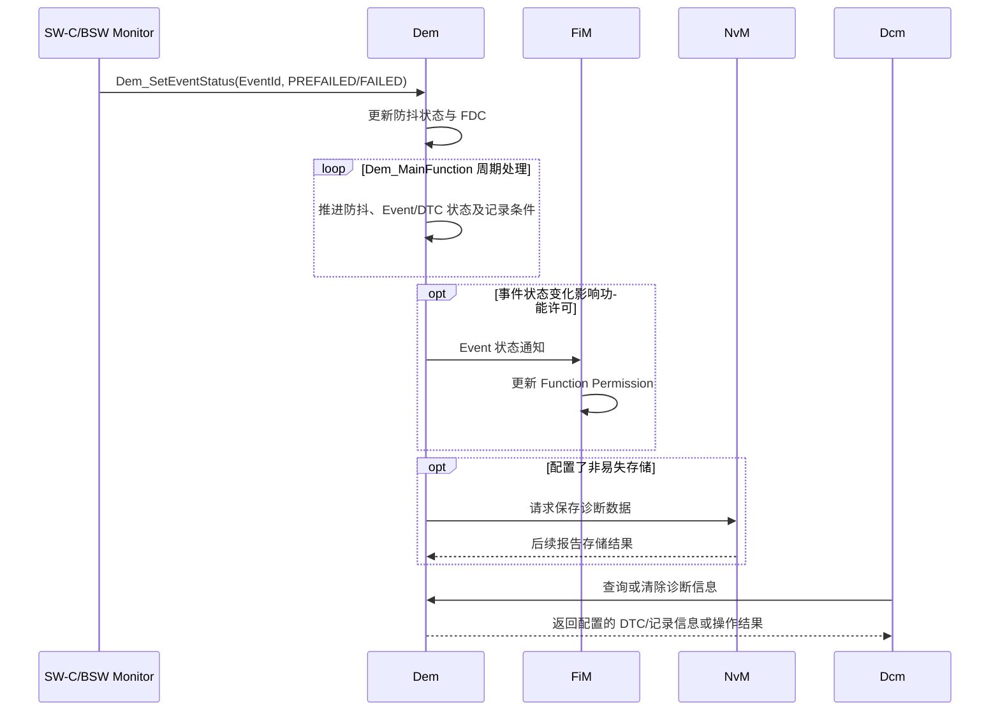
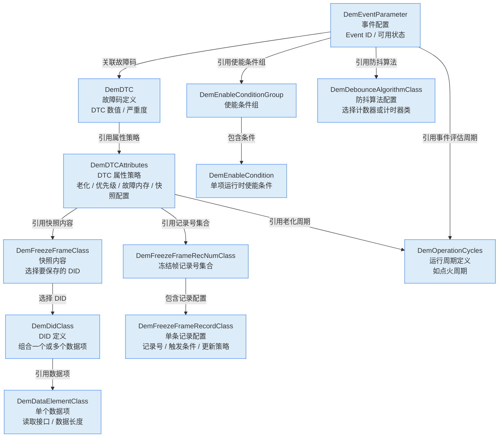
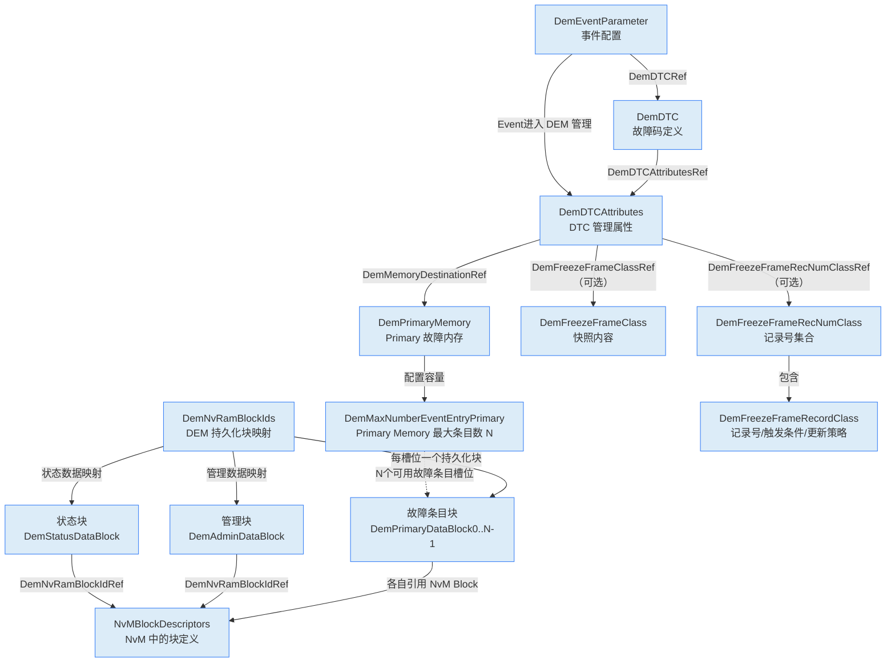

Dem 是 ECU 内部诊断事件和 DTC 状态的管理者。上游 Monitor 报告测试结果，Dem 按配置执行防抖、事件状态更新、DTC 确认、故障记录及老化处理，并通过 [[NvM]] 持久化需要保留的数据；[[Dcm]]、FiM、Dlt 等模块则通过相应接口读取诊断信息或接收状态通知。

需要区分 **Event** 和 **DTC**：Event 表示一个监控项的诊断结果，DTC 是面向诊断读取的故障代码；一个 DTC 可关联一个或多个 Event，状态汇总和故障内存行为受生成配置及诊断法规约束。

## 工作机制

### 职责与边界

SW-C 和 BSW 中存在大量故障监视器，但 Monitor 不应该各自实现防抖、DTC 状态机、故障确认、老化、故障内存管理和掉电保存。Dem 将这些共性能力集中起来，使故障监视器只需报告 `PASSED/FAILED/PREPASSED/PREFAILED`，其余生命周期由 Dem 统一处理。

同时，诊断服务模块并不保存故障信息。Dcm 处理 UDS/OBD 诊断服务，J1939 诊断由独立的 J1939Dcm 处理；DTC 状态、冻结帧、扩展数据和故障内存由 Dem 管理，并按配置通过接口提供给相应的诊断服务模块。

### 事件处理模型

Dem 采用“状态报告入口 + 周期处理 + 异步持久化”的混合模型。监控器报告结果后，Dem 根据配置推进防抖和事件/DTC 状态；符合记录条件时采集冻结帧、扩展数据等上下文，并在需要时通过 NvM 持久化。NvM 写入完成与事件状态更新是不同阶段。



![[dem-event-processing.png]]

Dem 处理 Event 报告的详细时序图：

![[dem-process-event.png]]

Monitor 可按配置在报告事件状态前请求预存冻结帧等现场数据；随后通过 `Dem_SetEventStatus()` 报告测试结果。记录数据的采集时机、触发条件、记录数量和覆盖策略均由 Dem 配置决定。

### 初始化

`FiM_Init()` 只完成 FiM 自身的基础初始化；在 `Dem_Init()` 完成并通过 `FiM_DemInit()` 通知 FiM 之前，FiM 还不能提供有效的功能许可查询，因此 `FiM_GetFunctionPermission()` 返回 `E_NOT_OK`。等 Dem 恢复诊断状态并完成初始化后，FiM 才读取所有相关 Event 状态、计算 Permission，并开始正常服务。

![[fim-dem-init-sequence.png]]

### UDS DTC Status Byte

|Bit|名称|工程含义|
|---|---|---|
|Bit0|`TestFailed`|当前测试结果是否为失败|
|Bit1|`TestFailedThisOperationCycle`|当前 Operation Cycle 内是否出现过失败|
|Bit2|`PendingDTC`|是否满足 Pending DTC 状态条件|
|Bit3|`ConfirmedDTC`|DTC 是否达到确认条件|
|Bit4|`TestNotCompletedSinceLastClear`|自上次清除后测试是否尚未完成|
|Bit5|`TestFailedSinceLastClear`|自上次清除后测试是否曾失败|
|Bit6|`TestNotCompletedThisOperationCycle`|当前 Operation Cycle 内测试是否尚未完成|
|Bit7|`WarningIndicatorRequested`|是否请求警告指示灯|

这些位的置位和清除规则由诊断规范、Operation Cycle、Dem 配置及 Event/DTC 状态共同决定；不能将单一状态位直接等同于“当前故障仍存在”。

### 防抖机制

#### Counter-based Debouncing

Monitor 报告：
```text
PREFAILED -> Counter 增加
PREPASSED -> Counter 减少
FAILED    -> 直接到 Failed Threshold
PASSED    -> 直接到 Passed Threshold
```

当计数达到失败阈值时，Dem 才把测试结果判定为最终 `FAILED`。`JumpUp` 和 `JumpDown` 的作用不是改变最终阈值，而是在检测方向发生反转时，把计数器快速移动到指定值，从而塑造故障建立和恢复的动态响应。

#### Time-based Debouncing

```text
PREFAILED -> 启动失败方向计时
PREPASSED -> 启动通过方向计时
FAILED    -> 直接判定失败
PASSED    -> 直接判定通过
```

时间型防抖的实际分辨率受 Dem 周期处理间隔和 OS 调度抖动影响。若设定时间短于任务的有效处理间隔，判定精度就无法达到该设定值；应结合实际调度周期评估防抖参数，而不能只看配置的毫秒数。

#### Monitor Internal Debounce

由 Monitor 自己维护防抖状态。Dem 可通过 `DemCallbackGetFDCFnc` 获取 `-128...127` 范围的 Fault Detection Counter (FDC)，再按配置将其用于事件状态和诊断信息处理。Monitor 的本地判定逻辑与 Dem 的 DTC 生命周期仍是两个不同职责。

### 配置与排查要点

- 核对 Event 到 DTC 的映射，以及事件组合、Operation Cycle 和使能条件。
- 确认 Monitor 报告的是即时结果还是预防抖结果，并核实防抖类型、阈值和任务周期。
- 检查冻结帧/扩展数据的触发条件与采集回调，避免把“事件已失败”误认为“记录数据已持久化”。
- 对照 DTC Status Byte、FiM 通知和 Dcm 查询结果，区分 Event 状态、DTC 汇总状态与功能许可状态。
- 若持久化数据缺失，检查 Dem/NvM 初始化顺序、写入请求及 NvM 最终状态。

## 再理解 2026-11-04

可以先把 DEM 看成两件事：==管理故障状态==和==保存故障发生时的证据数据==。不过还有一个关键中间层：DEM 实际上通常以 **Event** 为核心管理状态，再由 Event 关联到 DTC。

```text
监控逻辑发现异常
       ↓ 上报 Event 状态（失败/通过）
DEM 管理 Event：防抖、确认、老化、清除
       ↕
Event 关联 DTC：诊断仪看到的故障码
       ↓ 满足配置的触发条件时
保存快照：冻结帧、扩展数据
```
### 第一块：故障本身怎么管理

例如“电机温度过高”是一个 **Event**，它关联一个 DTC，比如 `Pxxxx` 或项目定义的 UDS DTC
- **防抖**：异常需要持续多久或累计到多少次，才算真正故障；恢复也可能需要满足相反条件
- **确认**：是否要经过多个测试周期才把故障标记为 confirmed
- **老化**：故障长期不再出现后，如何降低或清除其老化状态
- **故障内存**：哪些事件进入记录、容量满时怎么替换
- **清除**：诊断仪清故障时，Event 状态及相关记录如何处理

这块回答的是：**“这个故障现在是什么状态？是否记录、确认、老化或清除？”**

### 第二块：故障发生时保存什么

快照不是故障状态本身，而是故障发生时留下的诊断数据，帮助事后分析“当时车辆处于什么状态”。例如电机过温时保存车速、电机温度、电流和电压。

相关对象可以这样理解：
- **Data Element（`DemDataElementClass`）**：一个具体数据项，以及 DEM 如何取得它。比如“电机温度”，还要定义数据长度和读取接口。
- **DID（`DemDidClass`）**：给一组数据项一个标识。比如 DID `0xF1A0` 包含车速和电机温度。DID 是数据的组织/标识方式，不是一次快照。
- **冻结帧（Freeze Frame）**：配置一组 DID，定义“快照里要保存哪些数据”。
- **冻结帧记录（Freeze Frame Record）**：定义快照记录编号、什么时候触发保存、再次触发时是否更新。比如故障首次测试失败时记录一份，或 confirmed 时记录一份。
- **扩展数据（Extended Data）**：另一类与 DTC 关联的数据记录，常用于保存 DEM 管理的故障计数、老化计数等，或按配置取得的其他诊断信息。它和冻结帧是两种不同的数据记录类型。

假设“电机温度过高”对应一个 Event 和 DTC：
1. 软件周期性检查电机温度，异常时向 DEM 报告 Event 测试失败。
2. DEM 根据防抖配置判断是否达到故障阈值；达到后更新 Event/DTC 状态，并按存储策略把它放进故障内存。
3. 配置的冻结帧触发条件满足时，DEM 读取配置的数据，例如车速、电机温度、电机电流。
4. 这些值按配置保存为该故障的冻结帧数据。
5. 之后诊断仪通过 UDS `0x19` 读取 DTC 信息及相关快照，工程师看到的不只是“有一个过温故障”，还可以看到故障出现时的运行条件。

引用链
```text
DTC
 └─ DemDTCAttributes
     ├─ FreezeFrameClassRef       → 快照内容：哪些 DID / 数据项
     └─ FreezeFrameRecNumClassRef → 保存规则：记录号、触发时机、是否更新
```



如果 `DemDataElementClass` 配成 External CS 并启用 `DemDataElementUsePort`，就需要通过相应的 Client-Server/RTE 接口取得数据；具体生成什么端口、由谁实现，要看项目的生成和集成方式。关键不是“实现这个配置对象”，而是确保 DEM 调用时有正确的数据读取实现。

❓问题 1：`DemEnableConditionStatus` 定义该使能条件的初始状态。勾选，初始状态为使能；不勾选，初始状态为禁止。如果不勾选，后面谁让这个条件使能呢？也没看到 RTE 接口能 mapping
- 针对 BSW 的 interface，先要明确调用方向
  - DEM 提供服务（API），SW-C 调用：DEM 是 server，SW-C 是 client
  - DEM 主动调用外部实现的 callback：DEM 一侧是 client，提供回调实现的一侧是 server
- `Dem_SetEnableCondition` 是 Dem 提供的 API，调用者可以是 BSW 模块，也可以是通过 RTE 调用的 SW-C，如果一直没有人将它置为 true，关联事件的该条件就一直不满足

### 故障掉电保存

把关系分成 **DTC 的运行时存储策略** 和 **DEM 数据的 NvM 持久化映射** 两部分。图中实线表示配置引用，虚线表示容量约束或运行时关系：



如果项目==不使用 FreezeFrame 和 ExtendedData==，那么 DEM 持久化到 NvM 的内容通常只配置：`DemStatusDataBlock` 和 `DemAdminDataBlock`，这是很多量产项目（尤其是资源受限 ECU）的常见配置。