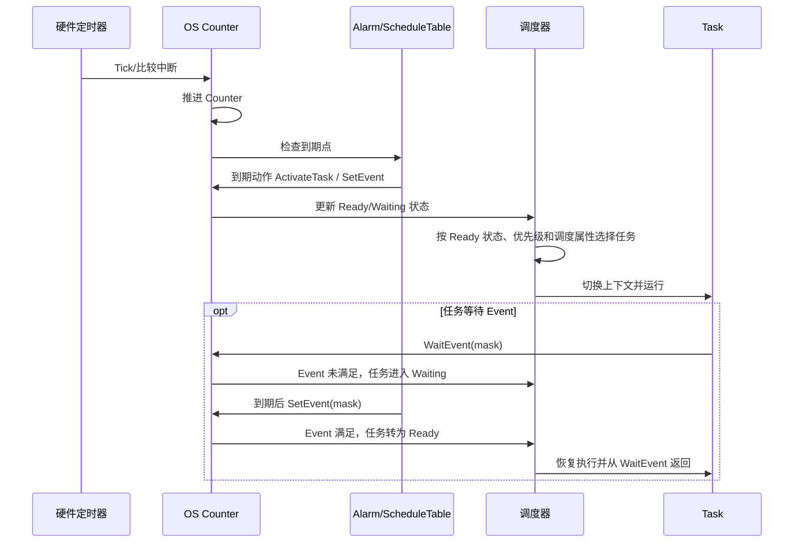

AUTOSAR OS 是运行在 MCU 与 [[RTE]]/BSW/Application 之间的实时内核，负责任务和中断调度、时间事件、同步原语以及可选的空间/时间保护。其主要职责包括：

- 将任务、ISR、Alarm、Event、ScheduleTable 统一映射到确定性的实时调度模型
- 在多核场景下提供跨核服务、IOC 通信和 Spinlock 同步
- 通过 MPU 内存保护和时间保护，限制非受信应用的空间访问与 CPU 时间占用
- 接管任务上下文、NVIC、SysTick、STM、MPU 等底层资源，向上屏蔽芯片级调度差异

OS 不是周期轮询型 BSW 模块，也没有类似 `Os_MainFunction()` 的统一入口。运行由硬件中断、Counter 到期、任务激活/事件设置、系统调用和跨核通知共同驱动。

## 工作机制

### 上下游接口契约

|方向/组件|职责与契约|
|---|---|
|EcuM/启动代码|在正确阶段完成 OS 初始化、启动从核（若配置）并调用 `StartOS(AppMode)`；是否存在单独的 `Os_Init()` 入口取决于具体集成实现|
|RTE|通常生成 OS Task、Alarm/Event 等配置，并把 Runnable 映射到相应任务；周期值和触发方式由生成配置决定|
|BSW/Application|通过 `ActivateTask`、`SetEvent`、`WaitEvent`、资源管理、多核服务或 IOC 使用 OS 能力；调用必须符合上下文、对象访问权限和核归属|
|硬件定时器|为 OS Counter 提供 Tick/比较事件；具体使用 SysTick、PIT、STM 或其他定时器取决于芯片和 OS 集成|
|中断控制器|OS 可能管理其接管的中断使能、优先级和 Pending 状态；应用不得绕过 OS 配置直接修改受管资源|
|MPU|启用保护时，OS/集成层按任务或 OS-Application 配置更新访问区域；区域覆盖范围需与各核硬件能力匹配|
|Linker/MemMap|配置描述保护区域，MemMap 和链接脚本将代码、数据、栈放入实际地址；需结合生成配置和链接 `.map` 文件核对|

非受信 OS-Application 只能访问自身及显式授权的内存区域；需要执行受信操作时，应通过配置的 Trusted Function 等受控入口，而不是直接访问特权资源。

### 运行模型

OS 的典型执行链是：

1. 硬件定时器产生中断，OS 驱动相应 Counter 前进
2. Alarm 或 ScheduleTable 到期，执行配置动作，例如激活 Task 或设置 Event
3. 调度器按任务状态、优先级及抢占属性选择当前核上的 Ready Task
4. 若启用保护，OS 在上下文切换时应用相应的内存保护，并在运行期间检查配置的执行预算、锁中断预算或时间框架限制

调度决策模型：

- `OsTaskPriority` 的数值方向及同优先级任务的调度规则应以所用 OS 实现为准；同核任务的优先级分配需与抢占策略和期限分析一致。
- 启动任务、Idle Task 的优先级及 `OsTaskSchedule`（如 `FULL`/`NON`）属于配置策略，不应视为所有平台的固定值。
- Basic Task 完成后通常调用 `TerminateTask()`；Extended Task 可通过 `WaitEvent()` 进入 Waiting，满足 Event 条件后回到 Ready。
- `OsTaskActivation` 限制任务尚未完成时可积累的激活数。若到达间隔短于最坏执行时间且激活上限不足，可能发生激活限制错误。
- 多核服务、IOC 和 Spinlock 必须遵守对象的核访问权限及锁顺序；锁持有期间不应执行无界等待，以免引入死锁或时间保护违规。

![[os-system-call.png]]

## 配置与排查

### OsSecondsPerTick

`OsSecondsPerTick` 是当前配置工具使用的时间换算参数之一，其适用 Counter 和单位应以工具/OS 实现定义为准。常见配置思路：

- PIT 类系统 Counter 通常以毫秒级 Tick 驱动周期任务。
- 若 HRT Counter 直接按 STM 计数，Tick 时间应根据实际输入时钟和分频计算。
- 例如计数频率为 160 MHz 且每个计数对应一个 Tick：`OsSecondsPerTick = 1 / 160000000 = 0.00000000625 s (6.25 ns)`。

该换算会影响：

- Alarm 周期的 Tick 到实际时间换算
- ScheduleTable Duration 和 ExpiryPoint Offset
- 时间保护预算及时间框架
- 显式同步的精度和调整幅度

若 STM 时钟树或分频发生变化而参数未同步更新，OS 仍可能运行，但 Alarm、ScheduleTable 和保护预算对应的实际时间会按比例偏移。

### 硬件资源与平台专用配置

- **SysTick/PIT**：部分项目使用周期中断驱动系统 Counter；计时器实例、频率和中断号均为集成配置，不是 AUTOSAR OS 的通用固定值。
- **STM/HRT**：若由 OS 用作高精度 Counter、ScheduleTable 或时间保护基准，应用不得再独立配置同一比较通道/中断资源。
- **S32K3x/S32G3x 中断号备注**：当前项目配置中 SysTick 中断字段分别使用 `-1` 和 `65535`。这类值的含义取决于配置工具和驱动约定，不应直接移植到其他 OS/芯片配置。
- **NVIC/MPU**：确认 OS 接管资源未被应用或其他驱动重复初始化；多核系统应分别核对各核的中断和 MPU 配置。
- **任务与保护配置**：检查任务激活上限、栈大小、抢占属性、执行预算、锁中断预算和 OS-Application 访问权限。

### 常见故障定位

- 周期任务未运行：检查 Counter 是否递增、Alarm/ScheduleTable 是否到期、到期动作是否激活正确任务或设置正确 Event。
- 任务延迟或激活溢出：核对优先级、抢占属性、任务执行时间、激活间隔及 `OsTaskActivation`。
- 时间整体偏差：核对计数器频率/分频、`OsSecondsPerTick`、OS 主函数/定时器中断周期和 ScheduleTable 配置。
- MPU/访问错误：结合 OS-Application 权限、MemMap 区域、链接地址与 `.map` 文件检查；多核时确认各核配置。
- 多核死锁或跨核调用失败：检查对象访问权限、Spinlock 获取顺序、调用上下文和核间中断/IOC 配置。
