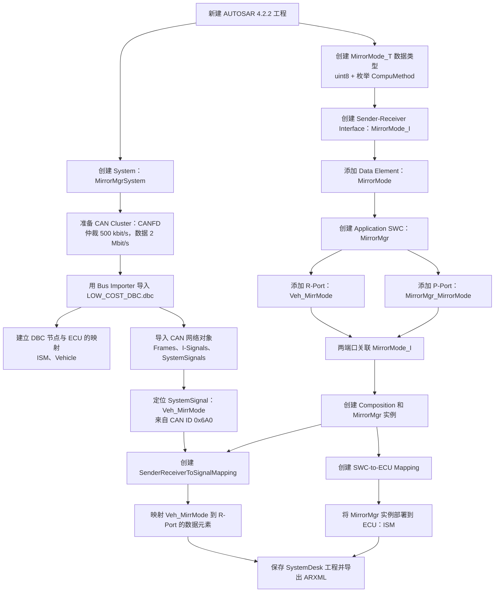
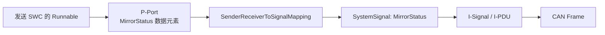
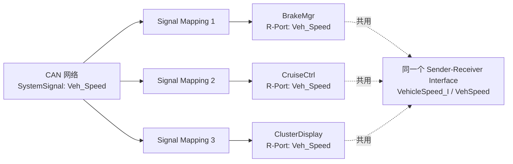
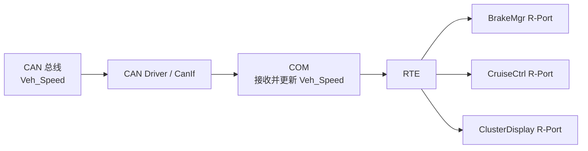

> 本文以 dSPACE SystemDesk 和 AUTOSAR Classic 4.2.2 为例，介绍如何将 DBC 中的 CAN 信号关联到软件组件 SWC 的接收或发送端口，并讨论多个 SWC 消费或产生同一个信号时的建模方式。

导入 DBC 并不意味着 SWC 已经能够使用其中的信号。DBC 导入主要建立通信网络相关对象；要将信号交给应用软件，还需要定义 SWC 的数据类型、接口和端口，并在 System Mapping 中建立信号与端口数据元素之间的映射。最后，再将 SWC 实例映射到目标 ECU。

## 建模工作流

以下以车外后视镜模式信号 `Veh_MirrMode` 为例，展示从导入 DBC 到导出 ARXML 的主要步骤：

### 1. 导入 DBC 并检查网络对象

在工程中创建 `MirrorMgrSystem` 和 CAN Cluster，再通过 Bus Importer 导入 `LOW_COST_DBC.dbc`。根据工程的通信设计配置网络参数，并建立 DBC 节点与 ECU 的对应关系。

导入后，检查报文、I-Signal 和 SystemSignal 等对象，以及它们之间的关联。在本例中，后续要使用的是来自 CAN ID `0x6A0` 的 `Veh_MirrMode` SystemSignal。DBC 文件名、节点名、报文 ID 和网络参数均为示例，应以实际工程为准。

### 2. 创建数据类型、接口和 SWC

创建表示后视镜模式的 `MirrorMode_T` 数据类型，例如使用 `uint8` 表示，并通过枚举 CompuMethod 描述各模式值。类型的取值范围和语义应与信号定义一致。

接着创建 Sender-Receiver Interface `MirrorMode_I`，添加数据元素 `MirrorMode`；创建 Application SWC `MirrorMgr`，并添加接收端口 `Veh_MirrMode` 和提供端口 `MirrorMgr_MirrorMode`，两者关联该接口。R-Port 用于接收外部信号；P-Port 可用于向其他组件提供处理后的模式值，但仍需根据实际设计建立连接和相应的软件行为。

### 3. 建立信号映射和 ECU 映射

创建 Composition 并实例化 `MirrorMgr`。在 System Mapping 中创建 `SenderReceiverToSignalMapping`，将 `Veh_MirrMode` SystemSignal 关联到 `MirrorMgr` 实例的 R-Port 数据元素。映射时需要指定组件实例路径、端口和数据元素，而不只是选择端口名称。

![[systemdesk-data-mapping.png]]

然后通过 SWC-to-ECU Mapping 将 `MirrorMgr` 实例部署到 ECU `ISM`。信号映射描述数据与端口的关系，ECU 映射描述组件的部署位置，两者不能互相替代。

![[systemdesk-ecu-mapping.png]]

完成检查后保存工程并导出 ARXML，交由后续 ECU 集成、通信配置和 RTE 生成流程使用。要让应用实际读取或处理数据，还需要配置 SWC 的 Runnable、事件和数据访问，并完成后续集成。

## SWC 如何通过 P-Port 发送 CAN 信号？

发送方向与接收方向类似，但要将 P-Port 的数据元素映射到待发送的 SystemSignal。下面以假设的 `MirrorStatus` 信号为例；它与前面的接收信号 `Veh_MirrMode` 是不同的信号，具体名称和报文归属应以实际 DBC 为准。

1. 在 DBC 导入后的网络对象中，找到目标 SystemSignal，并沿其关联检查 I-Signal、I-PDU 和 CAN Frame。确认该帧的 DBC 发送节点已映射到目标 ECU，并将发送 SWC 实例部署到这个 ECU；不能只创建信号映射而忽略发送节点和部署位置。
2. 为发送 SWC 创建 Sender-Receiver Interface、数据元素和关联该接口的 P-Port，并配置 Runnable 的数据写入访问及触发方式。在 System Mapping 中创建 `SenderReceiverToSignalMapping`，指定 SWC 实例路径、P-Port 和数据元素，再关联目标 SystemSignal。
3. 核对应用数据类型及实现类型与信号的位长、有符号性和取值范围是否兼容，枚举值及其含义是否一致。检查 DBC 的缩放系数、偏移量、单位和物理范围，与 AUTOSAR 的 CompuMethod 等转换定义相匹配；明确应用使用原始值还是物理值，以及转换由哪一层负责，避免遗漏或重复转换。
4. 检查 I-Signal 在 I-PDU 和 Frame 中的布局及字节序，并完成 ECU 的 COM、RTE 和底层通信配置，包括发送周期或触发条件。导出 ARXML 后还需完成集成和验证；端口映射本身不会自动保证报文被发送。

一个 CAN 信号通常应有一个明确的发送源。如果多个 SWC 需要影响同一信号，建议让它们通过各自接口向聚合或仲裁 SWC 提供候选值，由该 SWC 按明确的优先级、有效性和超时规则决定最终值，再通过唯一的 P-Port 映射发送。不要仅将多个 P-Port 直接映射到同一 SystemSignal 就假定系统会自动仲裁。

## 多个 SWC 如何接收同一个信号？

多个 SWC 可以各自拥有 R-Port，并将各自的端口数据元素映射到同一个 SystemSignal。不需要为了每个消费者在 DBC 或 SystemDesk 中复制 CAN 信号。

具体做法是先创建共享的 Sender-Receiver Interface 和数据元素，再为每个 SWC 创建关联该接口的 R-Port。随后，在 System Mapping 中为==每个 SWC 实例的 R-Port 数据元素==分别创建 `SenderReceiverToSignalMapping`，并指向同一个 SystemSignal，例如 `Veh_Speed`。每条映射都要指定对应的实例路径、端口和数据元素。

如果这些 SWC 部署在同一个 ECU，典型的数据路径如下：

这里的“接收一次”是指该 ECU 的通信栈接收报文并处理信号，而不是每个 SWC 分别读取 CAN 总线。COM 和 RTE 的具体配置及数据传递方式取决于后续集成；在模型中，无需仅为了向多个消费者分发信号而增加一个 SWC。

## 何时需要 Adapter SWC？

当消费者之间需要==共享实际处理逻辑==时，可以考虑增加 Adapter SWC。例如，对原始信号进行单位或语义转换、过滤与去抖、有效性检查和默认值处理，或者将多个底层信号整理成统一接口。

此时，Adapter 的 R-Port 接收 CAN 信号，处理后通过 P-Port 和 Composition Connector 向其他 SWC 提供数据。是否引入 Adapter 应由职责划分和处理需求决定，而不是仅由消费者数量决定。
