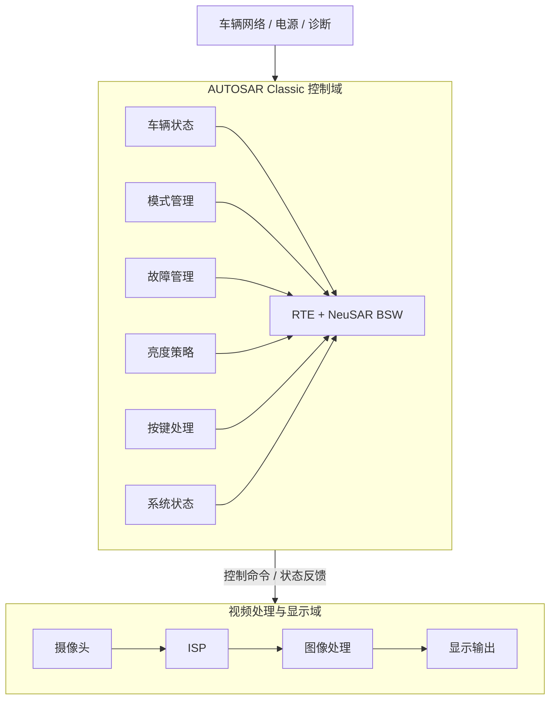
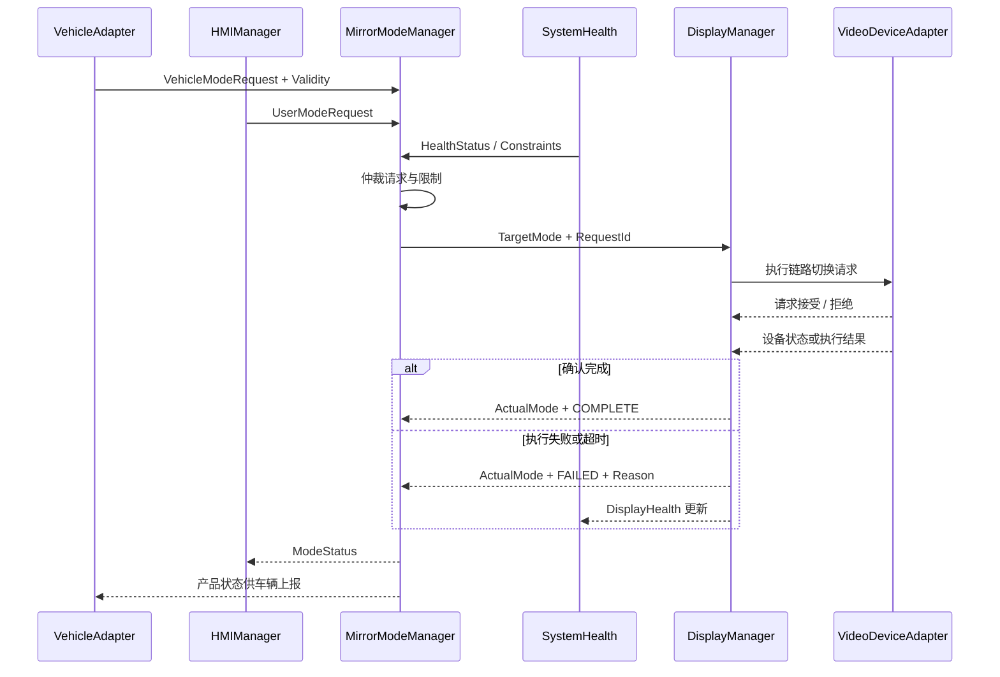
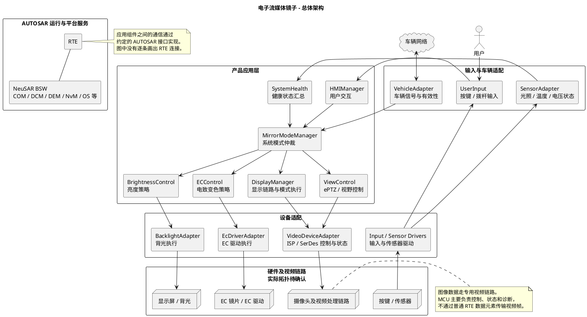
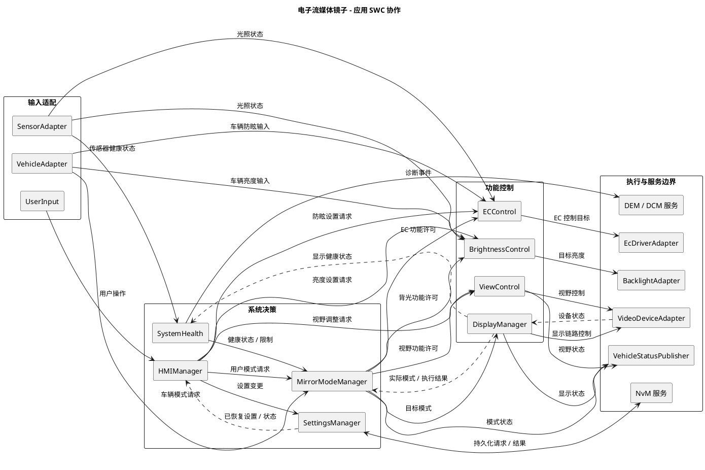
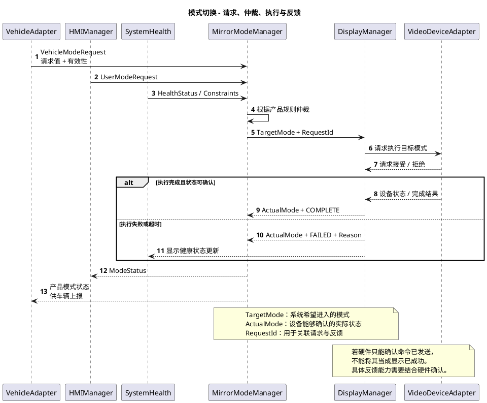
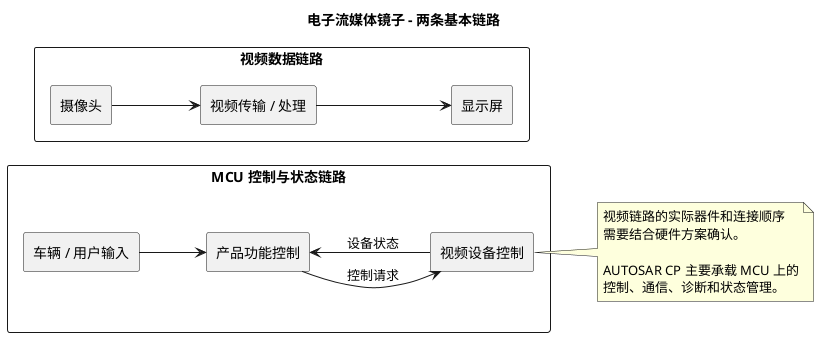
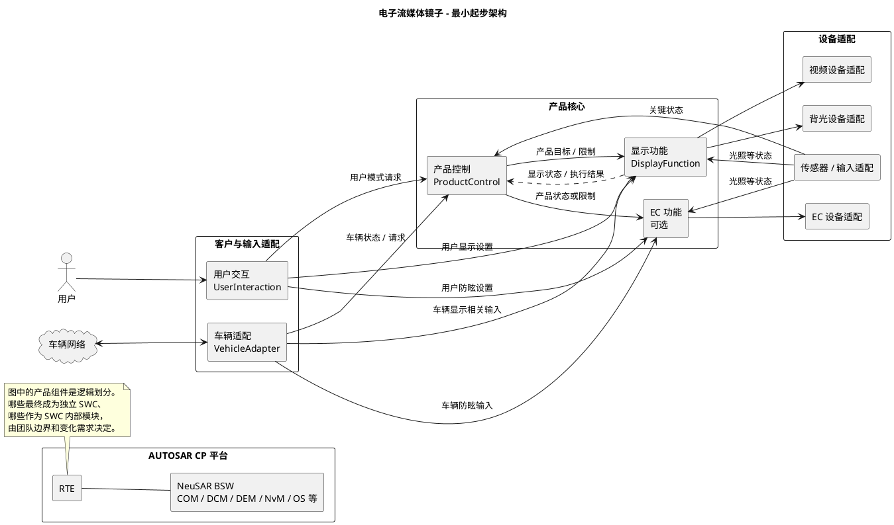
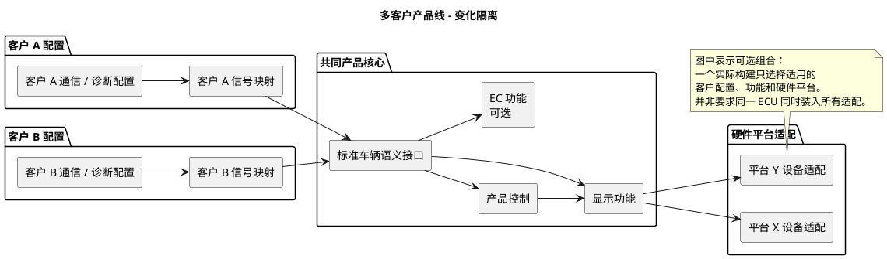

对于电子流媒体镜子，我建议把 AUTOSAR 开发的核心目标定为：先把功能边界、接口契约和故障行为设计清楚，再让各团队基于同一份架构并行开发；SystemDesk 管架构模型，NeuSAR 管 ECU 基础软件和运行时集成。

## Prerequisites

### 先明确：哪些东西适合放进 AUTOSAR

流媒体镜子通常同时有两类软件：
1. **控制和状态管理**：车辆信号、显示模式、亮度策略、故障处理、电源状态、诊断等。
2. **视频数据链路**：摄像头采集、解串、ISP、图像处理、合成、显示输出等。

这两类软件的实时性、数据量和运行平台差别很大。


### 怎样划分 SWC

下面是一个可作为评审起点的划分：

| SWC / 模块 | 核心职责 | 主要输入 | 主要输出 |
|---|---|---|---|
| `VehicleState` | 将车辆网络信号整理为应用可用的车辆状态 | 车速、倒挡、转向灯等 | 带有效性的车辆状态 |
| `UserInput` | 将按键等输入整理成用户操作事件 | 按键硬件状态 | 按键事件 |
| `MirrorModeManager` | 根据车辆状态、用户操作和故障状态决定目标显示模式 | 车辆状态、用户请求、健康状态 | 目标模式及原因 |
| `BrightnessManager` | 根据环境、设置和约束计算目标亮度 | 环境光、用户设置、系统状态 | 目标亮度 |
| `VideoControl` | 将目标模式转换为对视频域的控制请求，并接收执行反馈 | 目标模式、视频域状态 | 视频控制请求、视频状态 |
| `MirrorHealth` | 综合摄像头、视频链路、显示等健康信息 | 各模块故障状态 | 系统健康状态、故障事件 |
| `PowerModeManager` | 协调启动、运行、休眠等产品状态 | 电源/点火状态、系统状态 | 产品运行模式 |
| `SettingsManager` | 管理用户配置及持久化策略 | 设置变更请求 | 当前设置、存储状态 |

### 建议先做一个工具链贯通试验

不要一开始就试图把整个产品模型全部打通。先选最小链路：`VehicleState → MirrorModeManager → VideoControl`

试验目标：
1. 在 SystemDesk 中定义三个 SWC、接口、连接和 runnable。
2. 导出双方约定范围的 ARXML。
3. 在 NeuSAR 侧导入，完成最小 ECU 配置和 RTE 生成。
4. 三个团队分别实现一个最小 runnable，并完成编译和链接。
5. 输入有效、无效和超时的车辆状态，观察模式决策。
6. 模拟视频切换成功和失败，检查目标状态与实际状态是否分离。
7. 修改一次接口，验证变更能否可控地传递到各团队和集成环境。

### 建议的端到端开发流程

#### 第一步：从需求出发，而不是先画 SWC

对每个功能，先回答：
- 触发条件是什么？
- 功能的输入、输出和外部依赖是什么？
- 用户看到的正常表现是什么？
- 数据无效、摄像头异常、显示异常、系统重启时如何处理？
- 哪些要求涉及法规、功能安全、网络安全、启动时间或图像时延？

对电子后视镜尤其要注意：**不要自行假设黑屏、显示旧帧、切回其他画面等任意一种行为就是安全状态。** 必须结合产品用途、目标市场法规、整车需求和安全分析确定，并验证可实现性。

#### 第二步：建立逻辑架构和接口契约

在 SystemDesk 中先建立：
- 功能职责和 SWC 边界。
- 生产者、消费者、端口和连接。
- 数据类型、单位、范围、初值、有效性。
- runnable、触发事件和并发约束。
- 运行模式、故障行为和外部系统边界。

这时就应邀请 SWC、平台、测试和视频团队一起评审，而不是等代码写完再联调。

#### 第三步：完成部署和运行时设计

将逻辑设计落实到 ECU、任务和通信：
- SWC 分配在哪个 ECU、核或分区。
- runnable 如何映射到 OS task。
- 启动顺序、周期、优先级、deadline、互斥和数据一致性。
- 跨 ECU 或跨 OS 的通信协议、超时及重启恢复。
- 诊断事件、故障存储和模式管理的归属。

**架构图连上了，不代表时序就满足要求。** 任务周期、执行顺序和跨域通信都需要实际分析和测量。

#### 第四步：各 SWC 独立开发

每个团队拿到的交付包至少包括：
- 已评审的 SWC 模型及接口版本。
- runnable 的触发和并发约束。
- 输入有效性、初始化、异常和输出行为。
- 用于开发和测试的 RTE 接口或适配层。
- 可以独立运行的测试桩与验收用例。

业务逻辑尽量不直接依赖其他 SWC 的内部头文件、全局变量或私有数据结构。

#### 第五步：持续集成和分层验证

建议至少分四层：
1. **SWC 单元测试**：用测试替身构造输入，验证正常和异常逻辑。
2. **SWC 组合测试**：验证接口连接、初始化顺序、数据有效性和模式优先级。
3. **ECU 集成测试**：验证 RTE、BSW、OS、通信、诊断和真实调度。
4. **系统测试**：验证摄像头到显示屏的端到端行为，以及跨域异常、上电和重启。

### 团队协作机制：把“接口”变成可交付的契约

1. 每个接口有唯一 Owner， 负责维护接口语义和版本，但修改必须邀请生产者、消费者、集成及测试参与评审。涉及安全或整车接口时，相关负责人也要参与。
2. 区分兼容变更和破坏性变更
3. 一个模型对象只有一个权威来源
	1. SWC 接口和组合关系由 SystemDesk 架构基线维护
	2. ECU 配置及 BSW 参数由约定的 NeuSAR 配置基线维护
4. 禁止绕过接口形成隐性依赖
	1. 一个 SWC 直接读取另一个 SWC 的全局变量
	2. 应用代码直接调用其他团队的内部函数
	3. 不经过约定就直接读取底层驱动状态
	4. 多个 SWC 各自做一套车速超时判断，结果不一致
5. 定义完成标准
	1. 基于指定接口基线可编译
	2. 正常、初始、无效和超时场景有测试
	3. runnable 的执行和并发假设已说明
	4. 输出行为和错误行为与契约一致
	5. 集成依赖、已知限制及资源预算已交付

### 故障检测、系统决策和诊断记录不要混成一团

可以按职责区分：
- 功能模块负责检测并报告自己能识别的异常。
- 健康管理负责汇总和形成产品级状态。
- 模式管理负责按已批准的策略决定行为。
- 诊断机制负责事件、状态和故障记录。

诊断事件如何映射到 DEM、是否需要 DTC，以及故障反应时间，都要由项目要求和平台配置共同确定。

## 当前架构问题

```text
车辆网络
   │
   ▼
 Valin ───────────────┬──────────────┬─────────────┐
   │                  │              │             │
   ▼                  ▼              ▼             ▼
  HMI ───────────► MirrorMgr ─────► Display       EC
   ▲                  │              │             │
   │                  └──────────────┴─────────────┘
   │
 Toggle / HwButton        Light / HwAbs / BackLight / EcDrive
                                      │
                                      ▼
                                    硬件

 HMI / Display / EC / MirrorMgr ───► Valout ───► 车辆网络
```

### `Valin` 给多个消费者传递大包命令

`Swc_Val.arxml:32-76` 中的 `Ism_Cmd_St` 包含 Zoom、Pan、亮度、Auto Dimming、Mirror Mode、Tilt 等多类命令。这一个结构被送给多个组件，例如：
- `Valin → HMI`
- `Valin → MirrorMgr`
- `Valin → Display`
其中 `MirrorMgr` 实际只关心 `MirrorMode_Cmd`，但接口依赖整个 `Ism_Cmd_St`
带来的摩擦
- 增加一个显示命令字段，可能引起多个消费者的模型、生成类型和编译变化
- 接口名称是“ISM 命令包”，而不是消费者真正理解的领域语义
- 单个字段的有效性、超时和更新规则不容易独立表达
这不意味着所有结构体都应该拆成一个字段一个端口。更合理的是 **按变化原因和消费者需求拆分**

**建议：** 对关键车辆状态和命令明确契约：值、有效性、来源、超时责任和降级行为。超时可以由 COM、适配层或应用层承担，但必须由明确责任方把结果传递给消费者；不能假设 `Rte_Read == E_OK` 就等于总线信号健康

### `MirrorMgr` 设计不完整

建议区分三种状态

```text
请求模式 Request
     │
     ▼
仲裁目标 TargetMode
     │
     ▼
Display 执行切换
     │
     ├── ActualMode
     ├── SwitchStatus
     └── FailureReason
```
 例如：
 - `TargetMode = VIDEO`
- `ActualMode = PHYSICAL / VIDEO / UNKNOWN`
- `SwitchStatus = PENDING / COMPLETE / FAILED`
- `FailureReason = ...`

### 绕过模型直接读取硬件抽象层

### 时序设计

检查到的生成代码顺序是：
```text
Display_MainFunction()
EC_MainFunction()
EcDrive_MainFunction()
HMI_MainFunction()
Valin_MainFunction()
MirrorMgr_MainFunction()
```
这意味着在**这份生成代码对应的执行顺序下**：
- `HMI` 在 `Valin` 前执行，可能先读到上一轮 `Valin` 输出。
- `Display` 在 `MirrorMgr` 前执行，可能先读到上一轮 `MirrorMgr` 输出。
- 一个输入经多个周期处理链后才反映到显示控制，不能简单地说“每个模块都是 10 ms，所以响应就是 10 ms”

## 建议目标架构

### 建议的新模块划分

#### 1. 输入适配层

| 模块 | 建议职责 | 不应负责 |
|---|---|---|
| `VehicleAdapter` | 接收车辆信号，做协议值到产品语义的转换，向应用提供值及有效性 | 决定最终镜面模式或显示动作 |
| `UserInput` | 读取按键、拨杆，做去抖、短按/长按等输入事件识别 | 直接执行 ePTZ、亮度或模式切换 |
| `SensorAdapter` | 对光照、温度、电压等形成可供应用使用的状态及有效性 | 自行决定产品进入哪个镜面模式 |

**对应现有项目：**

- `Valin`：保留车辆适配思想，但拆清网络输入、数据有效性和领域语义。
- `HwButton`、`Toggle`：保留底层采集能力；用户操作事件由 `UserInput` 统一输出。
- `HwAbs`、`Light`：保留硬件采集/驱动能力，但不要让每个应用 SWC 直接依赖硬件内部函数。

#### 2. 产品决策层

| 模块 | 建议职责 | 核心输出 |
|---|---|---|
| `MirrorModeManager` | 汇总车辆请求、用户请求和健康约束，决定系统目标模式及功能许可 | `TargetMode`、`ModePolicy` |
| `SystemHealth` | 汇总各设备和功能上报的健康状态，形成产品级健康视图 | `HealthStatus`、限制原因 |
| `PowerStateManager` | 如现有 BSW 和产品需求确有必要，在应用层协调产品运行、待机、关断状态 | `ProductPowerState` |

`PowerStateManager` **不一定必须是独立 SWC**。ECU 电源与启动管理仍要和 NeuSAR 的 EcuM、BswM 等分工，不能重复造一个互相竞争的状态机。

最重要的职责规则
```text
SystemHealth：告诉系统“哪里不健康”
MirrorModeManager：决定“产品应该进入什么目标模式”
DisplayManager：执行“如何切换显示”
```

`SystemHealth` 不直接强制调用显示硬件；`DisplayManager` 也不自行覆盖系统级模式决策。异常情况下的最终安全行为仍必须由系统安全需求规定。

#### 3. 功能控制层

| 模块 | 建议职责 | 现有代码主要来源 |
|---|---|---|
| `DisplayManager` | 显示链路启动、显示模式切换、等待执行结果、上报实际状态 | `Display.c`、`Display_Ctrl.c`、部分 `Display_State.c` |
| `ViewControl` | Zoom、Pan、Tilt、视野参数约束与执行状态 | 部分 `Display_HMI.c` |
| `BrightnessControl` | 自动/手动亮度策略、亮度目标、约束 | 部分 `Display_HMI.c`、`Display_State.c` |
| `ECControl` | 电致变色策略、自动防眩相关控制 | 现有 `EC` |
| `HMIManager` | 用户交互状态、菜单、用户意图 | 现有 `HMI` 与部分 `Display_HMI.c` |
| `SettingsManager` | 管理需要持久化的用户设置及其恢复状态 | 现有散落在 `MirrorMgr`、`EC`、`Display` 的设置处理 |

这里的 `ViewControl`、`BrightnessControl`、`HMIManager` 是**逻辑模块建议**。如果当前团队规模较小，第一阶段可以先放在同一个 SWC 内，以内部模块隔离；只有当职责、测试和接口稳定后再拆成独立 SWC。

> 例如，不需要为了消除 `Display_HMI.c` 过大，一次性新增十几个 SWC。先让职责和依赖正确，再决定物理部署粒度。

#### 4. 硬件适配层

| 模块 | 建议职责 |
|---|---|
| `VideoDeviceAdapter` | 封装 ISP、SerDes、视频链路相关控制及状态获取 |
| `BacklightAdapter` | 接收目标背光值，执行硬件控制并反馈状态 |
| `EcDriverAdapter` | 封装 EC 驱动控制和必要反馈 |
| `SensorDeviceAdapter` | 封装 ADC、温度、光照等硬件访问 |
| `InputDeviceAdapter` | 封装按键、拨杆的原始硬件输入 |

这些适配可以由 AUTOSAR 标准 BSW、现有 CDD 或符合项目规范的其他机制实现。**不是所有适配都必须新建 CDD**；应先看 NeuSAR 已有模块以及芯片驱动能力。

#### 5. 平台服务

| 服务 | 建议责任 |
|---|---|
| `COM` / 通信栈 | 网络信号接收、发送及相关通信配置 |
| `DEM` / `DCM` | 诊断事件、故障记录和诊断通信，按项目配置使用 |
| `NvM` | 持久化请求和存储服务 |
| `OS` / `RTE` | 运行调度与 SWC 通信 |
| `EcuM` / `BswM` / 看门狗等 | ECU 生命周期、基础模式及运行监控 |

### 建议流程



### 建议接口

| 接口 | 提供者 → 消费者 | 主要内容 |
|---|---|---|
| `VehicleModeRequest` | `VehicleAdapter → MirrorModeManager` | 请求值、有效性、来源及必要的新鲜度信息 |
| `UserModeRequest` | `HMIManager → MirrorModeManager` | 用户请求、事件标识或序号 |
| `HealthStatus` | `SystemHealth → MirrorModeManager` | 当前健康状态、限制项、原因 |
| `TargetMode` | `MirrorModeManager → DisplayManager` | 目标模式、请求标识 |
| `DisplayModeStatus` | `DisplayManager → MirrorModeManager` | 实际可确认状态、执行中/完成/失败、关联请求标识、失败原因 |
| `ModeStatus` | `MirrorModeManager → HMI/上报模块` | 请求、目标、实际状态及限制原因 |

#### 需要提前规定的行为

- 多个来源同时请求时谁优先。
- 设备切换中来了新请求：覆盖、排队还是拒绝。
- 反馈超时由谁判定；超时后允许重试几次。
- 同一请求重复到来时是否幂等。
- 设备重启后是否重新下发目标状态。
- `UNKNOWN` 与 `FAILED` 的区别。
- 故障解除后是否自动恢复之前用户请求。

这些行为必须由产品需求、安全分析及整车约定决定；不能仅靠架构图推断。

### SWC 接口应该怎样设计

#### 不再把整个 `Ism_Cmd_St` 发给所有人

建议从现有大结构逐步演进为按消费者语义划分的接口：

```text
现有：
Ism_Cmd_St
 ├─ MirrorMgr
 ├─ HMI
 └─ Display

建议：
VehicleModeRequest      → MirrorModeManager
VehicleViewRequest      → HMIManager / ViewControl
VehicleBrightnessInput  → BrightnessControl
VehicleDimmingInput     → ECControl
VehicleOperatingState   → 有需要的消费者
```
#### 区分状态和事件

这个项目中存在两种不同语义：
- **状态**：当前车速、当前温度等级、目标模式。消费者通常需要最新值。
- **事件**：用户短按一次、向左调整一步、确认一次。消费者可能需要知道发生次数和顺序。

对于状态，可以考虑非队列式 Sender-Receiver；对于不能丢失的离散事件，需要评估队列、序号、确认或其他机制。

#### 每个接口必须有最小契约

以 `VehicleModeRequest` 为例：

| 项目 | 应规定的内容 |
|---|---|
| 来源 | 车辆哪个信号或信号组合 |
| 所有者 | `VehicleAdapter` |
| 值域 | 可请求的模式、保留值、非法值 |
| 状态 | 首次未接收、有效、无效、超时等是否需要分别表示 |
| 超时 | 从哪里计时、谁判定、阈值及恢复条件 |
| 输出行为 | 超时后保留旧值还是输出无效状态；由需求规定 |
| 消费者行为 | 数据无效时，`MirrorModeManager` 如何处理 |
| 更新方式 | 周期、变化触发，或其他约定 |
| 测试 | 首次上电、非法值、超时、恢复、重复请求 |

**这份契约比接口名称更重要。** ARXML 能表达其中一部分，不能方便表达或工具不支持的部分，应通过版本化的接口规格和自动化测试补齐。

### 总体分层图



### 应用 SWC 协作图



#### 每个模块的边界

| 模块 | 它负责什么 | 它不负责什么 |
|---|---|---|
| `VehicleAdapter` | 将车辆信号转换成应用语义，并传递有效性 | 决定最终镜面模式 |
| `HMIManager` | 识别用户意图、管理交互 | 直接操作 ISP、SerDes 或背光驱动 |
| `SystemHealth` | 汇总故障与能力限制 | 直接决定或执行显示切换 |
| `MirrorModeManager` | 仲裁请求，形成系统目标模式 | 直接控制底层设备 |
| `DisplayManager` | 执行显示模式切换并反馈结果 | 重新制定系统级模式优先级 |
| `ViewControl` | 执行 Zoom、Pan、Tilt 等视野逻辑 | 决定整个产品运行模式 |
| `BrightnessControl` | 计算目标亮度 | 直接操作 PWM 或背光驱动内部变量 |
| `ECControl` | 计算电致变色目标 | 直接依赖其他 SWC 内部实现 |
| `SettingsManager` | 管理约定范围内的用户设置及恢复状态 | 自动拥有所有 NvM block |
| `VehicleStatusPublisher` | 将产品状态转换成车辆上报信号 | 决定产品状态 |

这里画的是 **逻辑模块**，不要求第一阶段每个框都必须是独立 SWC。例如 `ViewControl` 和 `BrightnessControl` 可以先在 `Display` 内部模块化，接口稳定后再拆分。

### 模式切换时序图

这张图表达最重要的闭环：**请求不等于目标，目标也不等于实际状态**。



图中 `ModeMgr → Vehicle` 表示状态最终交给车辆上报链路；正式模型中可以通过 `VehicleStatusPublisher` 承接，不必由 `MirrorModeManager` 直接操作 COM。

## 反思和持续改进

架构的目标不是找出“电子镜应该有几个 SWC”，而是找到哪些职责需要独立变化、哪些边界需要稳定，以及哪些客户差异应该通过配置隔离。

我建议采用的总体思路是：
- **一个稳定的产品核心 + 可选功能 + 客户适配 + 平台适配**
- AUTOSAR CP 负责定义应用组件、接口和运行环境；客户差异不应直接渗入所有功能 SWC

### 先定义产品边界

这里讨论的电子流媒体镜子，可以理解为一个由摄像头、视频处理、显示及控制软件组成的产品。不同方案可能还有物理镜面、电致变色、按键、环境光传感器等。



### 从产品功能出发，不先想 SWC

#### 1. 每个项目都要回答的基础能力

这里的“基础”是指**需要做产品决策并明确责任**，不意味着每个功能都必须由 MCU 软件实现。

| 产品能力 | 需要回答的问题 |
|---|---|
| 系统启动与关闭 | 何时启动？何时休眠？显示链路准备好之前是什么状态？ |
| 图像显示 | 什么条件下显示什么画面？如何判断链路就绪？ |
| 显示控制 | 背光由谁控制？如何限制最大、最小亮度？ |
| 状态感知 | 摄像头、视频链路、显示、温度和供电等状态能监测到什么？ |
| 异常处理 | 发现异常后由谁决定产品行为？故障恢复后如何处理？ |
| 用户交互 | 产品是否有按键、菜单、模式切换或画面调整？ |
| 车辆交互 | 哪些车辆信息影响产品？哪些状态需要反馈整车？ |
| 诊断与持久化 | 客户需要哪些诊断能力、故障记录和用户设置？ |

#### 2. 可能因客户或硬件而不同的功能

| 可变化能力 | 示例 |
|---|---|
| 物理镜面/视频模式 | 有的产品有不同镜面模式，有的可能没有 |
| ePTZ | Zoom、Pan、Tilt 的有无、范围和操作方式 |
| 自动亮度 | 是否需要、传感器来源、控制曲线 |
| 电致变色 EC | 产品是否具有 EC、算法和控制策略 |
| 用户操作方式 | 按键、拨杆、车辆屏幕命令，或没有本地输入 |
| 故障提示 | OSD、车辆报文、诊断事件等表现 |
| 网络与诊断 | CAN 信号、诊断服务、DTC 和客户要求不同 |
| 设置保存 | 哪些设置保存、默认值、恢复和写入策略 |
| 硬件器件 | 不同 ISP、SerDes、背光和传感器 |

**重要结论：** 一个客户没有 EC 功能，不应该被迫携带一个到处充斥 `#if CUSTOMER_A` 的 EC 控制链；另一个客户换了 CAN 信号，也不应该修改亮度算法。

### 模块不是按功能数量划分，而是按“变化原因”划分

我建议用下面几个问题判断是否需要独立模块或 SWC：

1. **职责是否不同？**  
   例如车辆协议转换和亮度算法的职责不同。
2. **是否会独立变化？**  
   客户 CAN 信号变化，不应迫使显示控制逻辑变化。
3. **是否存在稳定接口和明确 owner？**  
   如果两块代码的边界无法说清，强行拆 SWC 只会制造摩擦。
4. **是否需要独立测试、复用或由不同团队交付？**
5. **是否真的需要成为独立 SWC？**  
   一个逻辑模块可以先是 SWC 内部的 C 模块；不必每个功能都穿过 RTE。

例如：
```text
“显示控制”与“客户 CAN 信号转换”
    → 变化原因明显不同，建议有清晰边界。

“Zoom 与 Pan”
    → 经常共享视野状态和设备控制；
      初期可以同属一个视野控制模块。

“只有几条模式规则”
    → 不一定要独立 MirrorManager SWC；
      先明确谁拥有这些规则即可。
```

### 推荐的最小起步架构

我建议第一版从**四个应用职责**开始，而不是预设十几个 SWC：

1. **车辆适配**：屏蔽客户网络信号差异。
2. **用户交互**：屏蔽按键和用户操作方式差异。
3. **产品控制**：负责系统级状态、请求仲裁和必要的跨功能规则。
4. **显示功能**：负责画面、视野、亮度等与显示密切相关的行为。

EC 如果是产品族的可选能力，作为**可选功能模块**；硬件操作通过设备适配边界访问。



#### 为什么只画这几个应用职责？

| 职责 | 为什么有必要单独考虑 | 是否必须单独 SWC |
|---|---|---|
| `VehicleAdapter` | 隔离客户报文、编码和有效性差异 | 建议有明确边界；是否单独 SWC 取决于集成方式 |
| `UserInteraction` | 输入设备和操作方式可能变化 | 可作为独立 SWC，也可与产品控制组合 |
| `ProductControl` | 当多个请求或故障共同影响产品时，需要明确系统决策 owner | **不一定独立**；规则简单时可并入显示功能 |
| `DisplayFunction` | 显示、视野和亮度有较强关联 | 可以先一个 SWC，内部再分模块 |
| `EC Function` | 可选功能，变化原因和显示不同 | 有 EC 且需要独立复用/交付时适合独立 |

这里的 `ProductControl` 不是前面那种“什么都管的 MirrorManager”。它只处理**确实跨功能的产品规则**；亮度算法和 EC 算法仍由各自功能处理。

如果某款产品没有跨功能模式仲裁，可以把少量产品状态规则并入 `DisplayFunction`，**连这个框也不必单独存在**。

### 怎么真正做到多客户兼容

“多客户兼容”不是在每个文件里写不同的宏，而是把差异放在正确的位置。

#### 建议把变化分成四类

| 差异类型 | 例子 | 建议放在哪里 |
|---|---|---|
| **客户协议差异** | CAN 信号名、编码、周期、诊断要求 | 客户通信/诊断配置及 `VehicleAdapter` |
| **产品功能差异** | 是否有 EC、是否有 ePTZ、是否有本地按键 | 产品变体选择，可选模块及对应 composition |
| **功能参数差异** | 亮度曲线、视野范围、默认设置 | 受控参数集、标定数据或配置 |
| **硬件平台差异** | ISP、SerDes、背光驱动芯片 | 设备适配与 BSW/MCAL 配置 |
| **业务规则差异** | 哪些输入允许切换模式、冲突优先级 | 产品策略配置；必要时采用不同策略实现 |

这里有一个重要边界：

> **不要把所有业务差异都塞成配置参数。**

如果两个客户只有亮度上下限不同，适合参数化；如果两个客户的模式切换流程根本不同，强行用几十个布尔配置拼接，可能比两种明确的策略实现更难维护和测试。

#### 客户适配示意



例如客户 A 和客户 B 都能表达“车辆请求视频模式”，但它们的报文、编码和超时规则不同：

```text
客户 A 信号 ─→ 客户 A 适配 ─┐
                            ├─→ 统一的 VehicleModeRequest
客户 B 信号 ─→ 客户 B 适配 ─┘
```

产品核心只需要理解 `VehicleModeRequest` 的约定语义，而不需要知道报文叫 `Veh_Msg_CMD01` 还是其他名字。

### 接口兼容：多客户架构的核心资产

稳定的接口不只是一个 C 结构体。至少要固定：

- 数据含义、单位、范围和非法值。
- 状态还是事件。
- 数据由谁提供、谁负责检查有效性和超时。
- 启动初始值和首次接收前行为。
- 更新周期、事件丢失和重复处理方式。
- 请求、目标和实际结果的区别。
- 接口版本和兼容规则。

#### 例子：车辆模式请求

```text
接口：VehicleModeRequest

语义：
    当前车辆是否请求某种产品模式。

至少明确：
    请求值
    数据是否有效
    请求来源
    更新和超时责任

消费者：
    ProductControl，或规则简单时由 DisplayFunction 消费
```

若客户 A 的原始信号超时由 COM 监控，客户 B 需要由适配层监控，两者都可以，但最后传入产品核心的语义必须一致。

**不能用 `Rte_Read() == E_OK` 直接替代“车辆信号有效”。** 它是否包含未接收或超时信息，取决于具体 RTE/COM 配置和应用接口设计。

#### 兼容性规则

一个接口发生下面这些变化，都要做兼容性评估：

- 枚举值含义变化。
- 单位、精度或有效范围变化。
- 默认值和超时行为变化。
- 数据从状态变成事件。
- 结构体增删字段。
- 提供者或消费者对错误的处理变化。

即使只增加字段，也不能自动假设兼容：需要检查 RTE 生成类型、所有消费者、跨 ECU 编码及工具链版本。

### 客户兼容不等于只关注 CAN

以下几个地方很容易在第二个客户项目时出问题：

#### 1. 诊断和正常功能的控制权

例如客户要求通过诊断控制背光或 EC。此时需要明确：

- 正常功能和诊断控制谁优先。
- 诊断退出、超时或会话结束后如何恢复。
- 设备当前由谁控制。
- 故障是否上报，以及上报方式。

这些规则可以通过 BSW 与应用协作实现，但**不能让诊断代码成为一个绕过架构的第二控制者**。

#### 2. NvM 设置兼容

不同客户或版本可能有不同设置项。需要规定：

- 数据格式版本与默认值。
- 老版本数据如何兼容或迁移。
- 新功能首次启用时使用什么初值。
- 恢复失败时功能如何运行。
- 写入完成、失败和断电时的行为。

并不是必须做一个统一 `SettingsManager` SWC，但每块数据必须有清楚的 owner 和版本策略。

#### 3. 产品功能差异与安全要求

某客户没有 EC，不应因为公共核心假定 EC 存在而导致启动失败。反过来，**可选功能不等于安全相关功能可以随意关闭**：哪些能力是必要的，必须由目标市场法规、整车需求和安全分析决定。

### 如何判断这套架构是否真的降低摩擦

我建议不用“SWC 数量”衡量，而用以下几个场景检验：

| 变化场景 | 期望影响范围 |
|---|---|
| 客户改变 CAN 信号名称或编码 | 通信配置和 `VehicleAdapter` 为主，显示算法不变 |
| 客户取消 EC | 去掉 EC 功能和相关配置；显示核心不需要到处改条件编译 |
| ISP 更换供应商 | 设备适配和相关配置为主，产品级接口尽量不变 |
| 亮度曲线变化 | 参数或亮度策略变化，不改车辆协议适配 |
| 增加一种用户输入 | 扩展输入适配，复用现有用户请求语义 |
| 改变模式优先级 | 修改产品决策规则和相关测试，不改底层驱动 |
| 新增客户诊断需求 | 影响诊断配置及明确的服务边界，不绕过功能 owner |

这些是**目标**，不是保证所有变化都只改一个文件。比如 ISP 更换可能改变硬件能力，进而需要更新上层接口；但至少影响范围应该清晰、可评估。

### 建议的推导与实施顺序

如果我们真要从零建立这一代架构，我建议按以下顺序，而不是马上打开 SystemDesk 画模块：

1. **列产品族功能清单**  
   区分基础能力、可选能力、客户变化和硬件变化，不先决定 SWC 数量。
2. **选两到三个有差异的客户场景**  
   用真实差异验证架构；如果目前只有一个客户，就用明确标注为假设的第二场景。
3. **定义稳定的产品语义**  
   先定义模式请求、显示状态、车辆状态、用户设置、设备健康等概念和语义。
4. **确定功能 owner**  
   谁决定模式、谁决定亮度、谁拥有显示执行、谁处理诊断接管。先明确责任，再决定 SWC 边界。
5. **建立最小 AUTOSAR composition**  
   从车辆适配、用户交互、产品控制、显示功能及必要设备适配开始；不必要的独立 SWC 不建。
6. **选一条功能链贯通工具和测试**  
   例如“车辆请求 → 产品决策 → 显示执行 → 状态反馈 → 车辆上报”，同时覆盖启动、失效和恢复。
7. **用客户差异反向验证**  
   修改信号映射、取消一个可选功能、替换一个设备适配，检查核心代码和接口是否被迫变化。

我的最终建议是：**第一版架构保持小而清晰，先为“客户协议、产品规则、功能逻辑、硬件设备”建立边界；不要一开始就为每个未来可能性创建一个 SWC。** 当某一部分确实需要独立复用、交付或变化时，再沿着已经存在的边界拆分。
