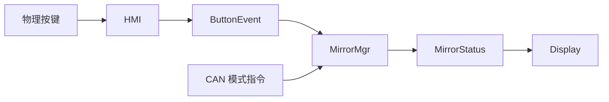
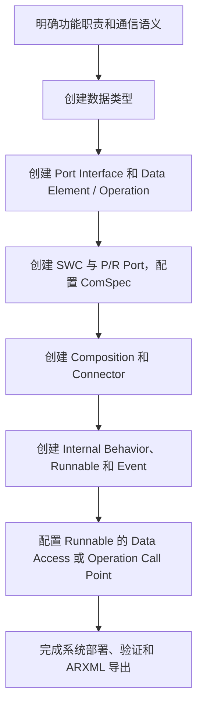
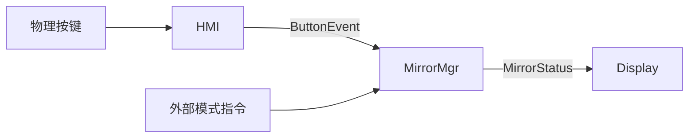

在 AUTOSAR 建模中，创建一个 SWC 和几个 Port 只是开始。要让软件组件能够被实现、集成和生成 RTE，还需要明确：

- 接口传递的是状态、事件，还是服务请求？
- 数据应该排队，还是只保留最新值？
- 哪个 Runnable 访问哪个数据元素？
- Runnable 是通过 Data Access 读写数据，还是通过 Operation 调用服务？
- 数据类型、初始值和 ComSpec 应该配置在哪里？

本文以一个简化的 E-Mirror 应用为例，梳理在 **dSPACE SystemDesk 2022-B** 中建立 AUTOSAR Classic 软件架构的基本流程。

## 一、从功能职责开始，而不是从 Port 开始

示例包含三个应用 SWC：



| SWC | 职责 |
|---|---|
| `HMI` | 按键采样、去抖、短按和长按识别 |
| `MirrorMgr` | 解释按键事件和外部指令，决定当前模式 |
| `Display` | 根据当前模式选择显示内容 |

这里有一个重要的设计原则：**HMI 报告按键事件，MirrorMgr 决定事件的业务含义。**

例如，HMI 发布 `ShortPress`，而不是直接决定最终模式。这样按键与模式之间的规则可以集中在 MirrorMgr 中维护。

## 二、推荐的基本建模流程

在 SystemDesk 中，可以按以下顺序组织工作：



这不是唯一顺序，但它能帮助我们先确定语义，再决定具体模型元素。

## 三、数据类型：Application Type 与 Implementation Type

AUTOSAR 数据类型可以从两个视角理解：

- **Application Data Type**：描述应用关心的数据语义，例如车速、模式或温度。
- **Implementation Data Type**：描述代码实现使用的数据类型，例如基于 `uint8` 的模式值。

如果接口使用 Application Data Type，生成 RTE 时需要建立 **Data Type Mapping Set**，把应用类型映射到实现类型。例如：

```text
Application Type:     MirrorMode
                             ↓ Data Type Mapping
Implementation Type:  MirrorMode_T → uint8
```

如果接口直接使用 Implementation Data Type，就不应机械地再创建一个 Application→Implementation 映射。

除了类型名称，还要检查：

- 值范围和约束；
- 枚举或物理值转换；
- 初始值及无效值；
- 接口双方使用的类型是否兼容。

> 官方参考：SystemDesk Manual，*Modeling Data Types*，pp.322–330。

## 四、接口语义：S/R 还是 C/S？

### Sender/Receiver：传递数据

S/R Interface 包含一个或多个 **Data Element**。发送方通过 P-Port 提供数据，接收方通过 R-Port 获取数据。

在 E-Mirror 中：

- `ButtonEvent`：HMI 发布按键事件；
- `MirrorStatus`：MirrorMgr 发布当前模式；
- Display 消费 `MirrorStatus`。

### Client/Server：请求执行操作

C/S Interface 包含 **Operation** 及其参数。Client 通过 R-Port 调用，Server 通过 P-Port 提供服务。

例如，可以设计一个可选的 `RequestMode(mode)` Operation，让客户端请求 MirrorMgr 切换模式，并定义接受或拒绝等结果。

两种接口的选择重点是**通信契约**：

| 问题 | 更自然的选择 |
|---|---|
| “当前状态是什么？” | S/R |
| “发生了什么事件？” | S/R |
| “请执行这个操作，并告诉我结果” | C/S |

C/S 并不是避免轮询的唯一方法：S/R 数据也可以通过 `Data Received Event` 触发 Runnable。

> 官方参考：SystemDesk Manual，S/R pp.296–298；C/S pp.311–313。

## 五、S/R 的 SW impl policy：状态还是事件？

创建 S/R Data Element 后，需要决定其通信语义。

![[systemdesk-impl-policy.png]]

| 选项 | 语义 | 示例 |
|---|---|---|
| `Standard` | nonqueued，接收方关注最新值 | `MirrorStatus` |
| `Queued` | queued，接收方按 FIFO 处理待接收数据 | `ButtonEvent` |
| `MeasurementPoint` | 测量用途，不作为普通 SWC 通信数据使用 | 专用观测数据 |

对于 `MirrorStatus`，Display 通常只需要最新状态；对于 `ButtonEvent`，每次短按、长按是独立事件，可能需要逐条处理。

但队列有容量。选择 `Queued` 之后，还必须配置接收端队列长度，并在应用集成时处理发送失败或队列溢出。

![[systemdesk-comspec-queue.png]]

> 官方参考：SystemDesk Manual，*Variable Data Prototype* p.534；queued/nonqueued 配置 pp.304–309。

## 六、Port 和 ComSpec：接口存在，还不够

Port 引用 Interface，表明 SWC 提供或使用该接口；**ComSpec 描述该 Port 的通信属性**。

以 `ButtonEvent` 为例：

```text
HMI.ButtonEvent          P-Port → Queued Sender ComSpec
MirrorMgr.ButtonEvent    R-Port → Queued Receiver ComSpec
                                 Queue Length = 根据需求确定
```

对于 nonqueued 数据，还==需要考虑初始值==：在第一次收到有效数据之前，接收方应该读到什么？

例如 `MirrorStatus` 的启动值可以定义为 `Idle`。但初始值不是超时策略，也不能替代无效数据处理。

随后，在 Composition 中连接兼容的 P-Port 和 R-Port：

```text
HMI.ButtonEvent        → MirrorMgr.ButtonEvent
MirrorMgr.MirrorStatus → Display.MirrorStatus
```

## 七、Runnable：定义代码执行单元

Runnable 是 SWC Internal Behavior 中可调度和执行的单元。一个 SWC 可以有多个 Runnable，各自由不同的 Event 触发。

E-Mirror 可以设计为：

| Runnable | 触发方式示例 | 职责 |
|---|---|---|
| `HMI_10ms` | Timing Event | 采样按键、去抖、识别短按/长按 |
| `MirrorMgr_10ms` | Timing Event | 读取输入并更新模式 |
| `Display_10ms` | Timing Event | 读取当前状态 |

另一种设计是用 `Data Received Event` 触发 MirrorMgr 处理按键事件，而不是周期性检查队列。选择事件触发还是周期触发，需要结合目标 RTE/OS 的调度和队列处理方式。

**当前 demo 工程使用的是 10 ms Timing Event；事件触发是可考虑的后续调整。**

> 官方参考：SystemDesk Manual，*Modeling SWC Internal Behaviors* pp.343–345；RTE Events pp.354–355。

## 八、为什么 Runnable 需要 Data Access？

创建了 Port，并不意味着 SWC 的每个 Runnable 都会访问它。

在 Runnable 的 **Data Access** 页面，需要明确：

```text
哪个 Runnable
    → 通过哪个 Port
        → 访问哪个 Data Element
            → 使用什么访问方式
```

例如：

| Runnable | Data Element | 访问方式 |
|---|---|---|
| `HMI_10ms` | `ButtonPressed` | Read |
| `HMI_10ms` | `ButtonEvent` | Send |
| `MirrorMgr_10ms` | `ButtonEvent` | Receive by argument |
| `MirrorMgr_10ms` | `MirrorStatus` | Write |
| `Display_10ms` | `MirrorStatus` | Read |

在 SystemDesk 中：

```text
Runnable Properties → Data Access → Select
```

选择 Port 下的数据元素后，再设置 `Access/Direction`。

### Read 与 Receive 如何选择？

- **Read**：隐式访问。Runnable 开始时取得输入快照；一次执行中多次读取保持一致。
- **Receive**：显式访问。Runnable 调用 RTE API 获取数据。
- Queued 通信使用显式访问；nonqueued 可以使用隐式或显式访问。

`Receive by argument` 与 `Receive by value` 分别表示数据通过函数参数传出，或作为函数返回值。实际函数签名和状态处理需检查目标 RTE 生成器。

Data Access 只是通信访问声明，**不会自动实现业务逻辑，也不会自动创建 Connector 或触发 Runnable**。

| 选项 | 官方含义 | 什么时候选 |
|---|---|---|
| **Read** | 隐式读取：Runnable 开始前取得数据；同一次执行中多次读取，值保持一致 | 非队列数据，希望一次运行使用稳定快照 |
| **Receive by argument** | 显式读取：Runnable 调用 RTE API，数据通过函数参数传出 | 需要主动读取；包括处理排队事件 |
| **Receive by value** | 显式读取：数据作为 RTE 函数返回值 | 需要通过返回值直接取得数据，且目标生成器支持 |
| **Read, receive by argument** | 同时声明隐式 Read 和显式 Receive by argument | 同一个 Runnable 确实需要这两种访问 |
| **Read, receive by value** | 同时声明隐式 Read 和显式 Receive by value | 确实需要两种访问 |
| **Receive by argument & value** | 同时声明两种显式访问 | 代码确实需要两种函数形式 |
| **Read, receive by argument & value** | 同时声明隐式及两种显式访问 | 确实需要全部形式；不建议仅为“保险”而选择 |

> 官方参考：SystemDesk Manual，*Specifying Data Accesses* pp.368–372；Data Access 选项表 pp.511–512。

#### 最重要的选择规则

##### 1. 先看数据是否 Queued

- **Queued：使用显式 Receive**，不能选单独的隐式 `Read`。
- **Nonqueued：既可以选 Read，也可以选 Receive**，取决于 Runnable 想要快照还是主动读取。

SystemDesk Tutorial 的示例也是对 nonqueued 使用 implicit access，对 queued 使用 explicit access；但这是示例做法，不是说 nonqueued 禁止显式访问。  

关于 `Receive by value`：较新的 **AUTOSAR CP R22-11** 规范明确限制它不能用于 queued Data Element（`constr_1277`）。你的工程目标是 **4.2.2**，不能直接把新版约束当成该版本的最终结论；对于本例排队事件，选择 **Receive by argument** 是更稳妥的建模方式，并仍需检查目标 RTE 生成器。

##### 2. 再看 Runnable 需要“快照”还是“每次主动读取”

假设一个 Runnable 执行期间，数据从 `Physical` 更新成 `Video`：

- **Read**：这次 Runnable 执行内读取的是开始时取得的同一份快照。
- **Receive**：每次显式调用都会执行一次读取；对 nonqueued 数据，可以观察调用时的最新值。

##### 3. 最后选 argument 还是 value

SystemDesk Manual 对两者的区别是：

```text
Receive by argument：数据通过 RTE 函数参数传出
Receive by value：   数据作为 RTE 函数返回值
```

具体函数名、参数、状态返回和错误处理，以==目标 RTE 生成器实际生成的 API 为准==。若应用需要检查接收状态，`by argument` 值得优先评估，但不能仅凭该选项断定所有错误状态都已配置或受支持。

## 九、C/S 场景：什么时候使用 Operations？

如果接口语义是“调用服务”，则不使用 S/R 的 Data Access 来表达 Operation 调用。

例如，可选地定义：

```text
Client: HMI
    R-Port → MirrorModeRequest_I.RequestMode

Server: MirrorMgr
    P-Port → MirrorModeRequest_I.RequestMode
```

建模时：

1. 在 Client Runnable 的 **Operations** 页面选择 Operation，创建 Server Call Point。
2. 在 Server 侧创建 Runnable。
3. 使用 **Operation Invoked Event** 将客户端调用关联到服务端 Runnable。
4. 根据需求选择同步或异步调用，并定义结果和错误处理。

### 同步还是异步？

SystemDesk 官方说明：

- **同步调用**：HMI 的 Runnable 等待 Server Operation 完成。
- **异步调用**：HMI 可以继续执行，之后通过异步返回事件和结果点处理结果。

如果 `RequestMode` 只做参数检查和快速提交，**可以先评估同步调用**；如果处理可能较慢，或 HMI 不能等待，再考虑异步。实际是否阻塞、任务调度、超时和并发能力仍需结合目标 RTE/OS 配置验证。同步调用返回也不必然表示 Display 已经完成画面切换——应先定义返回的是“请求已接受”还是“切换已完成”。

本文 demo 目前采用 HMI→MirrorMgr 的 **Queued S/R**。`RequestMode` 是对比说明，不是当前工程已经实现的 C/S 接口。

### C/S 不是唯一能避免轮询的方案

保留当前 **Queued S/R** 也可以：让 MirrorMgr 的 Runnable 由 `ButtonEvent` 的 **Data Received Event** 触发，而不是每 10 ms 轮询事件队列。Runnable 被触发后还需要按队列及 RTE 语义处理待接收的数据。

因此：

- 如果 HMI 只是发布一个按键事件，且不需要 MirrorMgr 的直接返回结果，事件触发的 **Queued S/R** 很自然。
- 如果 HMI 的语义是请求 MirrorMgr 执行模式切换，并需要接收接受/拒绝等结果，**C/S** 更贴近需求。

无论选哪种，CAN 和 HMI 同时发出不同请求时，仍要处理之前约定的“最新有效指令优先”。如果两个来源可能被不同 Runnable 并发处理，需要统一仲裁和状态保护；要严格按实际发生时间排序，还需要统一时钟和可靠的来源时间戳。

> 官方参考：SystemDesk Manual，*Invoking Client Server Operations* pp.373–375。

## 十、导出前检查什么？

导出 ARXML 前，建议按层检查：

1. **数据**：类型、取值范围、枚举、初始值是否正确？
2. **接口**：S/R 与 C/S 是否符合语义？Queued 与 nonqueued 是否符合需求？
3. **Port**：接口引用和 ComSpec 是否完整？
4. **软件架构**：SWC 实例和 Connector 是否正确？
5. **Internal Behavior**：Runnable、Event、Data Access 或 Call Point 是否齐全？
6. **系统交付**：导出范围是否包含下游工具需要的类型、接口和引用对象？

还要明确：**SystemDesk 模型中的 Runnable 声明，不等于应用 C 代码已经链接到 RTE。** 当前示例提供了独立 C 逻辑模拟器，但尚未完成真实按键、显示设备和目标 RTE 的集成。

## 总结

SystemDesk 中的软件组件建模，可以理解为逐层建立契约：

```text
Data Type       定义数据是什么
Interface       定义如何通信
Port + ComSpec  定义组件如何提供或使用接口
Runnable        定义代码执行单元
Data Access     定义 Runnable 如何读写数据
Operation       定义客户端如何调用服务
Event           定义 Runnable 何时被触发
```

把这些层次分开考虑，可以更容易发现“Port 已经创建，但 Runnable 无法访问”“接口已经导出，但缺少通信配置”等问题。

## 官方参考

本机文档位于：

```text
C:\Program Files\Common Files\dSPACE\Help 2022-B\Print\
```

主要参考：

- **SystemDesk Manual 2022-B**：数据类型 pp.322–330；S/R pp.296–310；C/S pp.311–319；Runnable 和 Data Access pp.343–380、511–513。
- **SystemDesk Tutorial 2022-B**：Lesson 3、Lesson 4、Lesson 5。

做 AUTOSAR 软件架构设计时，重点不是先画多少个 SWC，而是把这几件事说清楚：

1. **职责**：每个 SWC 负责什么、不负责什么？
2. **通信契约**：交换的是状态、事件还是操作请求？
3. **执行与时序**：谁触发、多久执行、能否并发？
4. **异常行为**：数据无效、超时、队列满或服务调用失败时怎么办？
5. **集成与验证**：部署到哪里，如何证明设计满足需求？

下面是一份可以直接用于 E-Mirror 的轻量级架构设计模板。它不是 dSPACE 官方模板，而是结合 SystemDesk 建模内容整理的工作模板。

---

# E-Mirror 软件架构设计模板

## 1. 功能目标与范围

### 1.1 功能目标

> 示例：系统识别用户按键和外部模式指令，由 MirrorMgr 决定当前后视镜模式，并将状态提供给 Display。

### 1.2 范围边界

| 包含 | 不包含或待其他设计定义 |
|---|---|
| 按键事件识别 | 具体按键驱动实现 |
| 模式仲裁和状态发布 | 实际显示画面渲染 |
| SWC 接口和 Runnable 建模 | 目标 ECU 的完整 BSW/RTE 配置 |

这一节很重要：它能避免把“架构模型已完成”误认为“功能已经能在 ECU 上运行”。

### 1.3 需求与待确认事项

| ID | 需求 | 当前约定 / 状态 |
|---|---|---|
| REQ-01 | 短按触发 Physical | 已确定 |
| REQ-02 | 按住超过 2 秒触发 Video | 已确定 |
| REQ-03 | 启动模式 | Idle |
| REQ-04 | HMI 与外部指令冲突 | 最新有效指令优先 |
| REQ-05 | 按键去抖时间 | **待确定** |
| REQ-06 | 外部指令失效或超时处理 | **待确定** |

不要把“待确定”默默填成一个看似合理的默认值，尤其是涉及安全或故障行为时。

## 2. 软件组件与职责



| SWC | 负责 | 不负责 |
|---|---|---|
| HMI | 采样、去抖、识别短按/长按、发布事件 | 决定最终模式、处理外部模式指令 |
| MirrorMgr | 解释事件、处理外部指令、模式仲裁、发布状态 | 物理按键采样、具体画面渲染 |
| Display | 消费状态并选择显示内容 | 决定模式切换规则 |

架构评审时可以问：**如果某条规则改变，应该修改哪个 SWC？** 如果一个简单规则需要同时修改多个无关 SWC，职责边界可能需要调整。

## 3. 接口契约

每条接口建议至少描述以下内容，而不仅是名称和类型：

| 字段 | 需要回答的问题 |
|---|---|
| 发送方 / 接收方 | 谁提供？谁消费？ |
| 接口语义 | 状态、事件还是请求/响应？ |
| S/R 或 C/S | 为什么选择它？ |
| 数据类型 | 值域、单位、缩放、有效值是什么？ |
| 更新方式 | 周期、变化触发，还是服务调用？ |
| 时序 | 最大允许延迟、新鲜度要求是什么？ |
| 错误处理 | 无效值、超时、队列满或调用失败时怎么办？ |
| 初始化 | 首次有效数据到来前使用什么？ |

### 示例接口表

| 接口 | 发送方 → 接收方 | 语义 | 初步选择 |
|---|---|---|---|
| `ButtonEvent` | HMI → MirrorMgr | 独立按键事件 | Queued S/R |
| `MirrorStatus` | MirrorMgr → Display | 当前状态 | Nonqueued S/R |
| `RequestMode` | 可选的 Client → MirrorMgr | 请求执行操作并返回结果 | 仅在需要请求/响应契约时考虑 C/S |

**设计判断：**如果只需要告知“发生了短按”，S/R 更自然；如果必须得到“模式请求已接受或拒绝”的结果，C/S 值得考虑。

## 4. 数据字典

| 数据 | 类型 / 取值 | 语义 | 初始值 | 无效与异常 |
|---|---|---|---|---|
| `ButtonEvent` | `ShortPress`、`LongPress` | 一次按键事件 | 不适用 | 队列满策略待确定 |
| `MirrorStatus` | `Idle`、`Physical`、`Video` | 当前模式 | `Idle` | 故障状态策略待确定 |
| 外部模式指令 | `Idle`、`Physical`、`Video`、保留值 | 模式请求 | 首次有效输入前不应视作已收到 | 保留值忽略；超时策略待确定 |

在 SystemDesk 中，再把这些语义落实为 Application Data Type、Implementation Data Type、约束、CompuMethod 和必要的 Data Type Mapping Set。

**架构层的值域不等于 C 类型。** 例如模式存储类型可以是 `uint8`，但应用允许的值仍需单独定义。

## 5. 状态机与仲裁

### 5.1 状态定义

| 状态 | 含义 | Display 行为 |
|---|---|---|
| `Idle` | 尚未选择显示模式 | **待定义具体画面** |
| `Physical` | 物理后视镜模式 | 显示行为待确认 |
| `Video` | 视频后视镜模式 | 显示行为待确认 |

### 5.2 状态转换

| 输入 | 条件 | 目标状态 |
|---|---|---|
| HMI 短按 | 识别到有效短按 | Physical |
| HMI 长按 | 按住时间 **> 2 s** | Video |
| 外部有效指令 | 值发生变化 | 对应模式 |
| 外部保留值 | 值为保留值 | 不切换；记录/诊断策略待定 |

### 5.3 仲裁规则

```text
最新发生的有效指令优先；
重复收到相同的周期性外部值，不视为新指令。
```

还需要写清楚：

- 两条指令时间相同时如何处理？
- 时间戳从哪里来？是否使用同一时钟？
- Runnable 并发执行时，谁负责保护状态？
- 旧事件延迟到达时是否丢弃？

当前 demo 的独立 C 逻辑使用时间戳仲裁；**SystemDesk 接口尚未提供统一时间戳**。因此这一项是待完成的集成设计，不应标记为已经实现。

## 6. Runnable 与触发设计

| SWC | Runnable | 触发条件 | 输入 / 访问 | 输出 / 访问 |
|---|---|---|---|---|
| HMI | `HMI_10ms` | Timing Event | `ButtonPressed` / Read | `ButtonEvent` / Send |
| MirrorMgr | `MirrorMgr_10ms` | Timing Event | `ButtonEvent` / Receive | `MirrorStatus` / Write |
| Display | `Display_10ms` | Timing Event | `MirrorStatus` / Read | 显示动作由实现定义 |

这张表建议再补上项目实际要求：

- 周期或最大响应延迟；
- 执行时间预算；
- 任务映射；
- 是否允许并发；
- 输入数据的新鲜度；
- 超时或执行失败时的行为。

**当前 demo 使用周期触发。** 如果后续改为 `ButtonEvent` 的 `Data Received Event`，需要同步更新 Runnable 表，并检查队列积压和目标 RTE 的调度语义。

## 7. 异常与降级

这是最容易在初版架构中遗漏的部分：

| 场景 | 检测位置 | 期望行为 |
|---|---|---|
| 按键抖动 | HMI | 去抖算法和时间待确定 |
| 按键长时间卡住 | HMI | 重复发送还是只发送一次？故障如何上报？ |
| 按键事件队列满 | HMI / RTE 集成层 | 失败处理和诊断待确定 |
| 外部数据无效或超时 | MirrorMgr / 通信集成层 | 保持状态还是切换到降级状态？待确定 |
| Display 无法完成显示 | Display | 反馈路径和降级行为待确定 |
| 两个来源同时请求 | MirrorMgr | 同时刻仲裁规则待确定 |

不要仅写“故障时进入安全状态”：还要定义**哪个状态、何时进入、谁检测、如何恢复**。正式项目还需结合安全需求和系统级故障分析，不能仅凭软件架构推断安全策略。

## 8. 部署和集成

| 项目 | 示例 / 待确认 |
|---|---|
| SWC 部署 ECU | HMI、MirrorMgr、Display → `ISM` |
| OS 任务与优先级 | 待确定 |
| 按键输入来源 | 硬件驱动或硬件抽象 SWC，待集成 |
| 显示输出 | 实际 Display 实现，待集成 |
| RTE/BSW | 目标工具和生成配置待确定 |
| 时间戳来源 | 跨 HMI 和外部输入的统一时间源待确定 |

这里应特别区分 **SystemDesk 模型**、**应用实现代码**和**实际 ECU 配置**。三者需要对齐，缺一不可。

## 9. 验证与需求追踪

架构完成后，应能把需求追踪到模型和测试：

| 需求 | 架构设计 | 验证场景 |
|---|---|---|
| REQ-01 短按 | HMI 识别，MirrorMgr 解释 `ShortPress` | 短按释放后进入 Physical |
| REQ-02 长按 > 2 s | HMI 计时并发送 `LongPress` | 测试 2 s 边界及超过边界 |
| REQ-04 最新指令优先 | MirrorMgr 时间戳仲裁 | HMI 与外部指令交错、乱序到达 |
| 事件不能被静默丢失 | Queued S/R 与失败策略 | 队列满、接收端延迟处理 |
| 状态发布 | `MirrorStatus` S/R | 启动初始值和状态变化 |

其中“事件不能被静默丢失”只有在**队列容量、满队列行为、应用错误处理**都定义并验证后才能作为已满足的要求；选择 `Queued` 本身不足以证明。

---

## 在 SystemDesk 中的对应关系

| 架构设计产物 | SystemDesk 模型元素 |
|---|---|
| 组件职责 | SWC Type、Composition、SWC Prototype |
| 数据字典 | Data Type、Data Constraint、CompuMethod |
| 通信契约 | S/R Interface、C/S Interface、Port、ComSpec |
| 执行设计 | Internal Behavior、Runnable、RTE Event |
| 数据访问 | Data Access |
| 服务调用 | Operation、Server Call Point、Operation Invoked Event |
| 部署 | System、ECU Instance、SWC-to-ECU Mapping |

**建议把这份模板放在 SystemDesk 建模之前使用**：先评审职责、接口和异常行为，再将已确定的决策落到模型里。SystemDesk 能检查不少模型一致性，但不能替你决定例如“超时后是否保持 Video”这样的产品需求。