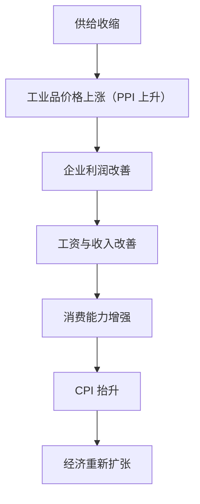

## 牛市逃顶策略（一）

### 划定收益目标（历史规律）

回顾历史上的几轮经济周期，可以发现 PPI（工业生产者出厂价格指数）与 CPI（居民消费价格指数）的变化，往往能够反映出经济所处阶段，也对股市、创业环境以及资产配置产生较大影响。

- 当 PPI 开始走高，股市比较赚钱（如 07、15 年）。
- PPI 低、CPI 高，适合创业（如 01 到 02、07 到 09、11 到 16、18 到 20 年）。
- **当 PPI 与 CPI 同时走高时，做什么都是好的选择**。各行业奋斗者（无论金融和实体）都可能获得丰厚回报；与此同时，在高通胀繁荣的社会，储蓄和躺平者，将会被飞速发展的社会抛弃。

#### 供给侧改革 2.0 与 2015 年的逻辑有些类似

当前反内卷、压缩低效供给的政策，与 2015 年的供给侧改革具有一定相似性。其传导链条大致如下：



最终目标是：修复企业利润、改善居民收入、缓解通缩压力，避免经济长期陷入低价格、低利润、低增长循环。

当 PPI 开始被国家干预、走高时（哪怕只是走高的预期），股市就开始进入牛市；同时提醒，经济基本面无法支撑股市继续高歌猛进时，机构和大资金会根据宏观基本面提前撤出。

所以设定止盈目标，首先成为散户投资者在牛市中，最重要的风险控制纪律！

30%、50% 或者更高？取决于每位投资者自己的风险偏好。

以我为例，我自己设置的止盈目标，是单月获利 30% 以上，则要强制性休息一段时间，或是强制性降低仓位（不断盈利会冲昏你的头脑，让你漠视风险）。

而我对单个标的的止盈目标，也设置在 30%。也就是说，一个个股在短时间内，如一两个星期或一个月内，涨幅超过 30%，我基本会卖出一半以上，或是 3/4 的仓位。短时间上涨 30% 也符合我老师教给我的交易经验——即短期上涨 30% 以上基本都是人为坐庄控盘的结果。

再说说长期，我对牛市的目标，就是我获利超过本金的 100% 到 150% 的时候，会撤出市场，起码半年到一年内不会再大资金参与股市了！

当然我觉得粉丝朋友们最好实际一点，当你没有足够的宏观判断能力，以及较为完善的交易策略时，尽量把目标定在合适的位置——比如 30% 或者 50%。

这顶得上您把钱放在银行里存定期，15 年到 20 年了！

比如到了 50% 收益，请你最起码把本金取出来，买金条也好，留着现金更好，存起来，像一个狙击手捕猎一样，等待下一轮周期到来的时候，再做打算！

100 万，赚了 50%，合计 150 万，请把 100 万本金取出来，留下 50 万，随便折腾，哪怕这 50 万亏得一分钱不剩，您都不会有损失！

所以，牛市当务之急，请您设置好自己的止盈目标！

### 评论

逻辑链条：

```txt
政策人为干预经济周期
        ↓
重启基钦周期，推动企业补库存
        ↓
股市上涨并形成牛市行情
        ↓
经济基本面逐渐无法支撑股市继续上涨
        ↓
机构和大资金根据宏观基本面提前退出
        ↓
散户如果没有预设止盈规则，容易承担牛市末期回撤
        ↓
提前设置月度、个股和整个牛市周期的止盈目标
```

值得借鉴的是：盈利快速增加后，不继续无条件扩大风险，而是通过休息、减仓和复盘打断过度自信。

但固定的 30% 阈值不一定适合所有投资者和市场环境。对于低波动的大盘股，短期上涨 30% 可能十分罕见；对于小盘成长股、周期股或高波动行业，30% 的波动则可能较为常见。更合理的做法是同时参考：

- 持仓波动率；
- 最大可接受回撤；
- 仓位占账户资产的比例；
- 个股估值及基本面变化；
- 上涨是否伴随成交量异常；
- 当前盈利相对于初始风险的倍数，即 R 倍数。

## 牛市逃顶策略（二）

### 交易部分（交易策略）

#### 四分之一法则与盈亏比

老一点的粉丝朋友，应该都清楚，最早在群里一直强调的四分之一法则，就是最简单实用的交易策略之一。

这是基于《博弈论》中筹码游戏的最优解！

通过“凯利数学公式”，我们也可以发现，即便你的胜率在 1/3（也就是买三次股，两次亏钱、一次赚钱），用 1/4 法则（每次买入 1/4 仓位，亏钱则继续补仓）也能让你最大限度地保证不亏损，或赚得更多。

四分之一法则的胜率与盈亏比对照表：

| 胜率（Win Rate） | 所需的最小盈亏比（Risk-Reward Ratio） |
|---|---|
| 50% | 1:1 |
| 40% | 1:1.5 |
| 33% | 1:2 |
| 30% | 1:2.33 |
| 25% | 1:3 |
| 20% | 1:4 |

### 评论

低胜率、高盈亏比：即使交易胜率不高，只要盈利交易的平均收益明显大于亏损交易的平均损失，长期仍可能实现盈亏平衡或正收益。

可执行规则：

```txt
第一笔：计划仓位的 25%
用于验证交易逻辑，不因小幅下跌自动补仓。

第二笔：计划仓位的 25%
只有价格到达预设位置，且基本面和交易逻辑没有恶化时买入。

第三笔：计划仓位的 25%
只有出现企稳信号、趋势重新转强或关键确认条件时买入。

第四笔：计划仓位的 25%
用于突破确认或趋势加仓，而不是无条件摊低成本。
```

#### 止盈策略

牛市，最重要的是个股的止盈。

如果你不懂枢轴点，也不会其他的技术分析，总是在卖飞和无法及时锁定利润之间犹豫不定。

牛市机械止盈策略（像机器一样执行）更适合您！

- 每个涨停，机械止盈（卖掉）初始总仓位的 15%，锁定利润。
- 非主板个股每上涨 20 厘米，首次机械止盈初始总仓位的 15%；之后每再涨 20 厘米，止盈初始总仓位的 25%。

（该策略是回测 2015 年、2021 年牛市连板高标股后，得到的接近最优止盈策略。）

#### 止损策略

- 总亏损超过 10%，强制斩仓 50% 冷静。
- 杠杆选手每天收盘前卖出四分之一，保证杠杆率低于 150%。
- 牛市默认个股亏损超过 7% 不补仓（可能是选错方向或追高）。
- 参与股市应默认承担风险，不要把全部身家梭哈投入股市，保证 10% 以上的现金傍身。股灾来了，最起码可以打个车回家，街边吃碗面！

止盈、止损策略都应与四分之一法则结合进行。

#### 仓位管理

比如我买自己看好的标的，觉得价格合适，还没怎么涨，未来有上涨动力，先买 1/4，不要动不动无脑梭哈个股，除非你有非常强的交易纪律和交易技术。

四分之一法则（25%）让你游刃有余。

跌了，有余钱继续补仓。

一飞冲天，你的资金使用效率也相对比较高（比10%、10%分批买入赚钱效率高）。

#### 分仓

小资金也不要太过分散，你没有过多的能力和精力去透彻地了解每一个行业。

3 到 5 个股是最适合小资金的策略。

通常你需要配置一些 ETF 作为低风险低收益的对冲性策略，一般建议在 20% 左右。

剩下的部分则去挑选优质个股，赚取更高的利润。

低位滞涨的个股，要敢于上仓位，不要那种涨了一两倍的，别人按照止盈策略开始慢慢卖掉的，你上仓位去接别人的盘！

```txt
选择看好的标的
      ↓
确认价格合适、尚未明显上涨，并判断未来存在上涨动力
      ↓
首次投入1/4仓位
      ↓
      ├─ 上涨：已有25%仓位参与，资金利用率较高
      │
      └─ 下跌：仍保留75%资金，可继续补仓
      ↓
持仓集中在3至5只股票
      ↓
约20%配置ETF，剩余资金选择优质个股
      ↓
优先考虑低位滞涨股票
避免追买已经上涨一至两倍的股票
```

## 牛市逃顶策略（三）

### 见顶信号

以下指标均以 2025 年 9 月 1 日收盘后数据为准，主要用于判断市场所处阶段，不宜单独作为买卖依据。

#### 沪深 300 市盈率中位数

该指标用于观察沪深 300 的估值所处位置，可参考以下区间：

| 市盈率中位数 | 市场阶段与策略 |
|---|---|
| 16～19 倍 | 历史性底部区域；16 倍以下在 A 股历史上累计不超过 15 天，可关注加杠杆抄底机会 |
| 21 倍 | 中性市场的变盘节点，约对应 3300 点附近 |
| 24 倍 | 可能进入牛市变盘区；若突破后不跌回，行情可能进入后半段加速 |
| 29 倍 | 小牛市区域，可开始考虑获利 |
| 40 倍 | 历史性大牛市区域；历史上持续时间很短，需警惕估值风险 |

![[a-share-300pe.png]]

2025 年 9 月 1 日，沪深 300 市盈率中位数刚突破 21 倍，距离 2021 年小牛市约 30 倍仍有差距。主要原因可能是权重股涨幅有限，且前 300 家企业今年的盈利能力更强；经济越弱，龙头企业的虹吸效应往往越明显。

文中同时参考了 A500 的市盈率中位数，其水平大致接近 2021 年高点，可能已处于小牛市顶部区域。小牛市通常可能延续更长时间，因此仍需结合其他指标判断。

#### 巴菲特指标

**A 股总市值 / GDP：**

| 指标水平 | 判断与策略 |
|---|---|
| ＜ 0.6 | 一般对应熊市底部；低于 **0.57** 时可关注加杠杆抄底机会 |
| ＞ 0.9 | 牛市进入后半段甚至末期，应结合止盈策略降低风险 |
| ＞ 0.95 | 市场估值压力较高，需警惕见顶 |

![[a-share-buffett-indicator.png]]

2025 年 9 月 1 日的数值为 **86.83%**，距离 90% 压力位仍有一定距离。历史上站上 90% 后，市场往往需要较长时间横盘，并可能多次触及 95% 后再选择方向。

短期需要关注两点：

- 9 月前 20 天可能以交易降息为主，指标或加速接近 90%。
- 9 月后 10 天，如果降息仅 25 个基点且美联储未停止缩表，同时指标触及 90% 历史压力位，A 股可能出现明显回调；美股 9 月下半月的季节性回调也可能形成叠加影响。

#### 融资余额

两融余额 / GDP 可用于观察市场杠杆水平：

| 指标水平 | 判断 |
|---|---|
| 约 2% | 已存在杠杆过热风险，对应两融余额约 2.7 万亿 |
| ＞ 3.5% | 较强的见顶信号 |

![[a-share-mfsl-balance.png]]

当前数据为 **2.26 万亿 / 134.91 万亿 = 1.68%**，距离 3.5% 仍有一定距离，但已经接近 2% 的风险观察线。作为参考，A 股历史两融余额曾在 2015 年 6 月 18 日达到 **2.273 万亿**。

#### 散户参与度

目前缺少连续、直接的公开数据，但截至 8 月，散户参与度明显低于去年 924 行情（10 月）。

散户尚未大规模入场，可能意味着行情仍有延续空间；这一判断还需结合成交量、开户数和资金流向验证。

#### 全 A 动态 PE

全 A 动态 PE 超过历史 90% 分位，可视为重要的估值风险信号。当前数据与历史阶段对比如下：

| 日期 | 市场阶段 | 动态 PE 历史百分位 |
|---|---|---|
| 2007 年 5 月 31 日 | 超级牛市 | **84.79%** |
| 2015 年 5 月 29 日 | 超级牛市 | **99.62%** |
| 2020 年 7 月 30 日 | 结构性小牛市 | **84.79%** |
| 2025 年 7 月 24 日 | 初步确认技术面牛市，上证月 K 实体三连阳 | **58.82%** |
| 2025 年 9 月 1 日 | 近期数据 | **67.48%** |

![[a-share-allpe.png]]
